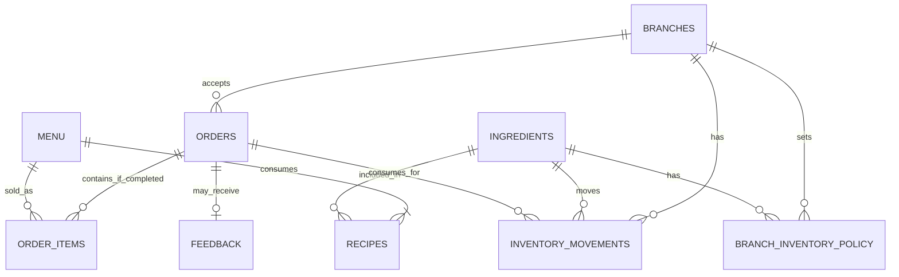
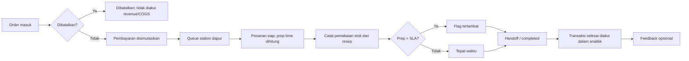
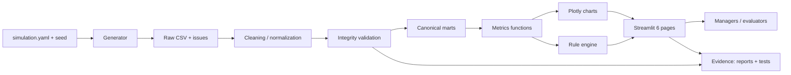

# CHICKFLOW — COMPLETE CODEX-READY MASTER PLAN (ALL IN ONE)

**Versi 2.3 — 24 November 2026**  
**Status:** Spesifikasi/perencanaan. *Tidak* menyatakan dashboard/data/tests telah diimplementasikan.  
**Tujuan:** satu dokumen Markdown yang dapat diserahkan ke Codex; isi yang sama tersedia sebagai paket modular per topik.  
**Acuan prioritas:** template proyek akhir; RPS untuk materi/CPMK; ZIP contoh Restora hanya referensi, **bukan** patokan rancangan.  

> **Petunjuk Codex:** baca bagian `codex/START_HERE.md` (terlampir di bawah) terlebih dahulu, lalu fase dan gates berurutan. Jangan meniru brand/layout Restora.  

---

## DAFTAR BAGIAN (Gabungan)

1. `README.md`
2. `docs/01_PRODUCT_REQUIREMENTS.md`
3. `docs/02_BUSINESS_AND_REQUIREMENTS.md`
4. `docs/03_DATA_CONTRACTS.md`
5. `docs/04_SYNTHETIC_DATA_PIPELINE.md`
6. `docs/05_METRICS_AND_BUSINESS_RULES.md`
7. `docs/06_SIX_PAGE_SPECS.md`
8. `docs/07_VISUALIZATIONS.md`
9. `docs/08_DESIGN_SYSTEM.md`
10. `docs/09_ARCHITECTURE.md`
11. `docs/10_FILTERS_AND_INTERACTION.md`
12. `docs/11_TEST_STRATEGY.md`
13. `docs/12_IMPLEMENTATION_ROADMAP.md`
14. `docs/13_REPORT_EVIDENCE.md`
15. `docs/14_RISKS_AND_DECISIONS.md`
16. `docs/15_MENU_AND_SEED_CATALOG.md`
17. `checklists/REQUIREMENT_TRACEABILITY.md`
18. `checklists/DELIVERY_GATES.md`
19. `checklists/SEED_CATALOG_SANITY.md`
20. `checklists/PROTOTYPE_FEEDBACK_INSTRUMENT.md`
21. `checklists/PROJECT_STATUS_TEMPLATE.md`
22. `checklists/AI_USE_LOG_TEMPLATE.md`
23. `checklists/FINAL_HANDOFF_AUDIT.md`
24. `codex/AGENTS.md`
25. `codex/START_HERE.md`
26. `codex/PHASE_PROMPTS.md`

---


---

## DOKUMEN 01 — `README.md`

# CHICKFLOW — MASTER IMPLEMENTATION BLUEPRINT (v2.3)

> **STATUS:** Rencana implementasi, **belum** ada dashboard atau dataset final yang dibangun.  
> **Tanggal perencanaan:** 24 November 2026 (WIB).  
> **Project:** ChickFlow — Fast Food Analytics & Operations Dashboard.  
> **Audiens:** pemilik proyek, Codex / coding agent, penguji, pembimbing akademik.  
> **Bahasa aplikasi:** Bahasa Indonesia (label UI), istilah teknis boleh bilingual. Mata uang IDR; zona waktu Asia/Jakarta.  
> **Prinsip utama:** *Correct data → correct decisions → clear visualization → attractive UI*. Bukan meniru Restora atau contoh dashboard apa pun.

## Cara menggunakan paket ini

1. Mulai dari **`codex/START_HERE.md`**, lalu ikuti tiga milestone pada roadmap.
2. `docs/01`–`docs/15` adalah *source of truth* untuk fitur, data, metrik, interaksi, desain, kualitas, dan dokumentasi.
3. `checklists/REQUIREMENT_TRACEABILITY.md` memetakan setiap syarat template ke implementasi dan bukti.
4. `checklists/DELIVERY_GATES.md` mendefinisikan *pass/fail* proyek. Fitur tidak selesai hanya karena halaman berhasil dirender.
5. `codex/PHASE_PROMPTS.md` berisi prompt berurutan untuk menghindari Codex membangun 6 halaman palsu sekaligus.
6. `codex/AGENTS.md` dapat **disalin ke root repository implementasi sebagai `AGENTS.md`** agar aturan pengembangan selalu dibaca coding agent.
7. Dokumen `CHICKFLOW_ALL_IN_ONE.md` (di tingkat paket hasil) menggabungkan spesifikasi agar bisa langsung diunggah ke Codex bila hanya ingin satu file.

## Prioritas sumber (jika berbeda)

1. **Template Laporan Proyek Akhir Visualisasi Data** yang disediakan pengguna: ketentuan wajib individu + rubrik + bukti.
2. **Keputusan produk ChickFlow dalam paket ini:** konsep, data, UX, rumus, modul, testing; merupakan keputusan proyek, bukan contoh.
3. **RPS Visualisasi Data 2025:** tujuan pembelajaran dan materi; RPS menuliskan `DIF62132`/`CPMK32` sedangkan template proyek menuliskan `DIF61143`/`CPMK43`. **Jangan menebak mana yang berlaku secara administratif**; konfirmasi dosen jika diperlukan. Ketentuan tugas spesifik mengikuti template.
4. **ZIP materi kelas (Restora, layout example, latihan, buku):** bacaan pembelajaran saja. **DILARANG** menyalin layout, urutan halaman, brand, logo, warna, atau data contoh menjadi ChickFlow. Sampel **tidak mengubah** keputusan utama.
5. Dokumentasi resmi pustaka untuk memastikan API yang digunakan valid pada versi yang dipasang.

## Batasan

- ChickFlow adalah **brand dan operasi restoran fiktif** yang dibuat untuk tugas individu.
- Data adalah **sintetis** dan dihitung dengan generator teruji. Jangan klaim sebagai penjualan, konsumen, alamat, atau evaluasi restoran nyata.
- Peran manajemen dan staf ialah **persona pengguna**, bukan login/role-based access control riil.
- Dashboard ini **analitik historis**, bukan POS/e-commerce/ERP produksi dan bukan sistem mengelola uang sungguhan.
- Fokus **enam modul** yang terkunci: `Overview`, `Orders`, `Kitchen Performance`, `Inventory`, `Sales & Reports`, `Food Cost & Profit`. Tidak diam-diam menggantinya dengan fitur contoh.
- **Dashboard dahulu; laporan final belakangan.** Bukti, screenshot, data cleaning log, matriks pengujian, dan perubahan prototype dicatat sepanjang pengembangan.

## Kontrak target

| Target | Ketentuan | Rencana ChickFlow |
|---|---|---|
| Modul | minimal 6 | tepat 6 modul wajib, opsional ditempatkan sebagai bagian modul |
| Data | ≥500 baris transaksi, ≥7 hari, ≥3 tabel berelasi | 3.600 order / 30 hari / 9 tabel inti, semua terhubung |
| Visualisasi | ≥2 kualitatif, ≥5 kuantitatif, ≥1 geografis | 2 / 10+ / 1; ada pemetaan pertanyaan bisnis |
| Dashboard | Plotly interaktif, ≥3 filter, ≥6 KPI | tanggal, cabang, kategori; target 8 KPI global + 4 KPI kontekstual |
| Insight otomatis | ≥4 aturan | target 6 aturan *rule-based*, transparan dan dapat diuji |
| Library wajib | pandas, numpy, matplotlib, seaborn, plotly | dipakai dan dibuktikan lewat file dan hasil visualisasi |
| UX/RPL | prinsip good UI, proses prototype | 2 iterasi, 4 prinsip, wireframe + screenshot + hasil uji |
| Tugas akhir | repo, laporan PDF, video, presentasi | pipeline dokumentasi dan handoff dipersiapkan, **tidak mengaku selesai** |

## Tahap pengerjaan

**00 Definition → 01 Foundation → 02 Data → 03 Business Metrics → 04 Visualizations → 05 Shell & UI → 06 Six Pages → 07 QA & Revisions → 08 Delivery & Report Evidence.**

**Aturan anti-*scope creep*:** jangan mengembangkan SeoulGrill AYCE, AI forecasting, login, pembayaran, notifikasi eksternal, atau database produksi ke ChickFlow v1. SeoulGrill adalah proyek terpisah di masa depan.

## Index lengkap

- [01 — Product requirements dan scope](docs/01_PRODUCT_REQUIREMENTS.md)
- [02 — Business analysis, personas, questions](docs/02_BUSINESS_AND_REQUIREMENTS.md)
- [03 — Dataset, skema relasional, kamus data](docs/03_DATA_CONTRACTS.md)
- [04 — Generator sintetis dan data preparation](docs/04_SYNTHETIC_DATA_PIPELINE.md)
- [05 — Definisi KPI, profit, SLA, stok, aturan insight](docs/05_METRICS_AND_BUSINESS_RULES.md)
- [06 — Spesifikasi 6 modul dan user flow](docs/06_SIX_PAGE_SPECS.md)
- [07 — Pemilihan visualisasi dan katalog grafik](docs/07_VISUALIZATIONS.md)
- [08 — UI/UX, design system, wireframe](docs/08_DESIGN_SYSTEM.md)
- [09 — Engineering, APIs, struktur repo](docs/09_ARCHITECTURE.md)
- [10 — Interaktivitas, filter semantics, state](docs/10_FILTERS_AND_INTERACTION.md)
- [11 — Testing: unit/integrasi/E2E/performance](docs/11_TEST_STRATEGY.md)
- [12 — Sprint backlog, prioritas, milestone](docs/12_IMPLEMENTATION_ROADMAP.md)
- [13 — Dokumentasi, demo, laporan, RPS alignment](docs/13_REPORT_EVIDENCE.md)
- [14 — Risiko, keputusan, alternatif, tradeoffs](docs/14_RISKS_AND_DECISIONS.md)
- [15 — Katalog konkret menu, bahan, dan BOM](docs/15_MENU_AND_SEED_CATALOG.md)
- [Matriks ketentuan → bukti](checklists/REQUIREMENT_TRACEABILITY.md)
- [Quality / delivery gates](checklists/DELIVERY_GATES.md)
- [Instrumen uji pengguna (kosong, tidak dibuat-buat)](checklists/PROTOTYPE_FEEDBACK_INSTRUMENT.md)
- [Template status implementasi](checklists/PROJECT_STATUS_TEMPLATE.md)
- [Template penggunaan AI](checklists/AI_USE_LOG_TEMPLATE.md)
- [Audit handoff final](checklists/FINAL_HANDOFF_AUDIT.md)
- [Validasi katalog 24 SKU dan biaya BOM](checklists/SEED_CATALOG_SANITY.md)
- [Codex entry point](codex/START_HERE.md)
- [Codex prompts per fase](codex/PHASE_PROMPTS.md)
- [AGENTS untuk Codex](codex/AGENTS.md)

## Definition of done proyek

**Tidak cukup:** aplikasi bisa `streamlit run`; navbar menunjukkan 6 judul; angka KPI muncul; grafik cantik.  
**Harus:** dataset reproducible, rekonsiliasi nominal **tepat**, tidak ada *double counting*, enam modul punya alur kerja yang relevan, filter tidak melanggar grain, ≥8 chart wajib dan peta benar, semua alert tertelusur ke angka, unit test & integration test lulus, bukti visualisasi kelima library, dua putaran prototype terarsipkan, demo bisa diulang dari README.

---

## DOKUMEN 02 — `docs/01_PRODUCT_REQUIREMENTS.md`

# 01 — Product charter, arah produk, ruang lingkup

## 1.1 Visi produk

**ChickFlow Operations Intelligence** adalah dashboard analitik restoran ayam cepat saji berbasis data sintetis, digunakan pengelola restoran untuk memantau penjualan, permintaan, waktu persiapan makanan, kesehatan persediaan, dan margin kontribusi makanan di tiga cabang simulasi. Fokus interaksi: **temukan perubahan → telusuri penyebab → pahami dampak → tentukan tindakan**.

### Apa yang dibangun

- **Satu aplikasi** Streamlit multi-page dengan Plotly untuk visualisasi interaktif dan filter global.
- **Satu pipeline data** deterministik untuk menghasilkan tabel operasi raw → clean/validated → analytical marts.
- **Satu pusat definisi metrik** mencegah hasil KPI berbeda antar halaman.
- **Satu mesin insight otomatis** berbasis aturan yang menyebut angka, konteks, dan tindakan, tanpa klaim AI/ML.
- **Satu paket QA & evidence**: pengujian, diagram, hasil EDA statis, screenshot, catatan perbaikan, dan panduan.

### Apa yang bukan produk ini

Bukan POS untuk kasir, bukan inventaris riil dengan pemesanan supplier, bukan peramalan ML, bukan sistem karyawan/gaji, bukan reservasi AYCE, bukan dashboard live production. Transaksi hanya dapat ditelusuri, bukan diedit demi demo.

## 1.2 Identitas ChickFlow yang dibekukan untuk v1

| Field | Nilai rancangan |
|---|---|
| Brand | **ChickFlow** |
| Tagline | **Fast Service. Smart Decisions.** |
| Jenis usaha | Fast-casual / quick service restaurant (QSR) ayam goreng |
| Produk | Fried chicken, burgers, rice bowls, wings, sides, drinks, combos |
| Segmen | Pelajar/mahasiswa, pekerja, keluarga kecil, delivery |
| Cabang simulasi | ChickFlow Padang, ChickFlow Bukittinggi, ChickFlow Payakumbuh (3 kota di Sumatra Barat, **bukan alamat komersial nyata**) |
| Channel | DINE_IN, TAKEAWAY, DELIVERY |
| Bahasa dan format | Bahasa Indonesia, IDR, WIB, tanggal `dd MMM yyyy` |
| Periode data awal | 1–30 Oktober 2026 (30 hari, 3.600 order total sebagai target generator) |
| Mode produk | Read-only historical analytics; synthetic demo banner |
| Pengguna primer | Manager restoran, Kitchen Lead, Inventory Officer, Owner/Finance |
| Layar primer | Laptop 1366×768 hingga desktop 1920×1080; tablet sebagai fallback |

**Merek/gaya:** tidak meniru Restora. Namanya mewakili aliran pesanan dan kinerja dapur; gunakan ikon visual yang orisinal atau sederhana, tanpa foto bermerek dari luar. Logo boleh berbentuk ikon garis sayap/ayam + aliran panah, dan menjadi artefak wajib Bab V serta sampul.

## 1.3 Tujuan bisnis (target simulasi, bukan fakta)

| Kode | Tujuan | KPI | Target evaluasi | Frekuensi |
|---|---|---|---|---|
| G01 | Monitoring pemasukan bersih | Net Revenue | cocok 100% dengan perhitungan transaksi | harian |
| G02 | Memahami beban dapur | Completed order count/h | jam sibuk teridentifikasi | per jam |
| G03 | Pelayanan tepat waktu | Delayed Orders % | baseline simulasi dibandingkan target bisnis **≤10%** | harian/mingguan |
| G04 | Memantau durasi persiapan | Median prep / P90 prep | disajikan per cabang dan channel | harian |
| G05 | Mempertahankan margin | Food gross margin % | target bisnis **≥30%** sebagai parameter; realisasi dihitung | mingguan |
| G06 | Mengidentifikasi menu bermargin lemah | Menu margin % | margin **<25%** memicu A02 jika minimal 10 unit terjual dan omzet positif | mingguan |
| G07 | Mengendalikan stok | Critical ingredient count | stok per bahan-cabang yang melewati ambang terdeteksi | per tanggal |
| G08 | Memahami perbedaan cabang | Revenue, AOV, delay, margin | ranking multimetric, tidak mengklaim sebab-akibat | mingguan |
| G09 | Menopang keputusan operasional | Insight panel | ≥4 aturan terbukti memicu sesuai fixture | per filter |

## 1.4 Functional requirements (FR)

| ID | Syarat perilaku | Prioritas | Verifikasi |
|---|---|---|---|
| FR-01 | Navigasi keenam modul terdaftar | MUST | AppTest/smoke UI |
| FR-02 | Tampilkan ≥6 KPI global dengan definisi | MUST | test metrics + visual inspect |
| FR-03 | Filter tanggal, cabang, kategori berlaku konsisten | MUST | matriks kombinasi filter |
| FR-04 | Semua grafik interaktif utama dibuat dengan Plotly | MUST | render + hover + dropdown |
| FR-05 | Pilihan grafik sesuai tipe data dan pertanyaan bisnis | MUST | traceability V ↔ PB |
| FR-06 | Peta geografis cabang memakai koordinat simulasi | MUST | validasi geodata + peta |
| FR-07 | ≥2 visualisasi kualitatif | MUST | word cloud + workflow diagram |
| FR-08 | ≥5 kuantitatif, mencakup 5 keluarga grafik utama | MUST | visual audit |
| FR-09 | ≥4 rules insight otomatis berbasis threshold | MUST | unit test per rule |
| FR-10 | Orders detail memuat pencarian dan pengecekan penyebab delay | MUST | scenario orders |
| FR-11 | Kitchen membandingkan prep time, SLA, jam ramai, cabang | MUST | scenario kitchen |
| FR-12 | Inventory saldo as-of dan bahan kritis per cabang | MUST | audit ledger |
| FR-13 | Profit mengalokasikan diskon dan menghitung COGS dari BOM | MUST | recon test |
| FR-14 | Grafik saling memperkuat tetapi tidak saling menghitung ganda | MUST | aggregation tests |
| FR-15 | Data loading mendukung empty/error states dan metadata freshness | MUST | simulated failures |
| FR-16 | Ringkasan ekspor CSV data yang difilter | SHOULD | download test |
| FR-17 | Penjelasan rumus KPI/tooltip dan link evidence | SHOULD | UAT |
| FR-18 | Perbandingan periode sebelumnya jika lengkap | SHOULD | comparison test |
| FR-19 | Filter chart-to-chart melalui klik Plotly | COULD | optional UI E2E |
| FR-20 | Light/dark theme toggle | COULD | a11y + snapshot |

## 1.5 Nonfunctional requirements (NFR)

| ID | Aspek | Target & metode |
|---|---|---|
| NFR-01 | Akurasi | Sum detail = sum header pada semua order; selisih nominal **Rp0** |
| NFR-02 | Reproducibility | dua kali generate dengan seed/config identik → hash tabel clean identik |
| NFR-03 | Kinerja | p95 pergantian filter target <3 detik pada laptop penguji; ukur, jangan klaim sebelum ada hasil |
| NFR-04 | Reliability | tidak crash untuk filter kosong, satu cabang, satu kategori, satu tanggal |
| NFR-05 | UX | mayoritas 5 responden menemukan tindakan utama dalam uji 3 detik (target penelitian kecil, bukan statistik representatif) |
| NFR-06 | Accessibility | kontras teks standar minimal 4.5:1, keyboard navigation, label jelas, tidak mengandalkan warna saja |
| NFR-07 | Portability | Windows/macOS/Linux Python 3.11/3.12 yang didukung dependensi; uji browser Chromium dan Firefox jika tersedia |
| NFR-08 | Maintainability | fungsi metrik murni, satu definisi schema, import tanpa efek side effect, type hints dan docstring |
| NFR-09 | Observability | status data/seed/periode/cabang terlihat; log data issue tanpa personal information |
| NFR-10 | Privacy/safety | tak ada PII asli, API key, kredensial, atau alamat outlet fiktif yang dipresentasikan sebagai nyata |
| NFR-11 | Data lineage | tabel sumber, aturan transform, grain, dan kolom KPI dapat dirunut |

## 1.6 Prioritas MoSCoW dan kontrol scope

- **MUST:** 6 modul, 9 tabel, generator, 8+ visualisasi wajib, 3 filter, 6 KPI, 4 alert, 5 library, dua putaran uji pengguna, proof-of-test, panduan.
- **SHOULD:** 8 KPI di overview, 15 pertanyaan bisnis terjawab, 6 alert, eksport CSV, tooltip penjelasan, responsif.
- **COULD:** chart crossfilter, scenario simulator, advanced staffing estimate, animated transitions, theme toggle, menu-detail deep dive.
- **WON'T:** login, checkout, penjualan riil, video AI, transaksi yang dapat diedit, alert WhatsApp, ML forecasting, SeoulGrill AYCE.

## 1.7 Keberhasilan pengguna (job stories)

- **Manajer:** Ketika keterlambatan naik, saya ingin melihat cabang + jam + channel penyumbang sehingga dapat memprioritaskan pemeriksaan kapasitas shift.
- **Chef:** Ketika waktu persiapan memanjang, saya ingin melihat distribusi waktu dan station terkait sehingga tidak hanya mengandalkan rata-rata.
- **Pengadaan:** Ketika bahan kritis, saya ingin tahu stok as-of, reorder point, unit, dan konsumsi historis sehingga bisa menyusun urutan pembelian.
- **Owner:** Ketika revenue tinggi tetapi profit lemah, saya ingin membandingkan menu, discount, food cost, dan margin sehingga tahu menu yang perlu evaluasi.

## 1.8 Acceptance utama produk

1. Tidak ada satu pun angka yang ditulis manual untuk menyamar menjadi metrik live aplikasi.
2. Mengubah filter menyebabkan KPI/grafik/insight yang relevan berubah, atau menampilkan penjelasan eksplisit bila filter tidak berlaku.
3. Revenue total dari halaman Overview, Orders, Sales, Profit setara pada konteks filter yang sama ketika definisi grain setara.
4. Peta menampilkan cabang fiktif berlabel lokasi simulasi, tidak mengklaim outlet nyata.
5. Ada bukti **matplotlib dan seaborn** melalui EDA/report bukan hanya deklarasi package.
6. Tidak ada klaim bahwa data sintetik membuktikan kondisi bisnis di dunia nyata.

---

## DOKUMEN 03 — `docs/02_BUSINESS_AND_REQUIREMENTS.md`

# 02 — Business understanding, problem formulation, stakeholder, PB register

## 2.1 Perspektif masalah yang harus dibuktikan setelah data jadi

Dokumen ini menyatakan **hipotesis** dan metode validasi. **Jangan masukkan angka temuan contoh sebagai fakta.** Setelah generator menghasilkan data, hitung nilai baseline dan isi evidence JSON/CSV. Sebaliknya, jangan sengaja mengatur data hingga semua target lolos; sedikit masalah bisnis memang diperlukan untuk analisis.

| Masalah | Hipotesis | Evidence minimal | Akibat potensial | Aksi yang masuk akal |
|---|---|---|---|---|
| P01 | Pesanan jam puncak lebih lama disiapkan | median dan P90 prep time per jam; sample size | antrean, tidak puas | evaluasi slot station/shift |
| P02 | Cabang tertentu memiliki delay lebih tinggi | late counts/eligible counts per cabang/channel | mutu layanan tak konsisten | audit workload cabang |
| P03 | Menu terlaris bisa bermargin rendah | unit sold, net sales, gross profit, margin | profit kurang optimal | evaluasi menu, BOM, harga |
| P04 | Stok kritis tidak seragam | ending stock vs reorder point per bahan-cabang | stockout | urutan restock berdasar coverage |
| P05 | Diskon berkorelasi dengan penurunan margin | discount %, menu-level profit | margin tertekan | telaah efektivitas paket |
| P06 | Hari dan jam punya campuran channel berbeda | channel × hour × weekday | salah jadwal personel | alokasi kapasitas |
| P07 | Rating pelanggan berkaitan dengan delay | rating dist by delay, N responden | retensi/kepuasan berpotensi menurun | review service experience |

**Pemisahan observasi vs rekomendasi:** bilang “Pada data sintetis, delayed rate meningkat di periode ...” bukan “cabang X perlu dipecat karyawannya”. Grafik korelasi tidak membuktikan kausalitas. Rating berasal dari data simulasi, sehingga kesimpulannya juga terbatas.

## 2.2 Stakeholder matrix

| Stakeholder | Tugas | Informasi kritis | Keputusan | Dashboard |
|---|---|---|---|---|
| Owner / finance | review kinerja | net sales, discount, COGS, food GP | menu/cabang prioritas | Overview, Sales, Profit |
| Operations manager | layanan harian | demand, delay, SLA, jam puncak | monitoring shift | Overview, Orders, Kitchen |
| Kitchen lead | pengendalian dapur | queue load, station, median/P90 | evaluasi bottleneck | Kitchen, Orders |
| Procurement | persediaan | saldo as-of, coverage, waste, reorder | restock item & cabang | Inventory |
| Akademik/evaluator | menilai proyek | pilihan chart, keterlacakan, test | validasi CPMK | semua + docs |

## 2.3 Personas

- **Persona-01 Maya, 30, manager operasional (fiktif):** laptop siang hari, fokus jam sibuk, butuh jawaban dalam ≤2 klik dari dashboard ke detail. Keputusan: memperiksa jam/cabang dengan delay tertinggi.
- **Persona-02 Arman, 42, owner (fiktif):** cek angka akhir hari, prioritas data exact dan biaya menu; tidak nyaman dengan grafik rumit tanpa penjelasan.
- **Persona-03 Sari, 27, inventory specialist (fiktif):** berangkat dari daftar bahan kritis, memerlukan unit dan tanggal saldo yang tidak ambigu.
- **Persona-04 Rina, 34, kitchen lead (fiktif):** butuh p90, distribution, station dan jumlah order; tidak menganggap rata-rata mewakili pesanan ekstrem.

## 2.4 Pertanyaan bisnis (15 PB, disimpan sebagai registry di kode/config)

| PB | Domain | Pertanyaan yang dijawab | Metrik primer | Visualisasi | Aksi potensial |
|---|---|---|---|---|---|
| PB-01 | Sales | Seperti apa tren pendapatan bersih per hari? | net revenue | V-Q01 line | periksa penurunan hari tertentu |
| PB-02 | Menu | Mana 10 menu terjual terbanyak? | units sold | V-Q02 bar | cek produk unggulan |
| PB-03 | Orders | Kapan order paling padat? | eligible order counts | V-Q03 heatmap | tinjau shift |
| PB-04 | Branch | Cabang mana dengan revenue terbesar? | net revenue/branch | V-Q04 bar | bandingkan volume |
| PB-05 | Kitchen | Bagaimana distribusi waktu persiapan? | prep minutes | V-Q05 histogram/KDE | evaluasi ekor distribusi |
| PB-06 | Kitchen | Mana cabang/channel paling banyak melampaui SLA? | delayed % | V-Q06 grouped bar | audit keterlambatan |
| PB-07 | Profit | Menu mana laris tapi low margin? | units, margin % | V-Q07 scatter | review recipe dan price |
| PB-08 | Stock | Bahan mana di bawah reorder point? | quantity on hand | V-Q08 grouped bar + table | restock |
| PB-09 | Channels | Bagaimana AOV tiap channel? | net revenue/order | V-Q09 bar | evaluasi mix transaksi |
| PB-10 | Branch | Bagaimana lokasi cabang dan kinerja spasialnya? | revenue/branch | V-G01 point map | orientasi antar kota |
| PB-11 | Kitchen | Bagaimana rentang/median waktu persiapan per cabang? | prep minutes | V-Q10 boxplot | review varians |
| PB-12 | Profit | Bagaimana kontribusi gross profit tiap kategori? | food GP | V-Q11 bar | prioritas menu |
| PB-13 | Stock | Bahan apa yang paling banyak terbuang? | waste qty/cost | V-Q12 bar | perbaiki batch planning |
| PB-14 | Feedback | Kata/tema apa muncul pada ulasan? | review tokens/themes | V-L01 word cloud | review kualitas layanan |
| PB-15 | Process | Bagaimana proses order→pembayaran→kitchen→siap→handoff? | event definitions | V-L02 flowchart | identifikasi titik ukur |

## 2.5 Pemetaan ke target, test dan bukti

Setiap PB memiliki: (1) data sumber, (2) definisi metric, (3) chart yang sesuai, (4) judul berbentuk pertanyaan atau temuan, (5) deskripsi pengukuran, (6) screenshot, (7) interpretasi dengan angka hasil generator, (8) aksi dan keterbatasan. Pemetaan disimpan dalam `docs/visualization_registry.md` versi repo atau tabel di README.

## 2.6 User stories & acceptance

| ID | Sebagai ..., saya ingin ... | Kriteria penerimaan |
|---|---|---|
| US-01 | manager, melihat 8 KPI agar tahu kondisi harian | angka sesuai filters; satuan jelas; delta hanya bila periode pembanding valid |
| US-02 | owner, memfilter cabang agar tahu kinerja lokal | semua KPI berbasis cabang berubah; title menunjukkan cabang |
| US-03 | manager, memfilter kategori agar tahu kontribusi menu | revenue terfilter item kategori; order count unik; status cakupan jelas |
| US-04 | kitchen lead, melihat p90 agar tahu worst typical waits | p90 dari eligible completed orders, bukan rata-rata p90 antar cabang |
| US-05 | owner, meninjau menu low-margin agar memperbaiki pricing | unit, net revenue, COGS, GP dan margin dapat direkonsiliasi |
| US-06 | procurement, melihat stok tanggal tertentu agar dapat melakukan restock | as-of stock dari movement lengkap sampai cutoff; tidak disaring awal date range |
| US-07 | manager, melihat alert agar dapat bertindak | rule id, threshold, nilai aktual, affected context, tindakan, severity |
| US-08 | mahasiswa, menjalankan seed generator agar dataset konsisten | CLI idempotent, snapshot hash and validation lulus |
| US-09 | penguji, memeriksa jenis chart yang dipakai | chart registry menyebut tipe data, perbandingan alternatif dan library |
| US-10 | penguji, melihat uji produk | ada test report, prototype feedback log, screenshot sebelum/sesudah |

## 2.7 Asumsi dan batasan bisnis

1. Tiga cabang berada di kota simulasi Sumatra Barat, koordinat hanya lokasi representatif pusat kota.
2. Data meniru operasional 10.00–22.00 Asia/Jakarta; tanggal analitik order mengikuti `ordered_at` WIB, termasuk jika pesanan siap setelah tengah malam.
3. Harga/biaya sintetik, tidak mewakili harga pasar aktual. Diskon dialokasikan ke baris menu; tidak ada pajak, ongkos kirim, jasa platform, biaya sewa, upah, atau depresiasi.
4. Profit yang disajikan adalah **food gross profit**, bukan net profit akuntansi.
5. SLA waktu preparasi adalah parameter aturan bisnis simulasi, bukan standar universal restoran.
6. Stok historis dihitung dari event ledger, bukan data realtime supplier.
7. Review sintetik bisa mempunyai bias yang dirancang untuk mendukung skenario belajar. Jangan mengklaim hubungan kausal nyata.
8. Pengujian usability kecil dilakukan sebagai dokumentasi proses prototype, tidak mewakili seluruh populasi pengguna.

## 2.8 Analytical decision stories

**Story A — delay malam:** pilih rentang 7 hari → identifikasi alert delayed rate → klik Kitchen → bedakan p50 vs p90 → pilih cabang dan channel → lihat histogram/boxplot dan jumlah sampel → rekomendasi audit kapasitas fryer malam, bukan keputusan permanen.

**Story B — menu tampak populer tapi rugi food-cost:** top-selling burger terlihat di Sales → buka Profit → lihat bar units sold dan scatter price-vs-margin → uraikan diskon dialokasikan dan biaya recipe → tampilkan item dengan GP positif/negatif → catat saran evaluasi BOM/promo.

**Story C — stok kritis:** kartu Critical Inventory → Inventory → as-of sesuai end-date → pilih cabang, lihat bahan dan ratio on hand/reorder → cek 7-day usage sebagai konteks, filter kategori hanya memengaruhi pemakaian atributif → prioritaskan restock.

---

## DOKUMEN 04 — `docs/03_DATA_CONTRACTS.md`

# 03 — Data contracts, relational schema, grain, ERD, dictionary

**Hal paling berisiko dalam proyek ini:** biaya, stok, revenue, jumlah transaksi, dan kategori menu berasal dari grain yang berbeda. **Seluruh coding agent wajib memahami dokumen ini sebelum menulis generator, KPI, atau grafik.**

## 3.1 Dataset scope dan rencana volume

| Entitas | Grain | Perkiraan volume | Tujuan |
|---|---|---:|---|
| `branches` | 1 baris/cabang | 3 | dimensi geografis dan kapasitas |
| `menu` | 1 baris/SKU menu | 20–24 | menu, kategori, harga list, station |
| `ingredients` | 1 baris/bahan | 27 | unit dan unit cost |
| `recipes` | 1 baris/pasangan menu-bahan | 100–160 | bill of materials (BOM) |
| `branch_inventory_policy` | 1 baris/pasangan cabang-bahan | 81 | reorder point, opening stock, lot, lead |
| `orders` | 1 baris/order (termasuk canceled) | **3.600** | fakta order dan SLA |
| `order_items` | 1 baris/order-item | ~6.000–9.000 | fakta omzet dan food cost |
| `inventory_movements` | 1 baris/event/bahan-cabang/order | puluhan ribu | stok as-of dan waste |
| `feedback` | maksimal 1 baris/order completed | ~500–1.100 | analisis kualitatif |

**Jumlah tabel inti = 9**. Metadata, derived tables/marts, rules config, dan QA logs merupakan artefak tambahan, bukan mengganti sembilan tabel tersebut. Jumlah pasti mengikuti generator dan dicatat dalam `manifest.json` di implementasi; jangan memalsukan angka hasil sebelum dieksekusi.

**Rentang:** `2026-10-01T00:00+07:00` hingga `2026-10-30T23:59:59+07:00`, order hanya pada jam simulasi 10:00–22:00. Gunakan satu pendekatan date boundary: `start_inclusive, end_exclusive`; contoh filter 10–12 Oktober berarti `[2026-10-10 00:00, 2026-10-13 00:00)`.

## 3.2 ERD wajib



Foreign keys: `orders.branch_id`, `order_items.order_id/menu_id`, `recipes.menu_id/ingredient_id`, `branch_inventory_policy.branch_id/ingredient_id`, `inventory_movements.branch_id/ingredient_id`, `inventory_movements.order_id nullable`, `feedback.order_id`.

### 3.2.1 Primary key / unique / index

- Semua PK harus string ID stabil unik atau pasangan unik (untuk resep/policy).
- `orders.order_id` unik global, misalnya `ORD-000001`.
- `order_items.order_item_id` unik; `order_id` *many-to-one*.
- `inventory_movements.movement_id` unik; banyak event dapat merujuk satu order.
- `feedback.order_id` **unique** supaya ulasan tidak menduplikasi denominator.
- `recipes(menu_id, ingredient_id)` dan `branch_inventory_policy(branch_id, ingredient_id)` **unique composites**.
- Join one-to-many hanya boleh di agregasi yang memperhatikan grain, bukan `orders` di-join item lalu `SUM(orders.net_amount)`.

## 3.3 Kontrak field — `branches`

| Field | Tipe logis | Null? | Aturan |
|---|---|---|---|
| `branch_id` | string PK | no | `BR-01`–`BR-03` |
| `branch_name` | string | no | ChickFlow Padang/Bukittinggi/Payakumbuh |
| `city` | string | no | kota representatif |
| `latitude`, `longitude` | float | no | `-90..90`, `-180..180`; kota konsisten; geolokasi simulasi |
| `opening_time`, `closing_time` | HH:MM | no | 10:00–22:00 WIB |
| `demand_multiplier` | float | no | parameter generator, `>0` |
| `prep_capacity_multiplier` | float | no | parameter simulasi, `>0` |
| `region` | string | no | Sumatera Barat |

Koordinat rancangan hanya representatif (cek ulang kewajaran dengan sumber geografi saat menulis data): Padang sekitar `(-0.95, 100.36)`, Bukittinggi sekitar `(-0.30, 100.37)`, Payakumbuh sekitar `(-0.23, 100.63)`. Jangan mengklaim titik sebagai bangunan restoran sebenarnya.

## 3.4 Kontrak field — `menu`

| Field | Tipe | Null? | Aturan |
|---|---|---|---|
| `menu_id` | string PK | no | `M01` dsb |
| `menu_name` | string | no | menu buatan, unik |
| `category` | enum string | no | `Fried Chicken`, `Burger`, `Rice Meal`, `Wings`, `Sides`, `Beverage`, `Combo` |
| `station` | enum | no | FRYER / GRILL / ASSEMBLY / DRINK |
| `base_prep_min` | float | no | 1–25, >0 |
| `list_price_idr` | integer | no | >0, tanpa digit sen |
| `is_active` | boolean | no | semua aktif pada simulasi awal |
| `popularity_weight` | float | no | >0 parameter generator |

**Harga menu bukan sumber pendapatan historis.** Untuk audit, transaksi memakai `order_items.unit_price_idr` yang merupakan snapshot pada saat order. Jika harga katalog berubah, histori tidak dihitung ulang.

## 3.5 Kontrak field — `ingredients`

| Field | Tipe | Null? | Aturan |
|---|---|---|---|
| `ingredient_id` | string PK | no | `I01` dsb |
| `ingredient_name` | string | no | unik, jenis bahan |
| `unit` | enum | no | `g`, `ml`, `pcs`; tidak boleh campur satuan untuk satu bahan |
| `unit_cost_idr` | float (decimal calculation) | no | biaya Rp per 1 g/ml/pcs; >0 |
| `shelf_life_days` | integer | yes | simulasi eksplorasi waste; bukan data keamanan pangan |
| `ingredient_group` | string | no | protein/oil/bread/produce/etc |

**Precision:** Qty gunakan Decimal atau integer dengan skala tetap (`quantity_milliunits` untuk konsistensi); jangan membulatkan qty tiap order sehingga stok drift. Rupiah transaksi integer. Food cost boleh dihitung Decimal dan dibulatkan **half-up** per line item, lalu hasil disimpan integer IDR. Catat kebijakan rounding global.

## 3.6 Kontrak field — `recipes`

| Field | Tipe | Aturan |
|---|---|---|
| `menu_id` | FK | harus ada di menu |
| `ingredient_id` | FK | harus ada di ingredients |
| `qty_per_unit` | positive decimal | penggunaan bahan per 1 SKU |

Menu combo memiliki **resep komposit yang *flattened*** (semua bahan penyusunnya dicantumkan dalam `recipes` untuk SKU combo), sehingga generator tidak menghitung bahan dua kali. Tidak ada tabel bundle parent-child yang digandakan lagi.

**Food cost katalog** per SKU = `SUM(recipes.qty_per_unit × ingredients.unit_cost_idr)`, bukan angka food cost random independen. Pastikan semua `menu_id` punya ≥1 resep. Tampilan harga dan recipe cost harus mendukung beberapa menu bermargin rendah untuk diskusi, tetapi **jangan memakai diskon sebagai komponen cost**.

## 3.7 Kontrak field — `branch_inventory_policy`

| Field | Tipe | Aturan |
|---|---|---|
| `branch_id`, `ingredient_id` | composite PK/FK | unik per cabang-bahan |
| `opening_qty` | decimal >0 | stok awal sebelum periode, satuan bahan |
| `reorder_point_qty` | decimal ≥0 | threshold kritis terspesifikasi cabang |
| `restock_lot_qty` | decimal >0 | lot pembelian simulasi |
| `lead_time_days` | int ≥0 | parameter jadwal receiving bila dimodelkan |
| `target_cover_days` | float >0 | digunakan hanya untuk insight tambahan |

Kontrak ini wajib karena reorder point bisa **berbeda per cabang**. Satu angka di `ingredients` tidak cukup untuk mendefinisikan ketersediaan lokal.

## 3.8 Kontrak field — `orders`

| Field | Tipe | Null? | Aturan |
|---|---|---|---|
| `order_id` | string PK | no | unik |
| `branch_id` | FK string | no | ada di branches |
| `ordered_at` | tz-aware timestamp | no | WIB, jam operasi |
| `ready_at` | tz-aware timestamp | yes | null untuk canceled |
| `completed_at` | tz-aware timestamp | yes | `>= ready_at` untuk completed |
| `channel` | enum string | no | `DINE_IN`, `TAKEAWAY`, `DELIVERY` |
| `order_status` | enum string | no | `COMPLETED`, `CANCELLED` |
| `payment_status` | enum string | no | `PAID` iff completed; `UNPAID` iff canceled (v1) |
| `gross_amount_idr` | integer | no | line_gross sum; ≥0 |
| `discount_amount_idr` | integer | no | 0 ≤ discount ≤ gross |
| `net_amount_idr` | integer | no | gross - discount |
| `sla_min` | positive float | no | 18/20/25 menit menurut channel, configurable |
| `prep_time_min` | nonnegative float | yes | null untuk canceled; `(ready_at-ordered_at)` |
| `delayed_flag` | nullable bool | yes | true iff prep_time > sla untuk completed |
| `simulation_date` | date | no | derived dari ordered_at WIB |

**Cancel:** terjadi sebelum pembayaran dan produksi. Order batal memiliki gross, diskon, dan net Rp0 serta tidak memiliki item atau event USAGE.

**ERD menampilkan hubungan opsional `ORDERS ||--o{ ORDER_ITEMS` karena canceled memiliki 0 item; validation asserts COMPLETED memiliki ≥1 item.**

## 3.9 Kontrak field — `order_items`

| Field | Tipe | Aturan |
|---|---|---|
| `order_item_id` | string PK | unik |
| `order_id` | FK | order completed saja |
| `menu_id` | FK | menu valid |
| `quantity` | integer | 1–5 |
| `unit_price_idr` | integer | snapshot unit price, >0 |
| `line_gross_idr` | integer | unit_price × quantity |
| `allocated_discount_idr` | integer | alokasi pro rata largest remainder; 0 ≤ alloc ≤ gross |
| `line_net_idr` | integer | gross - alloc |
| `unit_food_cost_idr` | integer | cost snapshot dari resep × ingredient cost, rounded consistent |
| `line_food_cost_idr` | integer | unit_food_cost × quantity |
| `line_food_gp_idr` | integer | line_net - line_food_cost |

**Diskon (kontrak deterministik):** hitung diskon order integer dengan % dan maksimum; alokasikan berdasarkan `line_gross` memakai floor yang jumlahnya ≤ order discount; distribusikan sisa rupiah ke line dengan pecahan terbesar; tie-break `order_item_id` ascending. Jadi setiap order **sum(line allocations) == discount**.

**Syarat invariants per COMPLETED/PAID order:**

```text
Σ line_gross_idr                == orders.gross_amount_idr
Σ allocated_discount_idr       == orders.discount_amount_idr
Σ line_net_idr                  == orders.net_amount_idr
Σ line_food_cost_idr           == derived order COGS
Σ line_food_gp_idr             == orders.net_amount_idr - derived order COGS
```

## 3.10 Kontrak field — `inventory_movements`

| Field | Tipe | Aturan |
|---|---|---|
| `movement_id` | string PK | unik |
| `branch_id` | FK | valid |
| `ingredient_id` | FK | valid |
| `order_id` | FK nullable | untuk `USAGE` dari completed order; null untuk receipt/waste/opening |
| `occurred_at` | WIB timestamp | valid |
| `movement_type` | enum | `OPENING`, `RECEIPT`, `USAGE`, `WASTE`, `ADJUSTMENT` |
| `signed_qty` | Decimal | + untuk OPENING/RECEIPT, - untuk USAGE/WASTE, ± untuk ADJUSTMENT |
| `reason` | string | `initial`, `reorder`, `emergency_restock`, `order_consumption`, `spoilage`, dll |
| `unit_cost_idr` | Decimal | positive cost snapshot per unit |
| `movement_cost_idr` | integer | abs(qty × unit cost), hanya digunakan sesuai konteks sign |

**Stock as-of = Σ signed_qty** sepanjang ledger **dari awal sampai cutoff**. Cutoff tanggal = **akhir tanggal filter**; jika filter 20–25 Okt, saldo pada akhir 25 Okt memakai semua movement sejak OPENING termasuk 1–19 Okt, bukan hanya di rentang filter. Untuk perbandingan stok, cutoff 1 vs 30 Okt jelas definisinya.

Usage harus berasal langsung dari **COMPLETED items × resep**. Event USAGE dihubungkan dengan order_id sehingga dapat direkonsiliasi ke item. Tidak boleh memakai angka usage acak yang tak cocok order. WASTE movement berbeda dari order usage; dianggap biaya waste **terpisah** dari food COGS transaksi untuk menghindari dua kali biaya.

Kuantitas stok harus **≥0 setelah setiap event yang disortir timestamp+sequence**; jika restock otomatis dibutuhkan, buat RECEIPT lebih dulu, **jangan clamp** saldo negatif atau menyisipkan stok misterius.

## 3.11 Kontrak field — `feedback`

| Field | Tipe | Aturan |
|---|---|---|
| `feedback_id` | string PK | unik |
| `order_id` | FK unique | completed order saja; 0 atau 1 feedback per order |
| `rating` | integer | 1..5 |
| `review_text` | string | teks Indonesia hasil generator, dapat kosong pada beberapa raw records (untuk cleaning) |
| `theme` | enum | `kecepatan`, `rasa`, `porsi`, `harga`, `kemasan`, `pelayanan` |
| `feedback_at` | WIB timestamp | >= completed_at |

Jangan simpan nama/nomor telepon pelanggan. Tema review disimulasikan dengan aturan dokumentasi (mis. lebih banyak kata “lama” pada delayed order), tetapi hal itu **bukan** bukti kausalitas di dunia nyata.

## 3.12 Data marts (DERIVED, jangan dianggap tabel sumber)

- `fact_orders_eligible`: completed+paid, **grain order**, fields derived: date, weekday, hour, branch, channel, prep, delayed.
- `fact_sales_lines`: completed+paid items, **grain order_item**, with menu/category/branch/date, net revenue, food COGS, GP.
- `mart_daily_sales`: **grain date × branch** dari line item.
- `mart_menu_performance`: **grain menu × branch × date** jika perlu drill-down.
- `mart_kitchen_hourly`: **grain date × branch × hour × channel**.
- `mart_inventory_asof`: **grain cutoff_date × branch × ingredient** dari events cumulatively.
- `mart_feedback`: **grain feedback**, optional features `is_delayed` (joined from orders once).

**Kaidah:** semua aggregasi financial bersumber dari `fact_sales_lines` lalu item->menu, sedangkan prep time/delay/order volume bersumber dari `fact_orders_eligible`. Order per kategori membutuhkan `distinct order_id` setelah set `order_id`s dari item kategori.

## 3.13 Unit, tanggal, tipe dan missing values

- Rupiah integer IDR. Jangan satu grafik dalam ribuan dan lainnya dalam rupiah tanpa label.
- Qty gram/ml/pcs ditampilkan dengan satuan aslinya, bukan menjumlah `g + ml + pcs` menjadi “total stok”.
- Durasi menit float untuk histogram, label 1 desimal.
- Waktu disimpan ISO 8601 timezone-aware dan diparse sebagai timezone Asia/Jakarta; konversi ke UTC boleh untuk internal, UI selalu WIB.
- Status canceled: `prep_time_min`, `ready_at`, `completed_at`, `delayed_flag` null, tidak dianggap keterlambatan.
- NaN prep untuk canceled **tidak diimputasi 0**.
- Missing `review_text` boleh diisi string kosong untuk text pipeline tetapi tetap dicatat missing count.
- Outlier prep time masuk audit; jangan langsung dihapus hanya karena di atas p99.

## 3.14 Quality assertions (wajib lulus setelah cleaning)

```text
A01 pk_uniqueness(all 9 tables)
A02 foreign_key_integrity(all FKs)
A03 completed_order_has_item; canceled_order_zero_items
A04 completed_payment_status_paid; canceled_payment_status_unpaid
A05 date_ranges_and_valid_channel
A06 readiness_chronology(ordered_at <= ready_at <= completed_at)
A07 prep_time_matches_timestamp_difference(tolerance <=1 sec)
A08 delayed_flag_matches_sla_exactly
A09 gross_discount_net_recon_per_order(Rp0 difference)
A10 recipe_coverage(all menu)
A11 food_cost_matches_recipe_snapshot(after prescribed rounding)
A12 inventory_usage_matches_orders_recipes_exactly(in unit precision)
A13 stock_on_hand_nonnegative_each_event
A14 movements_inventory_policy_coverage
A15 feedback_unique_and_valid_rating
A16 3 branches, >=500 eligible orders, >=7 unique order dates
A17 2 generate runs with same seed => deterministic SHA256 of normalized CSVs
A18 output data lineage / manifest / injected dirty issues report
```

## 3.15 Example manual recon case (unit-test FIXTURE, **bukan hasil dataset**)

Diberikan 1 completed order `O-T1` berisi 2 line: Fried Chicken Rp25.000 qty1, Iced Tea Rp10.000 qty1. Gross = Rp35.000, diskon order Rp3.500 (10%), food cost Rp11.000 dan Rp2.000.

| Line | Gross | Allocated discount | Net | Food COGS | Food GP |
|---|---:|---:|---:|---:|---:|
| Chicken | 25.000 | 2.500 | 22.500 | 11.000 | 11.500 |
| Tea | 10.000 | 1.000 | 9.000 | 2.000 | 7.000 |
| **Total** | **35.000** | **3.500** | **31.500** | **13.000** | **18.500** |

Konsekuensi KPI: `Revenue=31.500`, `Orders=1`, `AOV=31.500`, `Food Gross Profit=18.500`, `Food Gross Margin=18.500/31.500 = 58,730158...%`. **Jika filter kategori hanya Fried Chicken**, revenue scoped Rp22.500, unique orders 1, scoped COGS Rp11.000; jangan mengambil order-level net total Rp31.500.

## 3.16 Data type mapping untuk Bab IV (nanti)

- **Nominal**: ID, branch, channel, category, station, status, ingredient name, movement_type.
- **Ordinal**: rating 1–5, alert severity.
- **Interval**: waktu kalender/urutan timestamp bila diperlakukan sebagai posisi garis waktu (mengikuti definisi kontekstual).
- **Rasio**: rupiah, quantity, number of orders, duration minutes, stock units, food cost.
- Derived: percentage delayed, margin rate, basket size, AOV, revenue growth. Rumus dan denominator wajib dicantumkan.

---

## DOKUMEN 05 — `docs/04_SYNTHETIC_DATA_PIPELINE.md`

# 04 — Generator data sintetis: realism, cleaning, reproducibility, data quality

## 4.1 Tujuan generator

Dataset tidak boleh berupa kumpulan CSV acak yang kebetulan dapat diplot. Ia harus mewakili **sistem operasi restoran konsisten**: transaksi → line items → resep/BOM → penggunaan bahan → stok → food cost → pendapatan/GP, dan transaksi → station/queue → prep time → SLA/delay → feedback. Seluruh hubungan dapat diperiksa ulang.

**Generator bukan mesin penentu nilai tugas**: metrik kinerja baseline harus dihitung setelah data jadi; jangan mengarang hasil dan jangan mengubah data diam-diam demi membuat KPI tampak baik.

## 4.2 Input config dan seed

Contoh bentuk `config/simulation.yaml` (format referensi, bukan sudah ada):

```yaml
simulation:
  seed: 20261001
  start_date: "2026-10-01"
  days: 30
  target_orders: 3600
  timezone: Asia/Jakarta
  opening_hour: 10
  closing_hour: 22
  cancellation_probability: 0.025
  feedback_probability: 0.22
order_mix:
  min_items: 1
  max_items: 4
  channel_weights: {DINE_IN: 0.38, TAKEAWAY: 0.28, DELIVERY: 0.34}
  peak_hours: [12, 13, 18, 19]
sla_minutes:
  DINE_IN: 18
  TAKEAWAY: 20
  DELIVERY: 25
alerts:
  late_rate_warning_pct: 10
  margin_menu_warning_pct: 25
  food_margin_warning_pct: 30
  critical_stock_threshold: 1.0
```

**Kontrak config:** divalidasi dengan batas/enum yang eksplisit; seed disimpan di manifest, jangan pakai `np.random` global. Gunakan `numpy.random.default_rng(seed)` dan turunan generator yang dijadwalkan urut sehingga output deterministik.

## 4.3 Generator step by step

### Tahap A — master data

1. Buat 3 cabang simulasi dan koordinat pusat kota yang ditinjau, demand multipliers berbeda, station capacities berbeda.
2. Buat 20–24 menu dengan harga IDR, kategori, station dan popularity weight.
3. Buat 22–28 bahan, satuan, biaya/unit; hindari costing Rp0.
4. Buat BOM menu dari ingredients dengan qty positif; tiap menu ≥1 ingredient, termasuk combos flattened.
5. Hitung `unit_food_cost_idr` baseline per menu dari BOM (precision policy tersentral).
6. Buat policy opening_stock, reorder_point dan lot untuk setiap cabang-bahan.
7. Validasi kelayakan margin dan menu sehingga ada skenario menarik secara *wajar*: tidak semua menu sempurna, tidak semua menu rugi.

### Tahap B — demand calendar (tidak uniform)

- Total target 3.600 order secara deterministik; bagi di 30 hari × 3 cabang berdasar demand multiplier, weekday/weekend factor, event multiplier kecil, dan stokastik seeded.
- Gunakan `multinomial` atau allocation berbobot sehingga total order **persis** target walau distribusi bervariasi.
- Simulasikan jam makan siang 11–14 dan malam 17–20 dengan mixture distribution; sepanjang 10–22 masih ada transaksi.
- `branch_id` tidak uniform; Padang volume lebih banyak, yang lain tetap sampel memadai.
- Channel mix bercabang: misalnya Padang delivery tinggi, cabang lainnya lebih banyak dine-in. **Ini parameter simulasi, bukan pengetahuan faktual nyata.**
- Weekends memiliki volume berbeda dari weekdays; catat faktor dalam config.

### Tahap C — basket, prices, discounts, cancellations

1. Bagi status completed/canceled dengan target 2–3% canceled, seeded dan tidak menghitungnya sebagai completed.
2. Completed order berisi 1–4 line item, qty 1–3 per item; menu dipilih berbobot popularitas yang dapat bergantung pada jam/channel.
3. Prices disalin sebagai snapshot dari `menu.list_price_idr`, dengan skenario promosi harga terkontrol bila diperlukan.
4. Diskon bisa 0/5/10/15% dengan probabilitas realistis **sintetik**. Terapkan sebagai integer rupiah dan alokasikan ke line item dengan largest remainder; tidak ada diskon negatif.
5. Compute `line_net`, `line_cogs`, `line_gp` lalu `orders.gross`, `discount`, `net`; **reconcile 100%**.
6. Canceled order tidak memiliki order_items untuk versi 1, tidak memiliki food consumption/revenue/GP; tetap ada di status monitoring.

### Tahap D — kitchen queue dan SLA (bukan delayed random)

- Pisahkan cabang dan station (FRYER, GRILL, ASSEMBLY, DRINK), masing-masing punya `capacity_slots` parameter ≥1.
- Proses completed orders secara chronological. Untuk setiap line item, hitung `work_minutes = menu.base_prep_min × quantity_factor × branch/staff_multiplier × jitter`, dengan jitter bounded (contoh 0.85–1.15).
- Untuk station yang sama, pilih slot yang tersedia paling cepat (`next_free_at`). `start_at=max(ordered_at,next_free_at)`; finish = start + work.
- Beberapa station dalam satu order berjalan paralel; `ready_at = max(finish_at all items) + packing_minutes`.
- `completed_at = ready_at + handoff_minutes` (kedua parameter bounded, positif).
- `prep_time_min = (ready_at-ordered_at).total_seconds()/60`.
- `sla_min` ditentukan oleh channel; `delayed_flag = prep_time_min > sla_min` (strict >, bukan ≥).
- Peak load memperpanjang queue secara **mekanistik** (arrival rate > capacity), bukan karena delayed random. Jika queue meledak berjam-jam, tuning station/capacity; simpan tuning rationale.
- Canceled status tidak masuk antrean, jika cancel sudah sebelum produksi. Jangan pura-pura canceled diproses dan tetap distok sebagai usage.

### Tahap E — inventory ledger

1. Event `OPENING` pada sebelum awal transaksi, per branch × ingredient, senilai `opening_qty`.
2. Proyeksikan consumption dari **completed order line × recipe** dan buat event `USAGE` pada `ready_at`, per order × ingredient teragregasi; `signed_qty` negatif.
3. Buat `RECEIPT` restock otomatis berdasarkan reorder point dan lot pada waktu sebelum kebutuhan, sebisa mungkin dengan lead-time 1 hari.
4. Jika projected shortage akibat stok rendah, buat `RECEIPT` bertipe alasan `emergency_restock` (pembelian darurat sintetis) sebelum USAGE, **dicatat** dan menjadi temuan operasional; jangan langsung mengubah stock tanpa event.
5. Buat `WASTE` deterministik terpisah (mis. spoilage pada bahan tertentu per hari) dan jangan membuat total saldo negatif.
6. Semua movement diurutkan `(occurred_at, movement_type_sequence, movement_id)` agar pada timestamp sama receipt sebelum usage.
7. Reconcile event `USAGE` ke resep secara tepat dalam kuantitas basis; selisih 0 setelah precision policy.
8. Generate daily end-of-day snapshot dari cumulative ledger untuk inspect, bukan sebagai source-of-truth.

**Desain anti bias:** `RECEIPT` bukan pendapatan dan bukan biaya bahan yang otomatis menjadi COGS saat dibeli; pembelian stok = kenaikan aset persediaan dalam logika sederhana. Food COGS diakui saat menu completed digunakan; waste cost ditampilkan **terpisah**, tidak digabung dua kali.

### Tahap F — feedback text

- Sampling hanya completed orders; probability ~0.22, tema didistribusikan.
- Text memakai kalimat Bahasa Indonesia yang bervariasi (contoh: “Ayam renyah, tapi menunggu agak lama”). Variasi tidak menyertakan nama/nomor telepon.
- Rating 1..5 dan review theme dapat tergantung delayed, namun probabilistik, tidak hardcode semua delay buruk.
- Word cloud memakai token dari actual `review_text`, hilangkan stopwords dan filler kata `chickflow`, bukan sekadar gambar dekoratif yang dibuat manual.

## 4.4 Intervensi kualitas data untuk Bab IV

Karena tugas mengharuskan pembersihan data, buat pipeline: **`canonical_generated/` internal (truth) → `data/raw/` dengan injeksi masalah yang terkendali → `data/clean/` setelah cleaning → validasi**.

| Injected issue | Skala kecil rancangan | Target cleaning | Boleh mengubah fakta? |
|---|---|---|---|
| Row duplikat `orders` | ~0.5% order | keep canonical ID once | tidak |
| Format timestamp berbeda tetapi valid | ~1% | normalize ISO WIB | tidak |
| Whitespace/casing kategori | ~1% | normalize controlled enum | tidak |
| Null `review_text` | ~2% feedback | fill empty & flag; keep row | tidak |
| Null `menu.category` di salinan raw | ~0.5% | restore via master menu ID | tidak |
| Outlier prep time valid | sebagian kecil real simulation | flag+investigate, **tidak hapus otomatis** | tidak |
| Foreign key broken, price changed | **JANGAN injeksi** kecuali pemulihan deterministik dapat dibuktikan | fail rather than fabricate | tidak |

Parameter injection terpisah dari simulator supaya dapat dinonaktifkan. Simpan `data_quality_injections.csv` (record ID, field, injected problem, expected fix) untuk QA; ini **bukti audit**, bukan dipakai langsung oleh chart dashboard. Cleaning harus **idempotent**, menghasilkan clean dataset konsisten dengan canonical truth pada data penting.

## 4.5 QA pipeline gates

**Gate A — entity integrity:** PK unique, FK complete, datetime valid, enums valid, minimal row/date/table counts terpenuhi.  
**Gate B — financial integrity:** total item gross, net, allocated discount, COGS, GP sesuai order & BOM tanpa double count.  
**Gate C — operational integrity:** prep >=0, SLA valid, flags computed, canceled excluded.  
**Gate D — inventory integrity:** event usage equals consumption, stock never negative, no movement per nonexistent branch/item.  
**Gate E — reproducibility:** same seed + code + config -> normalized clean CSV SHA256 equal.  
**Gate F — visual readiness:** seluruh chart memiliki sample size memadai / empty fallback; 3 cabang punya data.

Jika Gate B atau D gagal, **jangan lanjut membangun dashboard**. Betulkan generator dulu. Dokumentasi exception secara eksplisit bila ada skenario tak dimodelkan.

## 4.6 Struktur pipeline CLI yang harus dibuat Codex

```bash
python -m chickflow.data.generate --config config/simulation.yaml --output data/raw
python -m chickflow.data.clean --input data/raw --output data/clean
python -m chickflow.data.validate --input data/clean --report reports/data_quality.json
python -m chickflow.data.build_marts --input data/clean --output data/marts
python -m chickflow.reports.eda --input data/clean --output reports/eda
pytest -q tests/data tests/metrics
```

**Ekspektasi:** `python -m` perintah tidak tergantung working directory luar repo, file input divalidasi, error pesan deskriptif, path cross-platform, exit code nonzero untuk kegagalan kualitas. `--seed` boleh override melalui config.

## 4.7 Manifest hasil generate

`data/manifest.json` minimal memuat `generator_version`, `seed`, `config_sha256`, `range_start`, `range_end`, `generated_at` (tidak memengaruhi hash clean), jumlah baris tiap tabel, SHA256 CSV, daftar issues yang diinjeksikan dan dibersihkan, library/package versions, catatan interpretasi data sintetik.

**Determinisme:** jangan memasukkan `generated_at` runtime ke dalam CSV atau hash data; timestamp audit berada pada manifest metadata yang memang boleh berubah.

## 4.8 EDA wajib memakai library yang benar

- **pandas:** `.info()`, `.describe(include='all')`, missingness, uniqueness, joins, crosstab.
- **numpy:** generator seeded, statistik, quantile, histogram arrays.
- **matplotlib:** static line revenue harian + bar kategori, dengan judul/label/legenda.
- **seaborn:** histogram/KDE prep dan boxplot branch, set `hue`/palette eksplisit jika dipakai untuk menghindari warning versi baru.
- **plotly:** chart interaktif halaman dan peta.
- Buat `reports/eda/` PNG plus teks temuan; screenshot matplotlib+seaborn disiapkan untuk laporan, bukan diwajibkan ada di Streamlit.

## 4.9 Output yang diperiksa saat penutupan fase data

- `data/raw/*.csv`, `data/clean/*.csv`, `data/marts/*` (Parquet opsional bila interoperabilitas environment tervalidasi).
- `data/manifest.json`, `reports/data_quality.json`, `reports/eda/`, `docs/data_dictionary.md`, `docs/erd.md`, `tests/fixtures/`.
- Laporan ringkas jumlah trans, days, join failures, late rate, margin distribution, branch mix, canceled count, stock critical, injection/cleaning counts; semua **dihitung otomatis**.
- Kontrak tidak melanggar “minimal 500 order dan 7 hari” meskipun data batal dihitung terpisah.

## 4.10 Variasi dan boundary tests generator

- Jika user memilih seed lain, total target orders tetap tercapai, dan tidak ada invalid key/negative stock.
- Seed berbeda menghasilkan distribusi berbeda dalam limit kewajaran.
- Jam puncak terlihat sebagai pola statistik (tetapkan toleransi, contoh rata-rata orders/hour pada 11–13 dan 18–20 melebihi off-peak), tetapi jangan menduplikasi baris untuk menipu target.
- 0% discount seluruh orders masih menghasilkan KPI tanpa divide-by-zero.
- Dataset satu cabang sebagai *test fixture* tidak harus ada semua cabang di chart scope; app menampilkan “tidak cukup data” jika relevan.
- Semua sold menu memiliki recipe dan cost; unsold menu tetap dapat ada di master untuk coverage dan nol penjualan.

---

## DOKUMEN 06 — `docs/05_METRICS_AND_BUSINESS_RULES.md`

# 05 — Canonical metrics, KPI formulas, thresholds, auto-insight rules

## 5.1 Aturan terpenting

1. **Satu fungsi untuk satu definisi metrik**, impor fungsi itu ke semua halaman.
2. **Revenue** selalu net sales setelah order-level discount, dihitung dari **completed+paid `order_items.line_net_idr`** (grain item).
3. **Order count** = jumlah **unique eligible completed+paid order ID**, bukan jumlah item/baris setelah join.
4. **COGS** = sum `line_food_cost_idr` item completed+paid; perincian resep hanya untuk audit. **Gross Profit** = net sales - COGS; belum menghitung gaji, waste, sewa, ongkir, service fee dan pajak.
5. **Inventory** = accumulated movement sampai end-date, bukan `sum(movements within current filter range)` untuk saldo akhir.
6. **Delayed rate** = delayed eligible orders / eligible orders dengan prep time valid, ditampilkan `%` dan `n/N`.
7. Semua perhitungan ratio = `sum numerator / sum denominator`, **bukan mean of branch percentages**.
8. Dividing zero: tampilkan em dash `—` atau label `Tidak ada data`, jangan `0%` seolah hasil sah.
9. Gunakan IDR integer; hasil `%` dibulatkan **untuk display saja**, tidak sebelum agregasi/alert.
10. Volume total pada chart menampilkan sample n jika relevan.

## 5.2 KPI registry formal

| KPI ID | Nama di UI | Formula resmi | Source/grain | Format | Kondisi |
|---|---|---|---|---|---|
| K01 | Net Revenue | Σ `line_net_idr` | fact_sales_lines | Rp dengan ribuan | paid+completed; item scope |
| K02 | Total Pesanan | `nunique(order_id)` | fact_orders_eligible | integer | completed+paid; category via distinct item→order |
| K03 | AOV / Omzet kategori per pesanan | K01/K02 | mixed scoped facts | Rp | zero-safe |
| K04 | Rata-rata Waktu Siap | mean(`prep_time_min`) | eligible orders | menit 1 digit | completed nonnull |
| K05 | Pesanan Terlambat | `sum(delayed_flag)/count(valid prep)` | eligible orders | % + n/N | channel-specific SLA |
| K06 | Food Gross Margin | `(K01 − K09)/K01` | sales line facts | % | K01 >0 |
| K07 | Bahan Stok Kritis | count(branch,ingredient with ending_qty < reorder_point) | ledger as-of | pasangan bahan–cabang | branch filter; category N/A |
| K08 | Total Food Gross Profit | `K01 − K09` | sales lines | Rp | not operating net profit |
| K09 | Food COGS | Σ `line_food_cost_idr` | sales lines | Rp | cost from BOM snapshot |
| K10 | Total Unit Terjual | Σ `order_items.quantity` | sales lines | integer | completed+paid |
| K11 | Food Waste Cost | Σ `abs(WASTE movement_qty × movement_unit_cost)` | ledger | Rp | **separate**, not in K09 |
| K12 | Rating Ulasan | mean(feedback.rating) | valid feedback | /5 + n | optional panel |
| K13 | Cancellation Rate | canceled orders / all orders | raw orders | % + n/N | **independent** from revenue |
| K14 | Median Waktu Siap | median(`prep_time_min`) | eligible orders | menit | kitchen context |
| K15 | P90 Waktu Siap | `quantile(0.90)` of prep minutes | eligible orders | menit | kitchen context |
| K16 | Diskon Diberikan | Σ `allocated_discount_idr` | sales lines | Rp | completed+paid |
| K17 | Revenue Growth | `(current−previous)/previous` | sales period | % | only if prior period exists+positive |
| K18 | Item Stock Cover Days | ending_stock / average daily usage last 7 days | ledger+usage | hari | invalid if daily usage=0; optional |

**6 KPI minimal** terpenuhi lewat K01-K06, namun **Overview target**: K01, K02, K03, K04, K05, K06, K07, K08. K09–K18 kontekstual pada halaman masing-masing. Food waste pada Inventory tidak sama dengan food COGS transaksi.

## 5.3 Leading / lagging

- **Lagging:** revenue, completed orders, AOV, food GP, margin realisasi, cancellations, delayed rate historis, customer rating.
- **Leading/proxy operasional:** ending critical stock count, pending reorder estimate/coverage, queue capacity utilization bila simulasi event tersedia. P90 prep time historis tetap **lagging**, meski dapat berfungsi sinyal dini terhadap risiko layanan berikutnya; jangan menandai otomatis sebagai leading tanpa penjelasan.
- KPI dapat bersifat proxy leading dalam konteks tindakan, tetapi label di laporan harus menyebut alasan.

## 5.4 Konvensi filter untuk KPI

**F = FilterContext(date_start, date_end_inclusive, branches, categories)**

- **K01, K06, K08, K09, K10, K16:** filter fact_sales_lines by order_date, branch, menu category; sum line-level fields.
- **K02, K03, K04, K05, K14, K15:** order scope selected through order IDs linked to **at least one item of selected categories**, then distinct order grain. Categorical selection tidak berarti prep time hanya milik kategori tersebut; cantumkan catatan.
- **K07:** as-of end_date, branch; category filter **not applicable to physical on-hand stock** karena bahan dipakai beberapa kategori dan saldo stock milik keseluruhan operasi. Tampilkan badge mikro `Kategori tidak memfilter stok saat ini` di Inventory, bukan angka yang tampak terfilter padahal tidak.
- **K11:** waste movement dalam date range, branch; category filter N/A sebab waste adalah event bahan, bukan menu.
- **K12:** valid feedback dari eligible order scope sesuai date/branch/category bila direlasikan ke order.
- **K13:** cancellation by date/branch; category filter **N/A** karena canceled order tanpa item; tampilkan label pengecualian.

**Contoh anti bug:** kategori Beverage memilih 2 dari 4 line items order `O-100`. Category revenue = Σ hanya 2 baris Beverage; Total Orders = 1 jika order O-100 punya beverage; Kitchen prep time = satu observasi order O-100, tidak 2 observasi.

## 5.5 SLA dan delayed

| Channel | SLA simulasi | Kondisi terlambat |
|---|---:|---|
| DINE_IN | 18 menit | prep_time >18 |
| TAKEAWAY | 20 menit | prep_time >20 |
| DELIVERY | 25 menit | prep_time >25 |

Semua angka SLA dapat diganti satu tempat (`config/simulation.yaml`). Jangan mencampur `completed_at - ordered_at` (service total) dengan `ready_at - ordered_at` (prep). Jika UI menyebut “Kecepatan Persiapan”, gunakan yang kedua. Delayed orders persentase dengan denominator seluruh eligible completed paid orders yang punya prep valid.

## 5.6 Profitabilitas per kategori/menu

```text
line_gross       = qty × historical_unit_price
order_gross      = Σ line_gross
order_discount   = configured deterministic discount (IDR int)
line_discount    = allocated largest-remainder share of order_discount
line_net         = line_gross − line_discount
unit_food_cost   = round_half_up(Σ ingredient qty_per_unit × ingredient_unit_cost)
line_food_cost   = qty × unit_food_cost
line_food_gp     = line_net − line_food_cost
food_margin_pct  = Σ line_food_gp / Σ line_net × 100
```

**Denominator low-margin menu:** gunakan menu revenue **setelah diskon**. Menu tanpa revenue: margin undefined; jangan masuk daftar bottom 10 dengan 0% atau >100% phantom. Jika keuntungan negatif, angka ditampilkan negatif dengan simbol `−Rp...`, bukan disembunyikan.

**Inventory waste accounting:** `waste_cost` dilaporkan di Inventory & optional cost analysis, **bukan otomatis dikurangkan dari food GP**. Kalau ingin “Food Contribution After Waste”, buat metrik tersendiri `Food GP − Waste Cost` dan jelaskan batasannya (waste tidak dialokasikan per menu). Default v1 tidak menampilkan “Net Profit” agar tidak menyesatkan.

## 5.7 Delta periods

`current window = [start,end] inclusive` dengan N hari kalender; `previous window = N hari tepat sebelumnya`, perlu dataset mencakup keseluruhan previous window. Jika tidak ada data lengkap (misal memilih seluruh 30 hari awal dataset), delta `N/A` dengan tooltip `Periode pembanding tidak tersedia`, bukan menghitung dari subset/0.

Growth dari integer sums dan `previous > 0`; turun 15% berarti `growth = -0.15`, tidak diterapkan pada n<3 hari jika alert memerlukan stabilitas.

## 5.8 Automatic insight rule engine

Format struktur rule output:

```yaml
rule_id: ALERT-KITCHEN-01
severity: warning
metric: delayed_rate
scope: {date_start: YYYY-MM-DD, date_end: YYYY-MM-DD, branches: [BR-01], categories: []}
actual_value: 0.135
threshold: 0.10
n: 27
N: 200
title: "13,5% pesanan melewati SLA"
explanation: "27 dari 200 pesanan selesai ..."
action: "Tinjau kapasitas fryer pada jam sibuk."
source_drilldown: "Kitchen Performance"
```

**Rule list target 6:**

| Rule ID | Kondisi | Severity | Teks tindakan | Trigger test |
|---|---|---|---|---|
| A01 | `delayed_rate > 10%` dan eligible n≥20 | warning | Audit station/shift pada jam dan cabang berkontribusi terbesar | n=20, late=3 → trigger |
| A02 | `menu_margin_pct <25%` untuk menu `units_sold≥10` dan `net_revenue>0` | warning | Tinjau BOM, harga dan promosi menu | menu margin24.99%, n10 → trigger |
| A03 | `ending_qty < reorder_point` | critical | Restock bahan/cabang terdampak; tampilkan qty+unit | stock 9, reorder10 → trigger |
| A04 | daily revenue <85% average daily revenue previous 7 complete days, n obs≥7, baseline>0 | info/warning | Telusuri channel dan menu yang menurun | 84% baseline → trigger |
| A05 | `food_margin_pct <30%` dan eligible revenue>0 | warning | Review kategori dengan gross profit rendah | 29.9% → trigger |
| A06 | `p90_prep_time >1.4× SLA_reference` pada channel dipilih, n≥20 | warning | Cek tail wait times, bukan hanya mean | p90=1.5× SLA → trigger |

**A06 detail:** apabila filter memilih banyak channel dengan SLA berbeda, hitung `lateness_ratio = prep_time / sla_min` per order dan bandingkan **p90 lateness_ratio >1.4**. Jangan rata-rata SLA 18/20/25 lalu p90 prep dibandingkan dengan SLA rata-rata. Jika satu channel, bisa tampilkan p90 menit selain ratio. Threshold configurable.

**Threshold boundaries:** `>` untuk persentase threshold, `<` untuk low stock, `= threshold` **tidak trigger** kecuali dinyatakan. A04 gunakan **rolling baseline** hari sebelum hari target, bukan window saat ini yang mencakup hari target (*data leakage*). Kategori/branch jika sampel kecil → `not_evaluable`, bukan alert positif/negatif palsu.

### Insight prioritas & suppression

1. Render maksimal 4 card aktif per view (sort critical > warning > info, lalu impact magnitude); sisa `Lihat semua` expander.
2. Jika tidak ada masalah, tampilkan `Tidak ada ambang yang terlampaui pada data terpilih` **bukan** “semua operasi baik” karena rules terbatas.
3. Jika data kurang, tampilkan `Insufficient evidence`; jangan klaim target tercapai.
4. Setiap alert harus memuat angka actual/threshold, satuan, N denominator, branch/date scope, rekomendasi yang **disarankan**, bukan tindakan otomatis.
5. Rule hasil pure function dari DataFrames + FilterContext, bukan text random.
6. Alert kategori N/A mengikuti filter semantics matriks.

## 5.9 Metric API yang wajib diuji

```python
# Signature spec (bukan implementasi final)
@dataclass(frozen=True)
class FilterContext:
    start_date: date
    end_date: date
    branch_ids: tuple[str, ...]  # empty tuple = semua
    categories: tuple[str, ...]  # empty tuple = semua

# pure functions; no st.* inside src/metrics
get_overview_metrics(bundle, filters: FilterContext) -> dict[str, MetricValue]
get_sales_metrics(bundle, filters: FilterContext) -> pd.DataFrame
get_kitchen_metrics(bundle, filters: FilterContext) -> pd.DataFrame
get_stock_snapshot(bundle, cutoff_date: date, branch_ids=()) -> pd.DataFrame
run_business_rules(bundle, filters: FilterContext) -> list[BusinessInsight]
```

Dataclass MetricValue memuat `value`, `unit`, `numerator`, `denominator` optional, `definition`, `filter_scope`, `data_status` dan `source_ids`; jika expensive, source_ids bisa dipakai debug test saja.

## 5.10 Golden fixtures untuk unit test

- **FIX01:** Rp35.000 gross − Rp3.500 diskon = Rp31.500 net; COGS Rp13.000; GP Rp18.500; margin 58.730158% (sesuai doc 03).
- **FIX02:** 1 order berisi 3 category lines harus dihitung sebagai **1** total order, bukan 3.
- **FIX03:** 1 delivery order prep 24 menit dengan SLA25 = **tidak terlambat**; 26 = terlambat.
- **FIX04:** 1 dine-in prep18.00 menit = **tidak terlambat**, 18.01 = terlambat.
- **FIX05:** Bahan opening50, receipt20, usage35, waste2 → as-of ending33; stok per tanggal tidak memakai date filter start.
- **FIX06:** Category Burger berisi order A+B; rice order B saja → subset burger order count2, revenue hanya burger lines.
- **FIX07:** No transactions → revenue0, orders0, AOV and margin N/A, aturan penjualan/layanan tidak dapat dievaluasi dan A03 tetap mengevaluasi ledger.
- **FIX08:** Menu 9 unit margin20% **tidak** memicu A02 karena minimum units10.
- **FIX09:** Previous period unavailable → growth N/A.
- **FIX10:** Rule n20 late2 delayed10.0% → **tidak** memicu A01 (`>`), n20 late3 =15% → memicu.

---

## DOKUMEN 07 — `docs/06_SIX_PAGE_SPECS.md`

# 06 — Six mandatory page specifications (functional + visual + state)

**Prinsip tiap halaman:** headline menjawab suatu keputusan, KPI atau chart penting terlihat tanpa scroll panjang, data lineage jelas, insight berorientasi tindakan, dan label filter terlihat. Semua halaman punya state: `loading`, `loaded`, `empty`, `partial`, `error`.

## 6.0 Navigasi global

```text
CHICKFLOW | Operations Intelligence
├── 01 Overview                 → Apa yang terjadi dan prioritas apa?
├── 02 Orders                   → Kapan, di mana, channel apa?
├── 03 Kitchen Performance      → Mengapa lambat, seberapa parah?
├── 04 Inventory                → Bahan mana perlu perhatian?
├── 05 Sales & Reports          → Menu dan tren mana menyumbang revenue?
└── 06 Food Cost & Profit       → Dari mana food gross profit berasal?
```

Topbar: title, `Data Sintetis` hint, data cut off, range picker, branch multiselect, category multiselect, reset. Sidebar: logo/text, six page nav, active page indication. Footer: data source, metric conventions, build version.

### Global state contract

- Date start <= date end; allowed dates intersect dataset; default last 7 days dataset, bukan local today yang di luar data.
- Branch empty selection = ALL, category empty selection = ALL; `Semua Cabang` / `Semua Kategori` harus eksplisit agar tidak membingungkan.
- Periode pembanding opsional, default off jika kurang histori.
- `Refresh Data` reload files via cache clear only after validation; jangan rerun generator diam-diam.
- `Reset filters` mengembalikan periode default, all branches, all categories, dan scroll/selection chart opsional clear.
- **Scope tag:** modal KPI yang tidak dipengaruhi kategori wajib diberi label `Semua kategori`/`Kategori tak berlaku`.

## 6.1 Page 1 — Overview (Executive Command Center)

**Pertanyaan inti:** bagaimana kesehatan ChickFlow, apa yang harus ditangani pertama?

**Prioritas layout:** area first screen: title & context, 8 KPI card grid (4×2 desktop/2×4 tablet), highlighted insight strip, revenue trend lebar dan operational health chart. Detail breakdown di bawah.

**KPI:** K01 Net Revenue, K02 Completed Orders, K03 AOV, K04 Avg Prep, K05 Delayed %, K06 Food Gross Margin, K07 Critical Stock Items (category N/A), K08 Food GP. Delta prior-period hanya valid bila full comparison window exists.

**Grafik:** line net revenue by date (V-Q01), bar revenue by branch (V-Q04), mini delayed rate by branch/channel, optional Top menu concise bar. Peta *tidak perlu memenuhi halaman Overview* jika hanya mengganggu; geografis di Sales & Reports.

**Insight:** prioritized A01–A06 (empat kartu utama dan panel Lihat semua), masing-masing `angka -> kondisi -> rekomendasi -> halaman detail`. Card critical stock jump ke Inventory; delay ke Kitchen; low margin ke Profit.

**Interaksi:** filter global, hover sparkline/line, legend toggles; klik CTA `Tinjau detail` pindah page sesuai rule. Jangan membuat angka statis sebagai placeholder ketika data tidak ada.

**Table:** 3 cabang `Revenue | Orders | Delayed | Food margin` ringkas, row sorted by revenue default; branch sort toggle.

**Acceptance:** 8 KPI valid; chart scope sama; stock N/A category microcopy; branch compare tidak mean-of-percentage; first impression action obvious.

## 6.2 Page 2 — Orders (Demand & Channel)

**Pertanyaan:** kapan order masuk, tipe apa paling sibuk, dan transaksi mana perlu ditelusuri?

**KPI:** eligible completed orders, canceled orders/rate (category N/A), peak hour, AOV, delivery share, unit sold.

**Grafik prioritas:** heatmap `weekday × hour` order count (V-Q03), grouped bar orders/AOV by channel (V-Q09), stacked channel mix per branch, hourly order trend. Warna heatmap adalah rata-rata order per hari pengamatan. Tooltip menampilkan jumlah order unik dan jumlah hari pengamatan.

**Table:** order detail read-only dengan ID, datetime, branch, channel, items summary, order net, prep min, delayed status. Paging/search (string order_id), sort, CSV download. Jika category active, tampilkan line subtotal kategori dan label `Subtotal menu kategori terpilih` untuk menghindari kebingungan terhadap full order total.

**Workflow:** user melihat `19:00 Jumat` peak → filter branch & channel → table sorted high prep → klik order → expander details (line item, SLA, margin tidak perlu semuanya).

**Acceptance:** canceled orders tidak berkontribusi revenue; filtered order list unik; category affects status of completed order in item scope; empty date shows helpful prompt.

## 6.3 Page 3 — Kitchen Performance (Operational Diagnostics)

**Pertanyaan:** berapa lama menyiapkan, apakah ada keterlambatan, dan di mana bottleneck terjadi?

**KPI:** avg prep, median prep, P90 prep, delayed orders n/N, throughput orders/hour, busiest station *simulated indicator* jika event queue tersedia.

**Grafik wajib:** histogram/kde prep time (V-Q05), **box plot** prep per branch (V-Q10), grouped delayed rate by branch/channel (V-Q06), hourly volume vs median prep (dua chart dengan aligned x, jangan dual axis yang menyesatkan), optional load vs p90 scatter.

**Interpretasi:** jelaskan median vs p90; confidence caution bila sample size rendah; outlier ditandai/tooltip; chart annotations SLA per channel hanya bila satu channel dipilih, kalau multichannel gunakan `prep/SLA` ratio chart agar tidak membandingkan apples-oranges.

**Workflow:** warning A01 → klik Kitchen → inspect delayed rate per branch → pilih branch + one channel → lihat distribusi, p90 dan jam → saran evaluasi station capacity (hipotesis, bukan pembuktian sebab).

**Acceptance:** strict > SLA, non-null prep only eligible; boxplot didukung n cukup; chart tidak menghitung line items sebagai banyak order; navigasi dari alert bekerja.

## 6.4 Page 4 — Inventory (Stock & Waste Monitor)

**Pertanyaan:** stok mana kritis pada cutoff date? Apa penggunaan dan waste yang perlu ditinjau?

**KPI:** critical stock pairs, ingredients with zero stock, waste cost period, receipts count, optional days-of-cover median valid; tidak tampilkan total stock across units sebagai satu angka.

**Tabel utama:** `Cabang | Ingredient | Unit | Stok akhir as-of | Reorder point | Gap | Status` dengan filter `critical/all`, sort by gap ratio; status CSS + text.

**Grafik:** grouped bar current stock vs reorder point untuk top 10 critical pairs (V-Q08), waste cost by ingredient (V-Q12), time-series stock level per selected ingredient (optional), 7-day usage trend for contextual restock.

**Filter scope:** `Tanggal` untuk saldo **menggunakan end date** sebagai cutoff; `Rentang tanggal` untuk waste/receipts. `Cabang` berlaku keduanya. **`Kategori` tidak mengubah fisik stock-on-hand**, tetapi boleh memfilter attributed usage via sold recipe by category dengan subtitel. Jelaskan di help icon; ini keputusan desain yang wajib, jangan menganggap filter diabaikan diam-diam.

**Units:** semua per bahan; chart antar bahan dengan beda units sebaiknya menggunakan **persentase terhadap reorder point** agar comparable, atau satu bahan/unit dalam satu chart. Jangan plot stok gram dan pcs pada satu sumbu angka.

**Acceptance:** historical as-of reconcile; tanda stock critical `< reorder`, zero stock count; baseline tanpa ledger events -> diagnostic fallback.

## 6.5 Page 5 — Sales & Reports (Menu Intelligence)

**Pertanyaan:** pendapatan dari mana, menu apa laris, bagaimana pola cabang?

**KPI:** net revenue, order count, AOV, units sold, discount value, revenue growth (jika prior periode lengkap).

**Grafik:** daily revenue line (V-Q01), top menu by units horizontal bar (V-Q02), category net revenue bar/treemap (pilih bar jika banyak kategori), revenue vs branch bar (V-Q04), channel AOV (V-Q09), **point geographic map** cabang (V-G01).

**Peta:** titik simulasi pusat kota, lat/lon dari `branches`, size by net revenue within selected period, tooltip label city/branch/order count/revenue, not real address. Jika memilih satu cabang, peta tetap satu pin dengan status filter. Gunakan `px.scatter_map` (MapLibre family), hindari legacy `scatter_mapbox`; jika offline tiles gagal, fallback geospatial point visualization dengan disclaimer (bukan hilang total).

**Table:** menu leaderboard sorted unit sold/revenue/GP, category, average discount percent, branch count, export CSV.

**Acceptance:** revenue by category Σ = total revenue selected, branch Σ = total revenue selected, no row multiplication; when selecting category, best menu chart only category.

## 6.6 Page 6 — Food Cost & Profit (Cost & Margin)

**Pertanyaan:** produk mana menguntungkan secara *food gross profit*, bagaimana dampak discount dan BOM?

**KPI:** net revenue, COGS, food gross profit, food gross margin, average discount/order, low-margin menu count (sample threshold).

**Grafik:** scatter units sold × food gross margin (V-Q07; bubble = revenue optional), bar gross profit contribution by category (V-Q11), bar bottom 10 menu margin with threshold line, waterfall/stacked comparison revenue→discount→COGS→food GP (jelaskan quantity, hindari grafik menipu), optional boxplot menu margin across branches.

**Table:** menu `Price | Units | Gross | Alloc discount | Net sales | Food COGS | Food GP | Margin % | Flag`. Click/expander menu details menampilkan BOM cost per ingredient, pricing snapshot caveat, dan counted orders.

**Terminologi:** header **Food Gross Profit**, bukan **Net Profit**. Jangan menyatakan value = revenue - total expenses karena payroll, rent, tax, delivery fee tidak tersedia. Waste cost ditampilkan sebagai separately labeled item bila ingin konteks, bukan digabung ke COGS transaction.

**Acceptance:** margin % uses aggregated net denominator; no margin if 0 net sales; allocated discounts reconcile; menu BOM cost matches snapshot; category table Σ GP = overall GP.

## 6.7 Empty/loading/error states lintas halaman

| Situasi | UX yang benar | UX yang dilarang |
|---|---|---|
| Tidak ada order pada filter | pesan `Tidak ada pesanan selesai pada kombinasi filter` dan reset suggestion | chart placeholder palsu, divide 0 |
| 1 branch terpilih | chart branch compare bisa berubah menjadi single-bar + insight | error Plotly category none |
| Data corrupted/missing | banner error + file path + apa yang perlu diperbaiki | KPI “0” dan klaim data valid |
| Baseline delta unavailable | `—` + tooltip `Riwayat belum cukup` | `+∞%` |
| Category not applicable to stock/cancel | note eksplisit | angka diam-diam berubah acak |
| Input tanggal invalid | validasi, disable query | traceback |
| Map tiles offline | fallback visual + warning halus | blank chart |

## 6.8 UI copy dan microcopy examples

- `Pendapatan bersih` (tooltip: diskon sudah dikurangkan; hanya completed paid).
- `Pesanan selesai` (tooltip: jumlah order unik, tidak termasuk cancel).
- `Terlambat dari SLA` (contoh `14,2% · 36 dari 253` bukan hanya `14,2%`).
- `Stok per 30 Okt 2026` (bukan `stok selama 1–30 Okt` bila yang ditampilkan saldo).
- `Margin kotor makanan` (tooltip: tidak mencakup biaya tenaga kerja dan overhead).
- `Data simulasi untuk tugas Visualisasi Data` pada top banner/help, tidak disembunyikan.

---

## DOKUMEN 08 — `docs/07_VISUALIZATIONS.md`

# 07 — Visualization design: types, choices, interaction, artifacts

## 7.1 Pemilihan grafik bukan dekorasi

Semua chart harus terkait pertanyaan PB dan memiliki: judul yang menyatakan tugas analisis, data+kolom, grain, library, jenis (kualitatif/kuantitatif/geografis), alasan pemilihan, alternatif yang ditolak, label, unit, tooltip, cara membaca, known limitations, serta rekomendasi tindakan. Jumlah chart yang bertambah **tidak otomatis** menambah nilai jika chart yang sama diulang tanpa pertanyaan.

## 7.2 Registry visualisasi formal

| V-ID | PB | Nama | Teknik/library | Jenis | Lokasi | Alasan tepat |
|---|---|---|---|---|---|---|
| V-Q01 | PB-01 | Pendapatan bersih harian | line Plotly + static Matplotlib | Kuantitatif | Overview/Sales | perubahan berurutan menurut waktu |
| V-Q02 | PB-02 | Top 10 SKU terjual | sorted horizontal bar Plotly + Matplotlib | Kuantitatif | Sales | peringkat banyak kategori |
| V-Q03 | PB-03 | Order per hari/jam | heatmap Plotly | Kuantitatif | Orders | pola gabungan weekday×hour |
| V-Q04 | PB-04 | Pendapatan per cabang | bar Plotly | Kuantitatif | Overview/Sales | banding kategori nominal |
| V-Q05 | PB-05 | Distribusi prep time | histogram+KDE static Seaborn / histogram Plotly | Kuantitatif | Kitchen | bentuk sebaran/skew/outlier |
| V-Q06 | PB-06 | Keterlambatan cabang×channel | grouped bar Plotly | Kuantitatif | Kitchen | banding proporsi berkelompok dengan denominator |
| V-Q07 | PB-07 | Popularitas vs margin | scatter Plotly | Kuantitatif | Profit | hubungan dua variabel, outlier |
| V-Q08 | PB-08 | Status stok kritis | bullet/grouped bar Plotly | Kuantitatif | Inventory | posisi stok vs threshold per bahan |
| V-Q09 | PB-09 | AOV channel | bar Plotly | Kuantitatif | Orders/Sales | banding nilai antar channel |
| V-Q10 | PB-11 | Prep time per cabang | boxplot Plotly + static Seaborn | Kuantitatif | Kitchen | median, IQR, outliers sekaligus |
| V-Q11 | PB-12 | Kontribusi Food GP kategori | ordered bar Plotly | Kuantitatif | Profit | kontribusi positif/negatif |
| V-Q12 | PB-13 | Waste cost per bahan | sorted bar Plotly | Kuantitatif | Inventory | prioritas bahan pemborosan |
| V-L01 | PB-14 | Suara pelanggan | word cloud (wordcloud + Matplotlib) | Kualitatif | Orders/Feedback expander | istilah sering muncul dalam teks review |
| V-L02 | PB-15 | Alur pesanan | Graphviz/Mermaid static diagram | Kualitatif | Orders / About process | hubungan langkah/status dan titik metrik |
| V-G01 | PB-10 | Lokasi & kinerja cabang | Plotly `px.scatter_map` | Geografis | Sales | melihat posisi representatif 3 kota |

**Coverage secara konservatif:** 12 visual kuantitatif yang direncanakan (minimal 5), 2 kualitatif, 1 geografis. Bukan 15 jenis grafik semuanya harus ada di satu layar. Setidaknya 5 kuantitatif wajib dari keluarga bar, line, histogram, scatter, boxplot; heatmap sebagai nilai tambah.

## 7.3 Detail setiap visual yang wajib benar

### V-Q01 Trend Revenue

- Source: `fact_sales_lines` (eligible). X `date`, Y sum `line_net_idr`. Tooltip `date/revenue/orders/AOV` (count distinct order id). Sorting chronological, date termasuk zero-sales days jika filter mencakup dan data ada; zero-sales displayed zero bar/line with note.
- Tidak salah mengagregasi order header yang diduplikasi item join.
- Color: primary amber accent; legend only if multiple branches.
- Invalid alternative: pie chart per hari (buruk untuk urutan waktu).

### V-Q02 Top Menu

- Source: `fact_sales_lines`; `groupby(menu_name).sum(quantity)`; top N, descending, horizontal bar; label `Unit terjual`.
- Jangan menyamakan jumlah order dengan unit terjual; satu order bisa punya 2–3 unit menu sama.
- Alternative scatter tidak seefektif sorted bar untuk rank.

### V-Q03 Peak Demand Heatmap

- Source: unique eligible orders; `weekday` ordered Senin–Minggu, `hour` 10–21; warna = jumlah order unik ÷ jumlah tanggal teramati untuk weekday tersebut. Tanggal teramati tanpa order bernilai 0, weekday di luar periode tampil kosong.
- Tooltip `Hari, jam, completed orders, n hari pengamatan`.
- Tidak boleh menggunakan `nunique` after item join without grouping.

### V-Q05 Prep Histogram & KDE

- Source: completed orders with non-null prep time; bins declared (contoh step 2 minutes), x prep minutes, y orders. Opsi KDE di static Seaborn with proper units, tidak memakai scale KDE sama dengan raw counts tanpa separate normalization.
- Display median, mean, p90 vertical lines if visible; outliers reviewed.
- Pastikan right tail tidak diamputasi sehingga proporsi delay tersembunyi.

### V-Q06 SLA Delays

- Source: completed orders, group by branch × channel; numerator sum delayed, denominator n eligible. Pct per group, tooltip `n/N`.
- Jangan mengurutkan persentase tanpa mengungkap sample n (n5, rate 60% bisa misleading).

### V-Q07 Scatter Profit

- Setiap titik = **menu** (atau menu-cabang jika toggle jelas), X units sold, Y food margin %, size optionally net revenue, color category. Tooltip full `units, net, COGS, GP, margin`.
- Threshold line at 25%, label `alert threshold`, jangan mengklaim semua menu di bawah rugi.
- Jangan plot item-level 8000 titik bila pertanyaan per menu.

### V-Q08 Stock vs Threshold

- Pilih ingredients dengan gap terburuk per branch; gunakan ratio `ending_qty / reorder_point` **atau** group bahan sama unit; jangan campur gram dan pcs pada satu sumbu nominal.
- Legend: `Aktual (x)` dan `Batas pesan ulang (x)`; label cutoff date.

### V-Q10 Box Plot Prep

- X branch, Y prep min, median/IQR/outliers; optional swarm sampled stable jika volume besar.
- Tidak perlu outlier suppression; jelaskan p90 vs median dan sample count.

### V-L01 Word Cloud

- Sampling: review_text cleaned for stopwords Indonesia; document stopword list/version, regex tokenization, strip punctuation; min token length, ignore common meaningless words (restoran, ChickFlow, sangat).
- Word size = count token; provide **top keywords table** for accessibility and interpretability. Read as relative frequent words, not positive/negative sentiment unless labels/analysis validate.
- If insufficient reviews: `Ulasan tidak cukup untuk word cloud` + frequency table/empty state.
- Library wordcloud + matplotlib; **no stock decorative word cloud asset**.

### V-L02 Order Process Flowchart



Flowchart adalah representasi kualitatif **proses**, bukan bukti bahwa semua order nyata melintasi setiap tahap. Di UI tampilkan diagram (bisa image static Graphviz/Mermaid render jika tersedia) plus keterangan titik di mana metrik dihitung.

### V-G01 Map

- 3 point markers dengan lat/lon simulasi; marker size by **net revenue**, **bukan** perbandingan lokasi sebagai real branch. Caption `Lokasi representatif cabang fiktif untuk demonstrasi analisis geografis`.
- Jika semua cabang revenue 0, size floor uniform dan tooltip tunjukkan 0, jangan `NaN` dan hilang.
- Catat koordinat di data dictionary, sumber/tipe sebagai **representative city coordinates (approximation)**.
- Plotly `px.scatter_map` adalah jalur modern berbasis MapLibre; dokumentasi: https://plotly.com/python/mapbox-to-maplibre/ . `scatter_mapbox` legacy harus dihindari.

## 7.4 Kolom wajib screenshot/visualization registry untuk laporan

| Kolom | Isi wajib |
|---|---|
| `chart_id`, `pb_id` | ID resmi |
| `title`, `question` | judul dan PB |
| `data_source` | nama tabel/kolom dan grain |
| `data_type` | nominal/ordinal/interval/ratio |
| `chart_type`, `library` | jenis spesifik dan library |
| `rationale`, `alternative` | alasan memilih dan menolak alternatif |
| `interaction` | hover, filter, drilldown jika ada |
| `expected_insight` | hipotesis sebelum generate |
| `actual_interpretation` | **baru diisi dari output aktual** |
| `screenshot_path` | path PNG bukti visual pada repo |
| `limitations` | data sintetik, 30 hari, sampling |

## 7.5 Graph quality checklist

- [ ] Sumbu, title, unit, legend, tooltip jelas.
- [ ] Batas sumbu tidak memotong batang/menipu. Baseline nol untuk bar nilai nonnegatif.
- [ ] Tidak ada pie chart >5 kategori; hindari pie jika peringkat lebih penting.
- [ ] Persentase memakai denominator n, bukan mean persentase.
- [ ] Palet categorical konsisten lintas halaman; warna tidak satu-satunya kode.
- [ ] Chart responsive; margin tidak menyebabkan label terpotong pada laptop 1366×768.
- [ ] Empty chart bukan `0 data` yang menyesatkan.
- [ ] Angka dari chart dapat di-reconcile dengan KPI.
- [ ] Plotly hover berisi metadata relevan, bukan semua kolom raw.
- [ ] Chart ID/kode PB disimpan di documentation registry.

## 7.6 Peran pustaka wajib & opsional

| Pustaka | Bukti penggunaan yang benar |
|---|---|
| pandas | loading, grouping, joining, cleaning, metrics |
| numpy | deterministic generator, statistical percentiles/sampling |
| matplotlib | EDA figure: static line dan bar (file PNG) |
| seaborn | EDA dist histogram+KDE dan box plot (file PNG) |
| plotly | seluruh grafik interaktif utama dan peta |
| streamlit (opsional pada template) | shell aplikasi, 6 pages, global state |
| wordcloud/Graphviz (opsional) | 2 kualitatif; install requirements jika dipakai |

## 7.7 Interaktivitas dan edge cases

- Filter tanggal+branch+category memicu recompute chart relevant; tooltip n; multiple selection channel bersifat lokal halaman jika diperlukan.
- Legend toggles ≠ data filter seluruh halaman; beri tahu pengguna jika legend hide hanya visual.
- Plotly click-selection sebagai bonus, jangan dependency inti agar dashboard tetap stabil ketika versi Streamlit tidak mendukung selection dengan baik.
- Offline map fallback diintegrasikan dan dites; jangan mengasumsikan internet selalu aktif saat presentasi.
- Chart image export PNG hanya bila deps yang sesuai tersedia (Kaleido/Chrome) dan benar-benar diuji; screenshot OS/manual adalah fallback.

---

## DOKUMEN 09 — `docs/08_DESIGN_SYSTEM.md`

# 08 — UI/UX, original design system, information architecture, wireframes

## 8.1 Arah estetika yang sengaja berbeda dari contoh Restora

**Arah produk:** `ChickFlow — Ops Control Room`. Semi-dark charcoal/navy dengan aksen amber, rasa dashboard analitik operasional yang modern, tegas, fungsional. **Bukan** meniru brand, komposisi, logo, palet, ilustrasi, atau tata letak contoh Restora/ZIP. Kita tidak memakai contoh sebagai acuan desain.

Prinsip: *signal over decoration*, cukup kontras, grafik lebih penting dari background, ruang kosong terstruktur, radius moderat, komponen stateful punya feedback.

## 8.2 Color tokens (proposal harus diuji kontras)

```python
DESIGN_TOKENS = {
  "bg_canvas": "#0B1220",       # navy sangat gelap
  "bg_sidebar": "#111C2E",
  "bg_card": "#17263C",
  "bg_card_hover": "#1E314D",
  "border_subtle": "#2C4161",
  "text_primary": "#F8FAFC",
  "text_secondary": "#C7D2E0",
  "text_muted": "#AABBD0",
  "accent_primary": "#F5B301",  # amber ChickFlow, teks gelap pada tombol amber
  "accent_blue": "#60A5FA",
  "success": "#34D399",
  "warning": "#FBBF24",
  "danger": "#FB7185",
  "neutral": "#94A3B8",
}
```

**Kontras:** pasangkan teks gelap `#0B1220` pada fill amber/kuning. Untuk teks white on colored alert, hitung WCAG contrast (target body ≥4.5:1) atau pakai body text putih di card gelap dan badge semantik hanya sebagai accent. Warna bukan satu-satunya sarana menyatakan sukses/critical: selalu sertakan ikon dan label.

**Chart palette:** Sales amber, Kitchen blue, Inventory mint, Profit violet, alerts pink/red; kategori berjumlah 7 gunakan warna yang berbeda + legend. Hindari representasi warna arbitrer per chart; build centralized `get_category_color(category)`.

## 8.3 Typography and spacing

- UI text `Inter` jika tersedia, fallback `Arial`, `sans-serif` (jangan menyertakan font proprietary).
- Page title 28–32px, heading 18–22px, KPI number 26–32px, body 14–16px, metadata 12px minimal.
- Grid spacing token 4,8,12,16,24,32px. Card padding 16–20px, radius 12–14px, border 1px.
- Line height 1.4–1.6; jangan pakai all-caps untuk banyak paragraf.
- KPI label satu baris bila mungkin, number line dua baris tidak clip.
- Baseline UI desktop: 1366×768; max content width sekitar 1480px; sidebar ~240px (Streamlit default nav bisa di-styling seperlunya tanpa brittle DOM selectors).

## 8.4 Sitemap

```text
User
 ├── Global filters (date, branch, category) — persistent across pages
 ├── Overview
 │    ├── Health KPIs
 │    ├── Alerts
 │    └── Branch/Revenue trend
 ├── Orders
 │    ├── Demand heatmap
 │    ├── Channel mix
 │    ├── Order detail
 │    ├── Customer review word cloud
 │    └── Process flowchart
 ├── Kitchen
 │    ├── Prep distribution
 │    ├── SLA/delay analysis
 │    └── Branch boxplots
 ├── Inventory
 │    ├── Critical stock table
 │    ├── Stock vs reorder chart
 │    └── Waste/usage
 ├── Sales
 │    ├── Time series
 │    ├── Menu leaderboard
 │    └── Geographic branch map
 └── Profit
      ├── Margin/discount cards
      ├── SKU margin scatter
      ├── Category GP bar
      └── Recipe COGS detail
```

**Navigasi:** ≤2 klik ke halaman utama (1 klik langsung sidebar), global filters always near top, breadcrumb optional. Tidak memecah halaman jadi sub-menu berlapis yang membingungkan.

## 8.5 Desktop wireframe utama (konseptual, original)

```text
┌────────────────┬────────────────────────────────────────────────────────────────┐
│ CHICKFLOW      │ Overview — Operations Intelligence                              │
│ ANALYTICS      │ Periode [ 7d   v ]  Cabang [ Semua v ]  Kategori [ Semua v ]    │
│                ├────────────────────────────────────────────────────────────────┤
│ > Overview     │  [Revenue] [Orders] [AOV] [Avg Prep]                           │
│   Orders       │  [Delayed] [Margin] [Critical Stock] [Food GP]                 │
│   Kitchen      ├────────────────────────────────────────────────────────────────┤
│   Inventory    │  INSIGHT TERPENTING: item/branch + nilai + tindakan + drill     │
│   Sales        ├─────────────────────────────────────┬──────────────────────────┤
│   Profit       │  REVENUE PER HARI                  │ DELAYED PER CABANG       │
│                │  time series line                 │ grouped bar              │
│                ├─────────────────────────────────────┴──────────────────────────┤
│ DEMO DATA      │ Branch comparison table | data context | disclaimer           │
└────────────────┴────────────────────────────────────────────────────────────────┘
```

Wireframe per halaman (lebih detail terdapat pada spesifikasi 06):

- **Orders:** row KPI → heatmap besar kiri, channel mix kanan → order searchable table → feedback word cloud + flowchart expander.
- **Kitchen:** row KPI→ histogram kiri, boxplot kanan → delayed branch×channel bar → bottleneck table.
- **Inventory:** as-of status header → low-stock table full-width → ratio-to-reorder chart → waste breakdown and usage.
- **Sales:** revenue trend full-width → menu ranking/category contribution → geo map+branch details.
- **Profit:** food GP summary + margin metrics → scatter units vs margin → bottom menu table & recipe cost.

Buat enam wireframe low-fi dan enam mockup hi-fi sebagai artefak desain Bab V dan Lampiran C. Screenshot Streamlit berjalan menjadi bukti implementasi Bab VI.

## 8.6 Four principles of good UI

| Prinsip | Implementasi konkret | Bukti & tes |
|---|---|---|
| Visual hierarchy | 1 pertanyaan utama per halaman, KPI dan insight prioritas di atas fold | uji 3 detik, screenshot 1366×768 |
| Consistency | shared tokens, shared KPI cards, filter bar, tooltip units, axis labels | audit 6 page screenshot dan style lint manual |
| User feedback | loading, no data, warning, error, alert drilldown, success feedback export | checklist state tests dan E2E |
| Accessibility | contrast, keyboard nav, alt/summary, tidak mengandalkan warna, descriptive table counterpart | color contrast check, keyboard walkthrough |

## 8.7 Information density guidance

- 8 KPI pada Overview boleh dua baris; jangan memaksa 12 kartu kecil sehingga label tak terbaca.
- Grafik menggunakan minimum height 280–360px; heatmap bisa 400px; responsif ke lebar kolom.
- Setiap chart: judul, 1 subheading/insight, chart, 1 footer yang menerangkan n atau scope.
- Batasi visual noise: minimal 2–3 gaya garis, tanpa animasi agresif, tidak pakai 3D pie/bar.
- Insight cards tidak boleh menutupi grafik saat hover; bukan notification toast terus-menerus.
- Data table menyediakan sort/search/export, bukan semua kolom mentah yang berlebihan.

## 8.8 Interaction feedback pattern

- **Loading:** `st.status`/spinner untuk load-data atau aggregate berat, tidak perlu spinner pada setiap perubahan cepat.
- **Success:** ketika unduh CSV tersedia, label `Unduh data sesuai filter`; tidak klaim data telah dikirim ke mana-mana.
- **Empty:** ikon netral + `Tidak ada data untuk kombinasi ini` + tombol reset.
- **Error:** `File dataset belum siap. Jalankan python -m chickflow.data.generate` + safe error ID di log. Jangan menampilkan traceback panjang ke pengguna kecuali debug mode.
- **Warning:** user tahu angka dan threshold yang dilanggar; disabled alert bila n terlalu kecil.
- **Tooltips:** definisi metric dan unit, bukan deskripsi dekoratif.

## 8.9 Visual quality QA at three widths

- **1920px:** chart area tidak melebar tidak proporsional.
- **1366px:** KPI tidak overflow, nav readable, bar labels visible, chart tooltip tidak memotong.
- **768px (tablet):** KPI 2 columns, chart 1 column, sidebar collapsible, filter wrap, tables horizontally scroll with clear label.
- **375px (opsional):** app minimal terbaca, bukan prioritas nilai; jika sulit, dokumentasikan batasannya, jangan klaim full mobile support.

## 8.10 Brand assets

- Logo ChickFlow **orisinal**: inisial CF dikombinasikan dengan stylized wing/stream motif sederhana. Gunakan SVG buatan sendiri.
- Tidak perlu mengambil foto restoran nyata; gunakan bentuk/ilustrasi abstrak buatan sendiri. Hak cipta aset yang digunakan dicatat.
- Simpan `assets/brand/README.md` berisi sumber/izin aset; jika pakai aset publik, tuliskan lisensinya; jangan mengklaim logo Restora orisinal.

---

## DOKUMEN 10 — `docs/09_ARCHITECTURE.md`

# 09 — Technical architecture, repository, modules, contracts, dependency strategy

## 9.1 Stack utama

- Python **3.12** sebagai baseline.
- `pandas`, `numpy` untuk data prep/metrics/generator; `matplotlib`, `seaborn` untuk EDA static; `plotly` untuk interactive visualization; `streamlit` untuk dashboard; `wordcloud` dan `graphviz`/Mermaid-render untuk qualitative; `pytest` untuk tests; `PyYAML`/Pydantic opsional untuk config validation.
- Gunakan **versi pinned lock setelah smoke test**, bukan menempelkan versi internet yang belum diverifikasi. `requirements.txt` menyimpan tested versions dan `requirements-dev.txt` menambah pytest + lint.
- Plotly versi modern **mendukung MapLibre `px.scatter_map`**; API Mapbox lama dihindari. Streamlit modern mendukung `st.navigation`, `st.Page`, dan `st.session_state`. Verifikasi API resmi berdasarkan versi di `requirements.txt` saat implementasi.

**Dokumentasi teknis resmi:**

- https://docs.streamlit.io/develop/api-reference/navigation/st.navigation
- https://docs.streamlit.io/develop/concepts/architecture/session-state
- https://docs.streamlit.io/develop/concepts/design/best-practices
- https://docs.streamlit.io/develop/api-reference/app-testing/st.testing.v1.apptest
- https://docs.streamlit.io/develop/api-reference/charts/st.plotly_chart
- https://plotly.com/python/mapbox-to-maplibre/
- https://plotly.com/python/maps/
- https://pandas.pydata.org/docs/user_guide/groupby.html

## 9.2 High-level dataflow



`data/clean` is source of truth for dashboards; `data/raw` for cleaning evidence. `data/marts` can be cached/derived; apps must not regenerate data every navigation. Business logic only in `src` modules; `app` is thin presentation layer.

## 9.3 Proposed repository tree

```text
chickflow/
├─ AGENTS.md
├─ README.md
├─ pyproject.toml                  # optional tooling config
├─ requirements.txt
├─ requirements-dev.txt
├─ .gitignore
├─ .streamlit/config.toml
├─ config/
│  ├─ simulation.yaml
│  ├─ alerts.yaml
│  └─ design_tokens.py
├─ data/
│  ├─ raw/                         # immutable injected-dirty simulation CSV
│  ├─ clean/                       # validated source-of-truth CSV
│  ├─ marts/                       # derived cached intermediates
│  ├─ fixtures/                    # test fixture sample, tiny
│  └─ manifest.json
├─ src/
│  └─ chickflow/
│     ├─ __init__.py
│     ├─ config.py                 # schema, validation
│     ├─ models.py                 # FilterContext, MetricValue, BusinessInsight, DataBundle
│     ├─ data/
│     │  ├─ master_data.py
│     │  ├─ generate.py
│     │  ├─ inject_quality_issues.py
│     │  ├─ clean.py
│     │  ├─ validate.py
│     │  ├─ load.py
│     │  ├─ build_marts.py
│     │  └─ schema.py
│     ├─ analytics/
│     │  ├─ filter_context.py
│     │  ├─ facts.py
│     │  ├─ metrics.py
│     │  ├─ kitchen.py
│     │  ├─ inventory.py
│     │  ├─ profitability.py
│     │  └─ insights.py
│     ├─ visualization/
│     │  ├─ chart_styles.py
│     │  ├─ sales.py
│     │  ├─ kitchen.py
│     │  ├─ inventory.py
│     │  ├─ profit.py
│     │  ├─ map.py
│     │  └─ qualitative.py
│     └─ reports/
│        └─ eda.py
├─ app/
│  ├─ main.py
│  ├─ pages/
│  │  ├─ overview.py
│  │  ├─ orders.py
│  │  ├─ kitchen.py
│  │  ├─ inventory.py
│  │  ├─ sales.py
│  │  └─ profit.py
│  ├─ components/
│  │  ├─ topbar.py
│  │  ├─ filters.py
│  │  ├─ kpi_card.py
│  │  ├─ insight_cards.py
│  │  ├─ section_header.py
│  │  ├─ data_status.py
│  │  └─ empty_state.py
│  └─ theme.py
├─ tests/
│  ├─ fixtures/
│  ├─ data/
│  ├─ metrics/
│  ├─ visualizations/
│  ├─ app/
│  └─ end_to_end/                # optional Playwright
├─ reports/
│  ├─ eda/
│  ├─ screenshots/
│  ├─ prototype_v1/
│  ├─ prototype_v2/
│  ├─ test_results/
│  ├─ evidence_matrix.md
│  ├─ change_log.md
│  └─ ai_use_log.md
├─ docs/
│  ├─ data_dictionary.md
│  ├─ metric_dictionary.md
│  ├─ visualization_registry.md
│  ├─ business_questions.md
│  ├─ erd.md
│  ├─ design_system.md
│  └─ running_deploying.md
└─ assets/
   ├─ brand/
   ├─ icons/
   └─ fonts/                     # do not ship unauthorized fonts
```

**Catatan namespace:** perintah CLI dengan struktur paket `src/chickflow` akan berbentuk **`python -m chickflow.data.generate`** sesudah `pip install -e .` atau `PYTHONPATH=src`; jangan campur dengan pseudocode `python -m src.data.generate` dari dokumen 04. **Keputusan final implementasi: gunakan `chickflow` package dan install editable (`pip install -e .`).** CLI publik harus konsisten dengan struktur repo di atas; update semua contoh penggunaan README hasil implementasi.

## 9.4 Architecture decision records (ADR)

| ADR | Keputusan | Alasan | Alternatif ditolak |
|---|---|---|---|
| ADR-01 | Streamlit multipage | cepat, native Python, mudah demo | Dash lebih fleksibel tetapi lebih banyak boilerplate |
| ADR-02 | Plotly charts | interaktif hover/filter, cocok CPMK | static Matplotlib saja tak memenuhi interaktivitas |
| ADR-03 | CSV cleaned + optional Parquet marts | transparan, portable, mudah divalidasi | database SQL production berlebihan |
| ADR-04 | Pure metrics in src | unit test, reuse across pages | hitung terpisah di tiap halaman rawan beda angka |
| ADR-05 | inventory event ledger | saldo as-of dapat diaudit | snapshot acak per hari tidak konsisten |
| ADR-06 | rule-based insights | explainable, testable sesuai syarat | LLM-generated “AI insights” tak berdasar |
| ADR-07 | deterministic simulation | validasi dan pengulangan demo | uncontrolled random generation |
| ADR-08 | no auth/edit write | menjaga scope tugas analitik | membangun ERP/POS lengkap bukan tujuan |

## 9.5 UI/data separation

- `src/chickflow` **tidak mengimpor Streamlit**. Semua KPI dan chart builders menerima DataFrames/Domain objects, mengembalikan dict/DataFrame/Plotly Figure.
- `app/main.py` menginisialisasi page registry, global filters, data bundle cached, CSS tokens, dan error boundary.
- Page functions mengambil `bundle` + `FilterContext`, mengatur layout, lalu memanggil `metrics`/`viz`; tidak membuat SQL/data joins panjang langsung di UI.
- Cross-page state hanya filter global; page-local filters disimpan key berbeda (contoh `kitchen_channel`, `sales_top_n`).
- `st.cache_data` dipakai untuk load/mart expensive, key by files version/manifest hash. Jangan cache object yang bisa bermutasi dengan efek side effect.

## 9.6 API function contracts (sketsa implementasi)

```python
# src/chickflow/models.py
@dataclass(frozen=True)
class FilterContext:
    start_date: date
    end_date: date
    branch_ids: tuple[str, ...] = ()
    categories: tuple[str, ...] = ()

@dataclass(frozen=True)
class MetricValue:
    value: int | float | None
    unit: str
    definition: str
    numerator: int | float | None = None
    denominator: int | float | None = None
    note: str = ""

@dataclass(frozen=True)
class BusinessInsight:
    rule_id: str
    severity: str
    title: str
    actual: float
    threshold: float
    denominator: int | None
    action: str
    destination_page: str

# pure data + analytics
load_clean_bundle(path: Path) -> DataBundle
validate_bundle(bundle: DataBundle) -> ValidationReport
get_sales_lines(bundle, filters: FilterContext) -> pd.DataFrame
get_scoped_orders(bundle, filters: FilterContext) -> pd.DataFrame
compute_overview_kpis(bundle, filters: FilterContext) -> dict[str, MetricValue]
compute_stock_asof(bundle, cutoff_date, branch_ids=()) -> pd.DataFrame
compute_alerts(bundle, filters: FilterContext) -> list[BusinessInsight]

# viz; Streamlit output wrappers live in app/pages
make_revenue_line(df: pd.DataFrame, palette: dict) -> plotly.graph_objs.Figure
make_prep_box(df: pd.DataFrame, palette: dict) -> plotly.graph_objs.Figure
make_branch_geo_map(df: pd.DataFrame, palette: dict) -> plotly.graph_objs.Figure
```

**Type-checking:** output contract documentation should be synchronized to implementation. Avoid cyclic imports (`metrics` may import facts, visualization may import metrics outputs; visualization must not import app).

## 9.7 Version and install strategy

1. Make new virtual environment, install Python 3.12 baseline.
2. `pip install -e .` + `pip install -r requirements-dev.txt` or unify with `pyproject.toml` extras; pick one and test.
3. Freeze tested versions in lock/requirements; record `python --version` and `pip freeze` to evidence.
4. Confirm latest Streamlit `st.navigation`, `st.Page`, `st.plotly_chart` signature; use `width='stretch'` if supported, else supported `use_container_width=True` for the chosen tested version, **not both blindly**.
5. Confirm Plotly `px.scatter_map` works with version; **avoid** deprecated Mapbox traces.
6. `pytest -q`, generator QA, `streamlit run app/main.py`, `ruff check .` if configured.
7. README includes both Windows PowerShell and Bash commands, config, seed, troubleshooting.

## 9.8 Security and engineering hygiene

- No secrets/credentials. `.env` optional for local dev only; never commit.
- No network requests required for core dataset calculations; map base tiles may need internet, provide fallback.
- Input CSV path sanitize using `pathlib.Path`; avoid unsafe deserialization of pickle from unknown sources.
- `numpy` RNG seed stable, chart builders pure, metrics don't mutate shared DataFrames in-place.
- Data pipeline safe to rerun: write temp and atomically replace generated files where possible; `--force` overwrite is explicit.
- Test that `python -m chickflow.data.validate` exits nonzero when financial inconsistencies found.

---

## DOKUMEN 11 — `docs/10_FILTERS_AND_INTERACTION.md`

# 10 — Cross-page filters, time semantics, interaction contracts

## 10.1 Why this is a critical contract

A beautiful dashboard can be wrong if filtering category in a line-item table multiplies order counts, or if filtering date range accidentally removes opening stock from inventory. Before implementing UI, implement filtered facts as pure functions and exercise this matrix.

**Global filter context:** `date_start`, `date_end`, `branch_ids`, `categories`. Selected empty branch/category tuple means **All**. Local page controls (channel, status, Top-N, breakdown, ingredient) do not mutate global context unless explicitly configured.

## 10.2 Core filter applicability matrix

Legend: `Y`=applies, `ASOF`=end-date cutoff only, `ATTR`=only for attributed usage, `N/A`=does not apply; UI must disclose N/A.

| Object / Metric | Date range | Branch | Category | Notes |
|---|---|---|---|---|
| Net Revenue | Y | Y | Y | item-line; category-specific revenue |
| Food COGS / GP / Margin | Y | Y | Y | item-line cost allocation |
| Total completed Orders | Y | Y | Y* | unique order containing any selected category |
| AOV / Omzet kategori per pesanan | Y | Y | Y* | omzet item kategori ÷ jumlah pesanan unik yang memuat kategori |
| Prep mean/median/p90 | Y | Y | Y* | order contains category; prep measured order level |
| Delayed Rate | Y | Y | Y* | completed selected orders; once per order |
| Units Sold | Y | Y | Y | item-line quantity |
| Cancel Count/Rate | Y | Y | N/A | canceled don't have line items; show scope |
| Feedback count/rating | Y | Y | Y* | orders selected by matching item category |
| Inventory Ending Stock | ASOF | Y | N/A | **all historical movements** through end-date |
| Critical Inventory Count | ASOF | Y | N/A | count branch/ingredient, no “sum mixed units” |
| Waste Cost | Y | Y | N/A | waste event not menu-specific |
| Ingredient Consumption from Sales | Y | Y | ATTR | recipe attribution for filtered sold items |
| Branch Map Marker Revenue | Y | Y | Y | 3 fictional representative city points |
| Word Cloud | Y | Y | Y* | feedback linked once to eligible orders |
| Order Flow Diagram | N/A | N/A | N/A | static business-process representation |

`Y*`: infer `selected_order_ids = DISTINCT(order_items.order_id WHERE menu.category IN selected_categories AND order eligible)` then filter `orders` to IDs once. With no category selection, all eligible orders. Never duplicate orders in join.

## 10.3 Time range and timezone

- Operate with `date` in Asia/Jakarta; backend timestamp stored aware. Filter 1–7 Oct inclusive translated to start 1 Oct 00:00 and end **8 Oct 00:00 exclusive**.
- Orders use `ordered_at` local date for sales/kitchen/order analytics even if `ready_at` or `completed_at` crosses midnight. This simulation opens until 22:00, but long queues could cross day; preserve chosen ordering date consistently.
- Inventory uses event `occurred_at`, i.e. usage may take place after order date; as-of end-day is based on event time, not order_date.
- Report `simulation window 1–30 Okt 2026`, default last 7 complete days in data = 24–30 Okt.
- Date picker can't select after 30 Oct or before 1 Oct without showing meaningful empty state; no silent clamp that surprises user.
- Prior-period delta requires complete N calendar days before selected start. No partial comparison except explicit separate mode with footnote.

## 10.4 Category and mixed-grain examples

**Example:** O1 completed with `Chicken (Rp20k)` + `Iced Tea (Rp8k)` after alloc discount; O2 completed with `Iced Tea (Rp10k)` only.

- All: Revenue Rp38k, unique order count 2.
- Beverage selected: Revenue Rp18k, unique order count 2; AOV beverage revenue/order = Rp9k. Not Rp38k.
- Fried Chicken selected: Revenue Rp20k, order count 1; prep time O1 is one observation.
- If only Beverage category, Inventory On Hand still includes all sales item usage; it is **not** beverage-only theoretical inventory. Beverage ingredient attribution chart may use filtered orders and recipes.

## 10.5 Global filter implementation rules

- `main.py` registers state defaults exactly once: `filter_start`, `filter_end`, `filter_branch_ids`, `filter_categories`, `filter_revision`.
- Validate and normalize to immutable `FilterContext` before calling business functions; reduce `None/[]/"All"` ambiguity.
- Category options derive from master `menu` sorted in stable business order; branches derive from master `branches`; options not artificially reduced by other filters by default (to prevent disappearing selection).
- `st.form` optional to batch filter changes and reduce reruns, but if used, provide `Terapkan` button and `Reset` outside/inside consistent. Another acceptable design: immediate updates with state and caching.
- Sidebar/page nav actions don't reset filters; page-specific drilldown may set branch filter using documented method, with breadcrumb/clear.
- When a category selection does not apply to a card, display a note or info tooltip. **No silent exceptions.**
- Chart hide by clicking legend affects only chart visibility, not KPI underlying filter unless clearly linked.

## 10.6 Drilldown flows

**Alert A01 → Kitchen:** preserve global date/branch/category, set local channel/branch highlighted if rule specifically identifies; show `Berdasarkan filter aktif`.

**Alert A03 → Inventory:** preserve date range/branch, set local filter `only critical` and target ingredient if rule identifies; show as-of cutoff context. Category selection remains in topbar but is marked N/A for stock.

**Low Margin → Profit:** preserve filters; target menu expanded in profitability table, if chart selected from filtered category correct detail.

**Overview → Orders:** preserve global filters, local peak hour default to peak under context without changing global date.

## 10.7 Crossfilter behavior (optional, NOT core)

Chart Plotly `on_select` is allowed only after all global filter tests pass. If enabled, scope must be explicit:

- Bar click may set local page filter, not mutate global filters unexpectedly.
- Selection clear button must exist.
- No crossfilter if chart selection unsupported in environment; fallback to visible selectbox.
- Avoid coupling chart internal `selectedpoints` to backend keys without tests.

## 10.8 UX test matrix

| Scenario | Expected result |
|---|---|
| All defaults | 3 branches, 24–30 Oct date, all categories; zero error |
| One branch | branch metrics and branch map single point |
| Two branches | both totals correct, alert scoped |
| One category | revenue subset, order count unique, inventory unaffected and explicit scope |
| Two categories | union of matching order IDs; revenue only selected lines |
| One date | charts readable with 1-day data; growth N/A if incomplete |
| Full period | all 30 days, totals reconcile; prior comparison N/A |
| 0 order fixture | no crash, averages N/A, clear empty state |
| Selection reset | returns exactly defaults from manifest |
| Nav page switch | all filter states preserved |
| 1/2 selected days | previous period check accurate |
| Map tiles offline | fallback visible plus disclaimer |
| Different timezone environment | same WIB day labels and totals |

## 10.9 Export behavior

`Download CSV` exports **aggregated table currently shown**, *not raw unfiltered underlying data*, with metadata header/README if needed. The file name includes page, date range and selected scope; characters safe for Windows. CSV numeric values stored as raw numeric (not preformatted `Rp` text) for reuse; separately provide descriptive column labels in `docs/metric_dictionary.md`.

## 10.10 Cache and freshness

- App load receives `data/manifest.json` hash; cache invalidates if manifest hash changes (or explicit Reload action), avoiding stale graphs after regeneration.
- `st.cache_data` memoizes DataFrame loads and expensive feature building; input FilterContext is hashable (frozen dataclass or tuples).
- Never cache alert card text independently of filtered metrics; when filters change alert must recompute.
- One source `DataBundle` per run, not independently loaded CSV with differing time parses on six pages.

---

## DOKUMEN 12 — `docs/11_TEST_STRATEGY.md`

# 11 — Test plan, fixtures, QA, usability, performance, and acceptance

## 11.1 Testing strategy

**Test pyramid:** (1) pure unit tests: data quality, formula, filtering, rule boundaries; (2) integration tests: generated dataset → marts → six pages; (3) UI smoke: Streamlit `AppTest` where supported; (4) manual/e2e browser walkthrough, screenshot, accessibility/performance; (5) prototype feedback two iterations.

Acceptance cannot be replaced by “berhasil import semua library” or “angka di UI muncul”. Unit tests **nominal Rp0 difference** mandatory.

## 11.2 Dataset test cases (D)

| ID | Test | Expected |
|---|---|---|
| D-01 | 3 branches count | ==3, unique geolocation labels |
| D-02 | completed orders/date coverage | >=500 complete, >=7 unique dates |
| D-03 | all PK/unique composite | 0 duplicate after cleaning |
| D-04 | all foreign keys | 0 orphans |
| D-05 | order status+payment mapping | only allowed pairs |
| D-06 | eligible completed with item | >=1 item each |
| D-07 | cancelled with item | 0 line for cancelled v1 |
| D-08 | currency integer fields | all integer and >=0 except GP allowed negative |
| D-09 | gross, discount, net per order | exact IDR equality |
| D-10 | category totals vs total revenue | exact equality |
| D-11 | food cost source | consistent with recipe snapshot rounding |
| D-12 | kitchen chronology | ordered <= ready <= completed |
| D-13 | prep time derived | timestamp diff ≤1 sec |
| D-14 | delayed flag | matches channel SLA and strict > |
| D-15 | all ingredients have policy per branch | 100% expected pairs |
| D-16 | usage events match BOM | exact at unit precision |
| D-17 | ending stock and every running balance | ≥0 |
| D-18 | feedback rating/order relation | 1..5, completed order FK, no duplicate order |
| D-19 | data issue log | injected issues cleaned, count documented |
| D-20 | repeat generate twice same seed | clean normalized CSV hashes equal |
| D-21 | date filtering boundary | end inclusive in local day, midnight correct |
| D-22 | no source file writes by dashboard | read-only application |

## 11.3 Metric/filter test cases (M)

| ID | Case | Expected |
|---|---|---|
| M-01 | fixture gross35k discount3.5k | net31.5k exact |
| M-02 | fixture revenue31.5k COGS13k | food GP18.5k, margin58.730158…% |
| M-03 | 3 lines same order | count1, not 3 |
| M-04 | filter category beverage | only beverage net, distinct order count |
| M-05 | combined category + branch | both applied at correct grain |
| M-06 | time window date inclusivity | both boundary days counted |
| M-07 | average prep excludes canceled | no null-as-zero |
| M-08 | SLA equality vs greater | equality on-time, greater delayed |
| M-09 | group delayed percentage | ratio of sum numerators to denominators |
| M-10 | margin with zero revenue | N/A; no ZeroDivisionError |
| M-11 | no eligible records | revenue0, orders0, mean N/A |
| M-12 | inventory opening50 receipt20 usage35 waste2 | ending33 |
| M-13 | inventory as-of 20 Oct with start19 Oct | includes events since opening |
| M-14 | inventory category selected | ending stock unchanged, UI N/A note |
| M-15 | waste not double-counted into food GP | no duplicate deduction |
| M-16 | 30-day range prior-period incomplete | delta N/A |
| M-17 | price snapshot change | historic revenue unchanged |
| M-18 | category-branch revenue totals sum | equal global total in same scope |
| M-19 | time zone on another system | WIB daily bins unchanged |
| M-20 | one selected branch | chart and KPI match subset |

## 11.4 Rule-engine boundaries (R)

| ID | Input | Expected |
|---|---|---|
| R-01 | late rate =10% n≥20 | no A01 (strict >) |
| R-02 | late rate =15% n20 | A01 on |
| R-03 | late rate =25% n<20 | `not_evaluable`, not A01 |
| R-04 | menu margin24.9%, units10 | A02 on |
| R-05 | menu margin24.9%, units9 | A02 off |
| R-06 | stock9, reorder10 | A03 on |
| R-07 | stock10, reorder10 | A03 off |
| R-08 | daily sales84% prior7d mean | A04 on if n7 daily baselines |
| R-09 | daily sales84%, prior6 days | A04 not_evaluable |
| R-10 | food gross margin exactly30% | A05 off |
| R-11 | ratio P90 >1.4, n≥20 | A06 on |
| R-12 | n no data | no fake green success |
| R-13 | filters change | alerts recompute, scope correct |
| R-14 | multiple issues | max 4 visible, order severity |

## 11.5 UI scenarios (U)

| ID | Action | Expected |
|---|---|---|
| U-01 | open app | six nav pages accessible |
| U-02 | toggle date filter | relevant KPI+charts update |
| U-03 | select branch | scoped data, no other branch in branch table |
| U-04 | select category | category sales only, unique orders, inventory N/A label |
| U-05 | reset filters | return default last 7 days |
| U-06 | navigate six pages | no uncaught exception, preserved filter state |
| U-07 | zero record filter | explanatory empty state |
| U-08 | corrupt CSV | visible diagnostic, no fake KPI |
| U-09 | no network / map tiles | fallback still communicates geographic position |
| U-10 | tooltip and chart labels | no missing units, clear source/scope |
| U-11 | download filtered CSV | matches visible aggregation |
| U-12 | alert CTA click | opens correct target module/context |
| U-13 | missing review text | word cloud skip null and show table |
| U-14 | single selected branch/channel | no chart crash |
| U-15 | keyboard controls / color | keyboard navigable, contrast target |
| U-16 | 1366×768 viewport | labels/cards not clipped, action visible |
| U-17 | 768px viewport | columns wrap, no overlapping content |
| U-18 | repeated page switches | no materially stale data/cache |

## 11.6 Integration and operational tests

- Generate + clean + validate + marts + static EDA + run all metric tests in **clean checkout**.
- Verify **unit tests pass from repo root** and `pip install -e .` works in clean environment.
- `streamlit run app/main.py` starts and routes all pages; startup logs show loaded manifest and seed.
- Fresh checkout with no `data/clean` should fail gracefully and say how to generate sample data; optional bootstrap dataset is allowed, but explicit and documented.
- Browser E2E (if time): Playwright Chromium screenshot per page, filter selection, alert navigation, empty state. `AppTest` can test Streamlit session widgets but not guarantee exact Plotly hover behavior; manual browser QA remains necessary.
- Screenshot artifact should be **captured from actual running app**, not generative mockup presented as finished product.

## 11.7 Usability tests — two prototype cycles required for rubric

### Cycle 1: prototype v1 setelah data dan tiga alur siap

- Recruit target 5 respondents if possible (may be classmates acting as manager/owner/inventory personas), record number and roles truthfully.
- Three tasks: (A) find branch with highest late rate; (B) identify menu with low food margin; (C) identify critical stock as-of date.
- Three-second test: show screenshot first fold for 3 seconds, ask most important action/info. Count respondents who identify.
- Task success, time-on-task, misclick count, major confusion (qualitative feedback), 1–5 satisfaction survey.
- Save `reports/prototype_v1/feedback.csv`, `screenshots/`, and issue log.

### Cycle 2: revised dashboard v2

- Prioritize and fix documented UX issues, rerun the same tasks with respondents, and preserve before/after screenshots.
- Log `issue → evidence → change → retest result`; no fabricated scores.
- One example possible change (not pre-stated as fact): `Users overlooked active branch filter → moved filter chips near title → retest.`

## 11.8 Accessibility checks

- Standard contrast for normal text target 4.5:1; large text >=3:1 WCAG AA style.
- Keyboard navigate page, filter, buttons, expander; check focus indicator visible.
- Alert states have textual labels `Kritis/Peringatan/Info`, not only green/red colors.
- Every important chart has concise accessible description and companion summary/table if needed.
- No flashing animations; charts don't require mouse-only hover for all information.
- `st.plotly_chart` optional `alt` supported when available in pinned version; verify official API.

## 11.9 Performance plan

**Target tentative, not claimed results**: with 3.600 orders and tens of thousands inventory events, cold-load target <5 sec, cached page switch/filter p95 target <3 sec on testing laptop. Benchmark exact hardware/OS/browser, event count, cold/warm start and 5 repeat runs. Use `time.perf_counter` for backend ops (load bundle, compute KPIs, generate charts); UI timing via browser manual or automation. If target fails, profile joins/cache, avoid prebuilding all 15 figures on one page.

## 11.10 Release gates

**G1 Foundation:** install/test/lint smoke passes.  
**G2 Data:** D-01..D-22 passes.  
**G3 Metrics:** M-01..M-20, R-01..R-14 passes.  
**G4 Visual:** 2 qualitative/5 quantitative/1 geo, 5 library evidence, chart correctness screenshots.  
**G5 App:** six modules U-01..U-18 pass (or documented skip with reason + manual alternative).  
**G6 Academic:** template mapping complete, two prototype cycles documented, report evidence archived, 3–5 min demo can run.  
**G7 Final:** no blocker, defects prioritized, README exact clean install command, reproducible repo.

**Rule:** if quantitative gate fails, do not hide it by improving visual cosmetics. All skipped automated tests must be documented honestly with manual substitute or open risk.

---

## DOKUMEN 13 — `docs/12_IMPLEMENTATION_ROADMAP.md`

# 12 — End-to-end implementation roadmap, task backlog, milestones

**Ini bukan estimasi deadline:** durasi aktual tergantung lingkungan, iterasi, debugging, dan pengujian. Jalankan fase berurutan; sebuah fase dianggap selesai **setelah acceptance check**, bukan setelah coding agent menulis summary. Format task ID `CF-###` digunakan lintas dokumen dan issue tracker.

## Milestone pelaksanaan v2.3

1. Fondasi, data, dan KPI (P0–P3). Buat logo, use case, enam wireframe, dan enam mockup saat menyusun fondasi. Validasi data sebelum menghubungkannya ke UI.
2. Prototipe v1. Ambil komponen P4–P6 yang diperlukan oleh Overview, Kitchen, Inventory, dan Profit. Jalankan CF-123 setelah ketiga tugas uji bisa dilakukan.
3. Dashboard v2. Lengkapi Orders dan Sales, dokumentasikan perbaikan berdasarkan feedback v1, lalu jalankan CF-125. Siapkan bukti P7–P8 dan deliverable pengumpulan setelah hasil uji tersedia.

## Phase 0 — Repository foundation & locked decisions

| ID | Task | Dependencies | Output / acceptance |
|---|---|---|---|
| CF-001 | Init repo, `.gitignore`, folder structure, AGENTS.md | none | tree sesuai doc09; no secrets |
| CF-002 | Setup Python environment and `pyproject.toml`/editable install | 001 | `import chickflow`, `python --version` recorded |
| CF-003 | Freeze conceptual scope & acceptance matrix | 001 | exact 6 modules documented |
| CF-004 | Config schema & simulation.yaml validation | 002 | invalid config raises clear error |
| CF-005 | Design tokens & UI copy glossary | 003 | centralized tokens, stable strings |
| CF-006 | Build test harness pytest, CI basic | 002 | `pytest -q` can run tiny fixture |
| CF-007 | ADR log, README baseline, issue template | 001 | architecture rationale stored |

**Gate P0:** empty project installs, tests run, scope locked.

## Phase 1 — Business model, master data & relational integrity

| ID | Task | Dependencies | Output / acceptance |
|---|---|---|---|
| CF-010 | Create branches master and coordinates (simulation disclaimer) | 004 | 3 validated branches |
| CF-011 | Create full 24-SKU menu/price/station/popularity | 004 | no duplicate SKU/category invalid |
| CF-012 | Create 25-ish ingredients, units and unit-cost | 004 | single unit per ingredient |
| CF-013 | Create flattened BOM recipes | 011,012 | every menu has BOM; cost computed |
| CF-014 | Branch inventory policy with opening/reorder lots | 010,012 | one policy for each branch×ingredient |
| CF-015 | Implement schema validation with explicit PK/FK | 010-014 | DB-like constraints pass |
| CF-016 | Document ERD and data dictionary | 010-015 | diagram accurate to code |
| CF-017 | Verify material costs and plausible margin opportunities | 013 | scenario diversity, not fake findings |

**Gate P1:** dimension tables and BOM valid; menu cost derives ingredients.

## Phase 2 — Deterministic simulated operations

| ID | Task | Dependencies | Output / acceptance |
|---|---|---|---|
| CF-020 | Date/branch/hour demand distribution engine | 010,004 | 3,600 target orders over 30 days, peaks exist |
| CF-021 | Order status/channel generation | 020 | canceled explicit, channel valid |
| CF-022 | Basket/items sampling weighted by menu and hour | 011,021 | completed orders 1+ item; canceled 0 |
| CF-023 | Snapshot prices, discount allocation | 022 | per-order gross-discount-net exact |
| CF-024 | Kitchen slot queue/scheduler & SLA derivation | 022,010 | prep derived timestamp; delay derived SLA |
| CF-025 | Recipe costing snapshots & line food GP | 013,023 | all cost from BOM, no random unrelated cost |
| CF-026 | Inventory OPENING/USAGE/RECEIPT/WASTE movements | 014,022,024 | usage matches recipe, no negative running stock |
| CF-027 | Feedback generator + themed Indonesian text | 024 | no PII, FK valid, rating 1..5 |
| CF-028 | Quality issues injection (controlled), clean pipeline | 020-027 | logged injection, deterministic repairs |
| CF-029 | Generate data manifest and all CSVs | 020-028 | config/hash/counts tracked |
| CF-030 | Build data integrity validator | 015,023-029 | asserts A01-A18 |
| CF-031 | Run 2 seeds, 2 repeat outputs; fix nondeterminism | 030 | same seed hash identical; different seed reasonable |
| CF-032 | Write EDA static reports Matplotlib/Seaborn | 030 | PNGs and summary text exist |

**Gate P2:** all D tests green; data ready. Do not build UI before this gate.

## Phase 3 — Analytical fact layer, KPI & rule engine

| ID | Task | Dependencies | Output / acceptance |
|---|---|---|---|
| CF-040 | Clean DataBundle loader + time types | 030 | no unexpected mutating imports |
| CF-041 | Facts `fact_sales_lines`, `fact_orders_eligible` | 040 | all joins obey grain |
| CF-042 | Global FilterContext normalization | 041 | three filters, immutable validated |
| CF-043 | Category-specific order ID selection | 041,042 | distinct orders, no double count |
| CF-044 | Revenue/orders/AOV/discount metrics | 041-043 | fixture exact |
| CF-045 | Kitchen mean/median/p90/delay metrics | 041-043 | SLA thresholds correct |
| CF-046 | COGS/GP/menu margin metrics | 041,043 | amount exact; zero safe |
| CF-047 | Stock as-of cumulative ledger | 040,042 | start_date does not reset stock |
| CF-048 | Consumption attribution vs physical stock semantics | 047,043 | category applies only attribution |
| CF-049 | Rule engine A01–A06 | 044-048 | n minimum and boundaries tested |
| CF-050 | Period comparison guard | 044 | incomplete prior window = N/A |
| CF-051 | Metric dictionary & fixture tables | 044-050 | all formulas documented |
| CF-052 | Run reconciliations across 3 branches×7 categories×date sets | 051 | no mismatch |

**Gate P3:** all M and R tests green, no inconsistent denominators.

## Phase 4 — Chart builders & visual evidence

| ID | Task | Dependencies | Output / acceptance |
|---|---|---|---|
| CF-060 | Shared plotly theme & standardized hover | 005,041 | labels and units uniform |
| CF-061 | Revenue line and branch/category bar | 060,044 | amounts reconcile |
| CF-062 | Menu units sorted bar + AOV chart | 060,044 | correct ranking |
| CF-063 | Weekday×hour heatmap | 060,045 | unique order counts |
| CF-064 | Prep histogram + boxplot | 060,045 | n counts, no hidden outliers |
| CF-065 | Delay branch×channel grouped bar | 060,045 | n/N and % |
| CF-066 | Margin scatter and GP contribution bar | 060,046 | low margin exact |
| CF-067 | Stock vs reorder / waste bar | 060,047 | units not incorrectly mixed |
| CF-068 | Word cloud from synthetic review texts | 040 | keyword table accessible |
| CF-069 | Business flowchart as qualitative view | 003 | process correct; not UI clone |
| CF-070 | MapLibre geo branch map + offline fallback | 060,044 | pins correctly labeled fictional |
| CF-071 | Chart registry PB→V with rationales | 061-070 | >=2 L,>=5 Q,>=1 G |
| CF-072 | Export static EDA evidence | 032,071 | all 5 mandatory libs used |

**Gate P4:** chart functions can be tested/inspected independent of Streamlit; no chart uses wrong grain.

## Phase 5 — UI shell, nav, shared components

| ID | Task | Dependencies | Output / acceptance |
|---|---|---|---|
| CF-080 | Streamlit entrypoint, 6 page registry | 002,005 | navigates to all pages |
| CF-081 | DataBundle `st.cache_data` loading | 040,080 | hash invalidation works |
| CF-082 | Global date/branch/category widgets | 042,080 | state persists pages |
| CF-083 | KPI cards with labels, deltas, tooltips | 051,080 | zero/null cases |
| CF-084 | Insight cards with actionable CTA | 049,080 | scope & n visible |
| CF-085 | Chart wrapper with empty/loading/errors | 060,080 | safe fallback |
| CF-086 | Data tables, search/CSV export | 080 | export equals current view |
| CF-087 | Apply original Ops Control Room theme | 005,080 | no borrowed sample composition |
| CF-088 | Privacy/fictional data banner | 080 | clearly marked synthetic |
| CF-089 | Basic 1366×768 and tablet responsive QA | 083-088 | no clip/overflow |

**Gate P5:** shell + components work; still not final pages.

## Phase 6 — Six complete pages

| ID | Task | Dependencies | Output / acceptance |
|---|---|---|---|
| CF-100 | Overview | 061,065,080-088 | 8 KPIs + alert + branch comparison |
| CF-101 | Orders | 062,063,068,069,086 | heatmap, channel, transactions, wordcloud, process |
| CF-102 | Kitchen Performance | 064,065,083-085 | stats, histogram, box, delay |
| CF-103 | Inventory | 067,047-048,086 | as-of and unit-aware stock view |
| CF-104 | Sales & Reports | 061,062,070,086 | trend, menu leaderboard, geo |
| CF-105 | Food Cost & Profit | 066,046,086 | proper GP/margins and BOM detail |
| CF-106 | Global filter integration matrix | 100-105 | no conflicts, N/A explained |
| CF-107 | Alert CTA navigation & context continuity | 100-106 | destination receives correct scope |
| CF-108 | Empty/error/loading/export behavior | 100-105 | U tests core pass |

**Gate P6:** six pages work and use **real computed data**. No filler graphs and no missing module hidden by tabs.

## Phase 7 — Academic-quality evaluation and visual polish

| ID | Task | Dependencies | Output / acceptance |
|---|---|---|---|
| CF-120 | Full unit/integration suite, fix all blockers | P6 | all Must tests green |
| CF-121 | AppTest UI smoke, browser manual test | 120 | six pages no crash |
| CF-122 | Run visual QA 1920/1366/768 widths | 121 | no clip, legible labels |
| CF-123 | Conduct prototype v1 feedback | 4 halaman inti dan 3 tugas siap | original feedback log |
| CF-124 | Prioritize UI fixes and implement v2 | 123 | change log + diff screenshots |
| CF-125 | Conduct prototype v2 retest | 124 | outcomes logged truthfully |
| CF-126 | Accessibility / contrast / keyboard audit | 124 | evidence for 4 UI principles |
| CF-127 | Performance measurements | 120,124 | measured cold/warm timings |
| CF-128 | Verify 5 library usage via logs/screenshots | 072,120 | claims substantiated |
| CF-129 | Complete evidence matrix and limitations | 120-128 | template mapping covered |

**Gate P7:** dashboard can withstand questioning: formula, dataset, chart selection, UI feedback, testing, evidence.

## Phase 8 — Delivery, demo and later report preparation

| ID | Task | Dependencies | Output / acceptance |
|---|---|---|---|
| CF-140 | Clean README install/run/seed/test instructions | P7 | exact working commands |
| CF-141 | Re-run from fresh checkout | 140 | no hidden local dependencies |
| CF-142 | Pin dependencies, freeze tested versions | 141 | requirements tested |
| CF-143 | Save screenshots per six module & required charts | P7 | genuine app captures |
| CF-144 | Data dictionary, ERD, metrics dictionary | P7 | docs match code |
| CF-145 | Write evidence notes for Bab I–IX (not final report) | 129,143 | no fabricated results |
| CF-146 | GitHub public/private repo based on user choice | 141 | secrets absent; README present |
| CF-147 | Optional deploy Streamlit | 141 | only if environment permits; fallback local demo |
| CF-148 | 3–5 min demo storyboard & recording script | 143 | covers filters and business questions |
| CF-149 | Slide outline and PDF report later | 145 | don't write conclusions before evidence |
| CF-150 | Final QA check all template checkboxes | 140-149 | complete or documented gaps |

**Gate P8:** reproducible repo, complete evidence, ready to prepare the actual academic report.

## Example implementation sprints (dependency based, not calendar promise)

1. **Sprint 1 — Foundation & data design:** CF-001..017.
2. **Sprint 2 — Simulation & data correctness:** CF-020..032.
3. **Sprint 3 — Analytical correctness:** CF-040..052.
4. **Sprint 4 — Visuals + shell:** CF-060..089.
5. **Sprint 5 — Six pages:** CF-100..108.
6. **Sprint 6 — QA, iteration, delivery:** CF-120..150.

## Mandatory checkpoints before coding agent proceeds

At end of each phase Codex must report:

```markdown
### Phase X review
- Implemented task IDs: CF-...
- Changed paths:
- Executed commands + actual exit status:
- Test results (counts, pass/fail/skips):
- Data totals/reconciliation, where relevant:
- Screenshots/evidence produced:
- Deviations from blueprint (reason + ADR):
- Known blockers or open TODO:
- Recommendation: proceed / do not proceed with next phase
```

**Stop conditions:** financial mismatch, negative stock, wrong filter grain, failed 6-module navigation, chart count shortfall, faked test results, unlicensed asset, or sample Restora design copied. Stop and fix, not bypass tests.

---

## DOKUMEN 14 — `docs/13_REPORT_EVIDENCE.md`

# 13 — Evidence-first academic report plan, RPS crosswalk, demo and deliverables

**Laporan final dikerjakan setelah dashboard terbukti bekerja, tetapi bukti dikumpulkan sejak fase pertama.** Dokumen ini bukan laporan akhir; semua contoh interpretasi harus diganti hasil penghitungan nyata pada data sintetis.

## 13.1 Source priority dan administrasi

- **Template tugas akhir** yang diberikan pengguna menjadi sumber spesifikasi minimum proyek individu. Template menuliskan mata kuliah DIF61143, semester 5, CPMK43 dan bobot UAS 30%.
- **RPS tahun 2025** yang baru diunggah menuliskan Visualisasi Data `DIF62132`, semester IV, CPMK32, bobot UAS 30%. Ini **tidak identik secara administratif**. Jangan memutuskan secara sepihak nomor mata kuliah definitif; bila final report/cover membutuhkannya, cek arahan pengampu.
- Kesesuaian akademik substantif: penguasaan konsep/pemilihan grafik; kemampuan membuat visualisasi kualitatif, kuantitatif, geografis; analisis/implementasi dashboard interaktif.
- Materi ZIP Restora dan gambar layout **hanya sebagai contoh belajar**, tidak mengatur desain, data, dan fitur ChickFlow.

## 13.2 Bukti yang dikumpulkan untuk setiap Bab (sebelum menyusun naskah)

| Bab template | Evidence yang harus dihasilkan selama implementasi | Phase |
|---|---|---|
| Sampul/abstrak | brand/logo, deskripsi solusi, **angka hasil actual** di akhir | P8 |
| I. Business Understanding | brand, 5+ masalah berbukti angka hasil generator, 10+ PB, KPI formula/target, rules | P1–P3 |
| II. RPL Methodology | Prototype process, tahapan v1–feedback–v2, tools Git, issue log | P0–P7 |
| III. Requirements | 2+ personas, FR, NFR, user stories, use case dan order workflow | P0–P5 |
| IV. Data understanding/preparation | generator seed, data dictionary, ERD, raw-vs-clean diff, info/describe, cleaning code, derived metrics | P1–P3 |
| V. Design + chart choices | sitemap, wireframe low-fi dan mockup hi-fi untuk enam halaman, token colors, 4 UI principles, PB→V rationale | P4–P7 |
| VI. Implementation | tools versions/reasons/alternatives, folders, 2 qual + 5 quant + 1 geo actual, 6 dashboard screenshots, deployment instructions | P4–P8 |
| VII. Testing & Evaluation | functional tests actual result, KPI manual recon, 4 UI tests, 2 feedback cycles, measured load times | P6–P7 |
| VIII. Interpretation & recommendation | answer PB with actual values, visuals code, specific action, expected impact **not claimed achieved** | P8 |
| IX. Conclusion & suggestion | compare goals/criteria against real test outcome, limitations, future scope | P8 |
| References | ≥8 trustworthy references, library docs versioned, consistent style APA/IEEE | P8 |
| Appendices | dataset, repo, design assets, AI usage log, tests, prototype log, 3–5 min demo URL | P8 |

## 13.3 RPS topic alignment (substansi)

| Topik RPS | Bukti ChickFlow |
|---|---|
| Konsep/jenis/tujuan visualisasi | chart registry, visualization rationale |
| Pengumpulan & pembersihan data | raw/clean pipeline, injection logs, validation report |
| Kualitatif | word cloud teks ulasan sintetis hasil generator + process flowchart |
| Kuantitatif | histogram, scatter, bar, line, boxplot, heatmap |
| Geografis | Plotly MapLibre point map cabang fiktif |
| Python pandas / Matplotlib / Seaborn | EDA code + static PNG |
| Plotly | all six modules interactive charts |
| Dashboard interaktif | three global filters and insight rules |

## 13.4 Continuous evidence capture convention

Untuk setiap screenshot simpan `reports/screenshots/{page}_{version}_{viewport}_{date}.png` dan file pendamping `reports/screenshots/manifest.csv` (filename, page, dataset seed/hash, filters, browser size, captured by, note). Jangan membuat screenshot dummy lalu menulis “hasil implementasi”. Screenshot v1 dan v2 sengaja dipisahkan.

Untuk setiap test run simpan `reports/test_results/phase##_pytest.txt` atau JSON junit report jika tersedia, timestamp/commit short hash, environment, pass/fail/skip; jangan mengklaim 100% pass bila ada skip.

Untuk setiap keputusan: `docs/adr/ADR-###.md` atau satu `docs/decision_log.md`, berisi tanggal, alternatif, alasan, risiko. Ini memudahkan isi Bab II/V/VI.

Untuk setiap cleaning rule: raw issue count before/after, action, justification, code path, sample example ID anonymized. Jangan memasukkan screenshot `.info()` sebagai satu-satunya bukti tanpa penjelasan.

## 13.5 Template-specific quantity/quality gates

- **Modul:** 6 dari opsi yang ditentukan, dipenuhi dengan Overview, Orders, Kitchen, Inventory, Sales/Reports, Food Cost & Profit.
- **Data:** synthetic, ≥500 order rows, ≥7 days, ≥3 related tables, target 9.
- **Charts:** ≥2 qualitative, ≥5 quantitative, ≥1 geo; target 2+12+1.
- **Interactive:** Plotly + date/branch/category filters + ≥6 KPI + ≥4 rules.
- **Required packages:** pandas, numpy, matplotlib, seaborn, plotly (all actual evidence).
- **Business problems:** at least 5 operational problems backed by numeric evidence.
- **Business questions:** ≥10 PB and mapped to visualizations (15 planned).
- **Non-functional UI:** visual hierarchy, consistency, user feedback, accessibility with evidence.
- **Prototyping:** at least two feedback iterations intended, record actual data.
- **References:** at least eight sources/documentations consistently cited.
- **Deliverables:** PDF report, GitHub repo, runnable dashboard, 3–5 minute demo, presentation deck, originality and AI-use declaration.

## 13.6 Report honesty checklist

- Dataset disebut “sintetis” pada abstrak, metode, limitation, dan demo.
- Setiap grafik memiliki judul, figure no, sumber, interpretation, PB mapping.
- Angka penjualan, margin, delta, dan overdue di report berasal dari output seed + version yang sama, bukan contoh di blueprint.
- Uji usability dicatat responden nyata/yang benar-benar melakukan uji; jangan menghasilkan “5 responden” hanya sebagai placeholder hasil.
- Jangan klaim kenaikan revenue/penurunan delay **akibat dashboard** tanpa studi intervention; hanya kemampuan monitoring dan identifikasi risiko yang bisa diuji pada dataset.
- AI usage harus dicatat alat, tujuan, kode/analisis yang dibantu, cara pemeriksaan manual; jangan menuliskan seluruh proyek “murni tanpa AI” jika pakai Codex.
- Jangan menyalin branding atau visual Restora dalam lampiran ChickFlow.

## 13.7 Demo 3–5 menit storyboard (future evidence)

**0:00–0:25** — Jelaskan ChickFlow fiktif, tujuan, data/seed/30 hari.  
**0:25–0:55** — Overview: KPI, filters, top warning dengan n/N.  
**0:55–1:35** — Orders & Kitchen: jam ramai, distribusi prep, delayed vs SLA.  
**1:35–2:15** — Inventory: as-of date, bahan kritis, stock movement; tunjukkan filter category N/A secara benar.  
**2:15–2:55** — Sales & Profit: menu top, map, SKU margin & BOM.  
**2:55–3:25** — Tunjukkan word cloud + process flow sebagai kualitatif.  
**3:25–4:05** — Test & reproducibility: one reconciliation fixture, test report, screenshots v1/v2.  
**4:05–4:30** — Interpretasi 2 temuan berbasis angka aktual + limitation.

**Catatan:** urutan ini untuk **demo setelah implementasi**, bukan bukti bahwa fitur sudah ada. Sesuaikan durasi aktual 3–5 menit, jangan menyebut screenshot yang belum dibuat.

## 13.8 Rekomendasi referensi akademik/dokumentasi (belum daftar pustaka final)

1. Pandas official documentation — `https://pandas.pydata.org/docs/`.
2. NumPy docs — `https://numpy.org/doc/`.
3. Matplotlib docs — `https://matplotlib.org/stable/`.
4. Seaborn docs — `https://seaborn.pydata.org/`.
5. Plotly docs — `https://plotly.com/python/`.
6. Streamlit docs — `https://docs.streamlit.io/`.
7. McKinney, *Python for Data Analysis* (edisi dirujuk yang benar-benar dipakai).
8. Claus O. Wilke, *Fundamentals of Data Visualization* (jika buku ZIP dibaca, cek edisi & lisensi, kutip ide bukan salin materi).
9. Andy Kirk / Stephen Few / Edward Tufte sesuai akses sumber sebenarnya, dan cukup dengan sumber yang benar-benar diperiksa.
10. Nielsen Norman Group / W3C WCAG untuk prinsip UX/a11y — cek halaman resmi saat menulis report.

Gunakan format IEEE atau APA **konsisten** dan hanya mengutip sumber yang benar-benar dibaca. URL dokumentasi mencerminkan sumber teknis, bukan otomatis sumber semua klaim desain.

---

## DOKUMEN 15 — `docs/14_RISKS_AND_DECISIONS.md`

# 14 — Risk register, design decisions, change governance, project limits

## 14.1 Risk register

| ID | Risiko | Likelihood × impact | Mitigasi preventif | Bukti mitigasi |
|---|---|---|---|---|
| RK-01 | Revenue terhitung ganda karena join orders→items | H×H | facts terpisah + exact recon tests | D-09/M-03/M-18 |
| RK-02 | Stok akhir salah setelah filter tanggal | H×H | cumulative ledger to end date, not range sum | M-12/M-13 |
| RK-03 | Category filter di Kitchen menghitung item bukan order | M×H | distinct order set semantics | M-04/M-05 |
| RK-04 | Food cost random tidak konsisten BOM | H×H | compute recipe costs, cost snapshot checks | D-11/D-16 |
| RK-05 | Banyak grafik tetapi bukan 5 family/2 qualitative/1 geo | M×H | V registry and coverage audit | Gate P4 |
| RK-06 | Dashboard bagus tapi performance lambat | M×M | caching, marts, measure p95 | NFR-03/CF-127 |
| RK-07 | Contoh Restora memengaruhi desain tanpa sengaja | M×H | freeze product charter, original brand tokens | design review |
| RK-08 | RPS vs template beda kode/CPMK | H×M | template proyek controls specs, ask teacher administratively | doc13 note |
| RK-09 | Synthetic data terlalu mulus tak ada masalah | M×M | realistic variation + audit scenario without fabricating findings | EDA baseline |
| RK-10 | Synthetic data terlalu kacau sehingga semua metrics absurd | M×H | bounded distributions, scenario checks, seeded repeatability | data validation |
| RK-11 | Salah sebut “net profit” | M×H | use Food Gross Profit only, limitations tooltip | terminology audit |
| RK-12 | Peta MapLibre memerlukan internet pada demo | M×M | offline geospatial fallback, smoke test | U-09 |
| RK-13 | Filter kosong membagi dengan nol atau crash | M×H | zero-safe MetricValue and no-data state | M-10/M-11 |
| RK-14 | Langsung coding enam halaman sebelum data valid | H×H | strict P2/P3 data correctness gates | roadmap |
| RK-15 | Dokumentasi laporan terlambat, screenshot/test hilang | H×H | evidence captured phase by phase | screenshots manifest |
| RK-16 | Library update memecahkan API lama | M×M | pin tested versions, Streamlit & Plotly official docs | clean install |
| RK-17 | Aset/font/logo copyright tidak jelas | M×M | original simple logo, licenses audit | assets README |
| RK-18 | Scope melebar ke AYCE/logins/POS | H×M | Won't list + changes require review | ADR |
| RK-19 | Codex mengklaim berhasil tanpa menjalankan test | H×H | require commands/exit/output at phase review | phase reports |
| RK-20 | Data geografis mengklaim outlet nyata | M×M | representative coords disclaimer | map caption |

## 14.2 Decision hierarchy — frozen and flexible

### Frozen (tidak boleh diubah Codex hanya karena selera)

- ChickFlow fast-food fried chicken, bukan Restora dan bukan SeoulGrill AYCE.
- 3 cabang simulasi (Padang/Bukittinggi/Payakumbuh), Bahasa Indonesia, IDR, WIB.
- 6 halaman resmi sesuai template.
- Dataset relational synthetic, 30 hari, target 3600 order, 9 tabel inti.
- Five required libraries + Plotly interactive core.
- Global filters tanggal/cabang/kategori, semantik grain benar.
- Food Gross Profit = Net Revenue - Food COGS; waste separate.
- All historical inventory movements to as-of cutoff.
- At least two qualitative, five quantitative, one geographic; at least four auto rules; two prototype iterations.
- **No cloning sample design**.

### Flexible (Codex boleh memilih sambil mendokumentasikan)

- Minor UI component spacing, exact navigation icon, responsive breakpoint.
- Exact 20–24 menu names, ingredient costs and BOM quantities if scenario validation demands (but update doc15 + config).
- Exact number chart beyond required family coverage, if meaningful.
- Data storage CSV/Parquet for marts if optional and tested; cleaned CSV mandatory for transparent evidence.
- Graphviz image vs Mermaid flowchart implementation method; result must be visible in app and exportable.
- Testing framework add-ons, CI platform, automated screenshot method.
- Workarounds for API changes, documented with ADR and links.

### Change control

Any frozen decision change requires a documented tradeoff and user's explicit approval, except breaking bug that makes solution impossible and can be fixed without changing user-visible product scope. For a necessary deviation, Codex records `deviation_id`, `old`, `new`, `reason`, `risk`, `tests_changed`, `docs_updated`, and asks before destructive change.

## 14.3 Quality vs scope choices

When under pressure, prioritize: **Correctness > completion of required modules > tests/evidence > clarity of UI > extra polish > experimental features**. Delete optional charts before dropping a required chart family. Do not fake data or pass status. A boring exact metric is better than a spectacular incorrect visualization.

## 14.4 Data realism parameters — not empirical claims

- Branch demand multipliers, channel shares, base prep minutes, unit costs, reorder points are parameters chosen to create a **plausible teaching scenario**.
- There is no “ground truth” actual restaurant behavior in this dataset, so findings belong to **synthetic scenario** only.
- More data volume does not automatically improve validity if all rows derive artificial rules; clearly disclose that limitation.

## 14.5 Decision escalation to user

Codex should normally proceed autonomously with this spec, but **stop and ask** before: removing one of six modules, substituting tool stack, creating real payment/account flows, switching brand, using sample Restora visual language, changing demographic or location assumptions, publishing repo to public, or using credentials/external integrations.

## 14.6 Future sequel — SeoulGrill AYCE (separate scope)

**Not part of ChickFlow.** It can reuse *generalized* patterns (typed metrics, filter context, data validation, test harness) but must have new brand, ERD and workflow: reservation, table sessions, package tier, time limit, refill, waste, revenue per seated group, constraints. Do not write any AYCE table/widget into ChickFlow as “future-proofing”.

---

## DOKUMEN 16 — `docs/15_MENU_AND_SEED_CATALOG.md`

# 15 — Concrete seed catalog: 24 menu SKUs, 27 ingredients, BOM recipes

**Mengapa ada dokumen ini:** Codex tidak perlu mengarang nama menu, bahan, harga, atau resep secara sembarang. Semua angka di bawah adalah **parameter simulasi yang sengaja dibuat**, bukan harga pasar aktual atau klaim biaya restoran nyata. Dapat berubah hanya setelah tes profit/stock mengharuskannya dan perubahan dicatat.

## 15.1 Ingredient master (27 bahan)

| ID | Ingredient | Satuan basis | Biaya sintetik per basis unit (Rp) | Kelompok |
|---|---|---|---:|---|
| I01 | Daging paha ayam | g | 48 | Protein |
| I02 | Fillet dada ayam | g | 55 | Protein |
| I03 | Sayap ayam | g | 43 | Protein |
| I04 | Tepung crispy mix | g | 16 | Dry goods |
| I05 | Minyak goreng | ml | 25 | Oil |
| I06 | Bumbu rempah | g | 55 | Seasoning |
| I07 | Nasi matang | g | 12 | Carb |
| I08 | Roti burger | pcs | 3.000 | Carb |
| I09 | Keju slice | pcs | 1.600 | Dairy |
| I10 | Selada | g | 45 | Produce |
| I11 | Tomat | g | 35 | Produce |
| I12 | Mayonnaise | ml | 50 | Condiment |
| I13 | Saus pedas | ml | 65 | Condiment |
| I14 | Saus barbeque | ml | 60 | Condiment |
| I15 | Saus teriyaki | ml | 70 | Condiment |
| I16 | Kentang | g | 32 | Carb |
| I17 | Kubis | g | 22 | Produce |
| I18 | Wortel | g | 26 | Produce |
| I19 | Telur | pcs | 2.200 | Protein |
| I20 | Tortilla | pcs | 2.600 | Carb |
| I21 | Konsentrat teh | ml | 40 | Beverage |
| I22 | Sirup gula | ml | 45 | Beverage |
| I23 | Perasan lemon | ml | 75 | Beverage |
| I24 | Soda | ml | 18 | Beverage |
| I25 | Air | ml | 3 | Beverage |
| I26 | Gelas dan tutup | pcs | 850 | Packaging |
| I27 | Kotak makanan | pcs | 1.200 | Packaging |

**Satuan:** biaya I08/I09/I19/I20/I26/I27 per 1 pcs; bahan lain per g/ml. Simulasi komponen kemasan dihitung di BOM food cost (meski secara akuntansi bisa diklasifikasi sebagai packaging COGS). **Label UI lebih akurat:** `Food & Packaging COGS` bila kemasan dimasukkan. Keputusan final v1: kolom KPI tetap `Food COGS` dengan tooltip **“bahan dan kemasan langsung sesuai resep”**, bukan semua overhead.

**Biaya resep:** unit cost dari tabel bahan, hasil `SUM(qty × unit cost)` dibulatkan half-up ke IDR, disimpan di line snapshots.

## 15.2 Menu SKU catalog (24 item)

| SKU | Menu resmi | Kategori | Harga list Rp | Station | Popularity (weight) |
|---|---|---|---:|---|---:|
| M01 | Original Crispy Chicken | Fried Chicken | 22.000 | FRYER | 12 |
| M02 | Spicy Crispy Chicken | Fried Chicken | 24.000 | FRYER | 11 |
| M03 | Crispy Chicken Breast | Fried Chicken | 26.000 | FRYER | 8 |
| M04 | Smoky BBQ Chicken | Fried Chicken | 29.000 | FRYER | 7 |
| M05 | Mozza Crunch Chicken | Fried Chicken | 32.000 | FRYER | 5 |
| M06 | Original Chicken Rice | Rice Meal | 32.000 | ASSEMBLY | 10 |
| M07 | Spicy Chicken Rice | Rice Meal | 34.000 | ASSEMBLY | 9 |
| M08 | Teriyaki Chicken Rice | Rice Meal | 35.000 | ASSEMBLY | 7 |
| M09 | Fire Chicken Rice Bowl | Rice Meal | 33.000 | ASSEMBLY | 8 |
| M10 | BBQ Chicken Wings | Wings | 32.000 | FRYER | 8 |
| M11 | Hot Chicken Wings | Wings | 33.000 | FRYER | 7 |
| M12 | Crunchy Wings Bucket | Wings | 49.000 | FRYER | 4 |
| M13 | Classic Chicken Burger | Burger | 31.000 | GRILL | 9 |
| M14 | Spicy Chicken Burger | Burger | 32.000 | GRILL | 8 |
| M15 | Double Chicken Burger | Burger | 34.000 | GRILL | 5 |
| M16 | Crispy Chicken Wrap | Burger | 30.000 | ASSEMBLY | 6 |
| M17 | Classic French Fries | Sides | 16.000 | FRYER | 10 |
| M18 | Loaded Cheese Fries | Sides | 26.000 | FRYER | 6 |
| M19 | Chicken Nugget Bites | Sides | 24.000 | FRYER | 8 |
| M20 | Fresh Coleslaw | Sides | 14.000 | ASSEMBLY | 5 |
| M21 | Iced Tea | Beverage | 10.000 | DRINK | 13 |
| M22 | Fresh Lemon Tea | Beverage | 14.000 | DRINK | 9 |
| M23 | Cola Fizz | Beverage | 16.000 | DRINK | 7 |
| M24 | Family Feast Box | Combo | 69.000 | FRYER | 5 |

**Catatan:** Kategori `Combo` bisa muncul sebagai satu line SKU dengan BOM flattened, tidak menciptakan child order items untuk item internal. Kategori khusus `Burger` termasuk wrap untuk kesederhanaan; UI menu bisa menggunakan label `Burger & Wrap` asalkan enum konsisten. Menu menunggu persiapan dari station assigned; `Family Feast Box` kerja station FRYER paling berat.

## 15.3 Formula BOM (qty × kode bahan)

Satuan qty mengikuti `15.1`. Daftar ini adalah **kontrak awal**, bukan sekadar contoh untuk dipilih sesuka hati.

| SKU | BOM (ingredient ID : qty per 1 unit) |
|---|---|
| M01 | I01:140, I04:30, I05:20, I06:8, I27:1 |
| M02 | I01:140, I04:30, I05:20, I06:8, I13:12, I27:1 |
| M03 | I02:150, I04:32, I05:22, I06:8, I27:1 |
| M04 | I01:145, I04:30, I05:22, I06:8, I14:20, I27:1 |
| M05 | I01:150, I04:32, I05:22, I06:8, I09:1, I12:10, I27:1 |
| M06 | I01:130, I04:26, I05:18, I06:7, I07:180, I27:1 |
| M07 | I01:130, I04:26, I05:18, I06:7, I07:180, I13:15, I27:1 |
| M08 | I02:125, I04:22, I05:16, I06:6, I07:180, I15:25, I27:1 |
| M09 | I02:120, I04:24, I05:18, I06:8, I07:175, I13:22, I27:1 |
| M10 | I03:200, I04:36, I05:30, I06:10, I14:25, I27:1 |
| M11 | I03:200, I04:36, I05:30, I06:10, I13:25, I27:1 |
| M12 | I03:350, I04:62, I05:48, I06:18, I14:30, I27:1 |
| M13 | I02:110, I04:18, I05:12, I06:5, I08:1, I10:20, I11:20, I12:18, I27:1 |
| M14 | I02:110, I04:18, I05:12, I06:5, I08:1, I10:20, I11:20, I12:15, I13:12, I27:1 |
| M15 | I02:210, I04:36, I05:24, I06:10, I08:1, I09:2, I10:20, I11:25, I12:20, I27:1 |
| M16 | I02:105, I04:20, I05:14, I06:5, I20:1, I10:20, I11:18, I12:16, I27:1 |
| M17 | I16:150, I05:12, I06:4, I27:1 |
| M18 | I16:165, I05:14, I06:5, I09:2, I12:18, I27:1 |
| M19 | I02:110, I04:28, I05:20, I06:6, I27:1 |
| M20 | I17:90, I18:45, I12:22, I06:2, I27:1 |
| M21 | I21:20, I22:10, I25:180, I26:1 |
| M22 | I21:22, I22:12, I23:25, I25:165, I26:1 |
| M23 | I24:250, I25:30, I26:1 |
| M24 | **Flatten** 4×M01 + 2×M17 + 3×M21; sum repeated ingredient quantities into **one** recipe row per ingredient for M24 |

**Important:** M24 physically includes 4 chickens, 2 fries, 3 drinks but customer buys **one Combo SKU**. For unit-sold chart, `M24 quantity=1` means **one family box**, not 9 menu units. Inventory BOM consumes all components. Compare `SKU units` vs `component-equivalent count` only with explicit derived metric; v1 uses SKU units.

## 15.4 Station prep base minutes

| Station | Example per SKU baseline and constraint |
|---|---|
| FRYER | M01/M02 9–11 min; wings 12–16; M24 18–24; max concurrency varies branch |
| GRILL | burger 6–10; M15 double 11–13 |
| ASSEMBLY | rice/wrap 5–9; coleslaw 2–3 |
| DRINK | tea/soda 1–3 |

**Simulation simplification:** station assigned at SKU level, not separate component operations, even though BOM combo has multiple foods. Family box fryer station bottleneck is a reasonable teaching abstraction. Do not imply exact real-world kitchen process.

Suggested per-branch slots (configurable):

| Branch | FRYER | GRILL | ASSEMBLY | DRINK | demand multiplier |
|---|---:|---:|---:|---:|---:|
| BR-01 Padang | 4 | 2 | 3 | 2 | 1.25 |
| BR-02 Bukittinggi | 3 | 2 | 2 | 2 | 1.00 |
| BR-03 Payakumbuh | 2 | 1 | 2 | 1 | 0.80 |

Peak concurrency and SLA should be calibrated by EDA so delayed rate not 0% for every branch and not near 100% unless explicitly documented. Adjust **capacity / demand parameters**, not raw `delayed_flag` outputs.

## 15.5 Demand default mix (simulation only)

- Channel baseline weights: Dine-in 38%, Takeaway 28%, Delivery 34%; branch-specific shift ±5–10 percentage points and normalize 100%.
- Mean items/order around 1.8–2.3 SKU line items, with 1–4 distinct SKU; qty 1 most common, 2 occasionally, 3+ rare.
- Date weights: weekday base1.0, Fri1.12, Sat1.25, Sun1.18; hour mixture high around 12 and 19, low near 10 and 21.
- Menu popularity from table; order items sample without replacement at the SKU-line level, but qty may exceed1.
- Cancellation target 2–3% and feedback response about 20–25% of completed orders; variability stochastic with deterministic seed.
- Discount rates candidate set `[0%, 5%, 10%, 15%]`; chance discounts higher on combo and selected delivery days. Never let net revenue negative.

## 15.6 Reorder policy generation

`expected_daily_usage_qty(branch, ingredient)` estimated from precomputed completed orders (or iterative seed demand plan). Define:

```text
reorder_point_qty = quantize_to_unit(max(minimum_qty, expected_daily_usage * 1.5))
opening_qty = quantize_to_unit(max(reorder_point_qty * 1.5, expected_daily_usage * 3))
restock_lot_qty = quantize_to_unit(expected_daily_usage * 5)
```

For zero-usage ingredients, policy still has small safe minimum with unit-aware scale. `quantize_to_unit` pcs→integer, g/ml→fixed precision; source `expected_daily_usage` is only simulation planning helper, not historic real consumption claim.

**Output scenario**: some critical stock events may occur depending on simulated receipts/waste; do not **force** critical event through fake ledger. For demonstrable low-stock alerts, tune reorder lead-time/lot or waste distribution, then rerun entire deterministic pipeline and QA. Document tuning changes.

## 15.7 Economics sanity check (analytical only)

- `M24` cost is expected close to net price; low margin is **intentional teaching scenario**, but the **actual margin** must be computed from I01..I27 and discounts. Do not hardcode “16%” in UI.
- `M15` double burger is likely food-cost heavier than single but cost computed, not asserted.
- Drinks have high nominal margin while volume driven; plot scatter margin vs units sold for business discussion.
- Cost does **not** include salaries, taxes, overhead, platform charges. Use precise naming.

## 15.8 Clean seed artifacts

Codex must create **actual** `config/menu.yaml`, `config/ingredients.yaml`, `config/recipes.yaml`, `config/branches.yaml` (or equivalent Python config masters) from these tables. Tests must assert every `menu_id`/`ingredient_id` appears with consistent names and an exact BOM. Record deviations from this plan in ADR and update source docs.

---

## DOKUMEN 17 — `checklists/REQUIREMENT_TRACEABILITY.md`

# Requirement Traceability Matrix — TEMPLATE → ChickFlow → Acceptance → Evidence

**Source:** user-provided `Template Laporan Proyek Akhir Visualisasi Data.docx` (task-specific). `RPS 25 VISUALISASI DATA ok(1).pdf` is an older RPS reference; it has a different course code, so do not replace specific assignment requirements with that administrative metadata. ZIP Restora contents are examples only.

| ID | Template requirement / chapter | ChickFlow implementation | Test/gate | Deliverable evidence |
|---|---|---|---|---|
| TR-01 | Individu, brand sendiri | ChickFlow original with own logo/tokens | visual audit | brand asset, logo license, README |
| TR-02 | ≥6 allowed modules | Overview, Orders, Kitchen, Inventory, Sales, Food Cost & Profit | U-01/U-06 | 6 real screenshots |
| TR-03 | synthetic ≥500 transactions | target 3,600 order | D-02 | raw/clean orders, manifest |
| TR-04 | ≥7 days | fixed 30-day window | D-02/D-21 | date range in manifest |
| TR-05 | ≥3 relational tables | 9 normalized tables | D-03/D-04 | ERD + data dictionary |
| TR-06 | ≥2 qualitative visuals | word cloud, order process flowchart | Gate P4 | V-L01, V-L02 images |
| TR-07 | ≥5 quantitative | line, bar, histogram, scatter, box plot (+heatmap etc) | Gate P4 | V-Q01..V-Q12 registry |
| TR-08 | ≥1 geographical | Plotly fictional branch map | U-09/Gate P4 | V-G01 screenshot |
| TR-09 | Interactive Plotly | charts across 6 pages | U-10 | screenshots + runtime |
| TR-10 | ≥3 filters | date / branch / category | U-02/U-03/U-04 | UI filters & tests |
| TR-11 | ≥6 KPIs | target Overview K01..K08 | M-01..M-20 | KPI dictionary & UI |
| TR-12 | ≥4 auto rules | A01..A06 pure rule engine | R-01..R-14 | alert fixtures & UI |
| TR-13 | pandas | cleaning, joins, metrics | D/M suites | import and code evidence |
| TR-14 | numpy | seeded RNG, statistics | D-20 | generator code + seed |
| TR-15 | matplotlib | static EDA revenue/bar charts | CF-032 | reports/eda PNG |
| TR-16 | seaborn | static dist/box plots | CF-032 | reports/eda PNG |
| TR-17 | plotly | interactive core + geo | Gate P4 | graph builders + UI |
| TR-18 | RPL Prototype methodology | v1 feedback → corrections → v2 | CF-123..125 | prototype versions/change log |
| TR-19 | Good UI four principles | hierarchy, consistency, feedback, accessibility | U-15/U-16/CF-126 | UI evaluation report |
| TR-20 | justify every tech decision | ADR tradeoffs | doc09/14 | architecture decision log |
| TR-21 | visuals numbered and captioned | V-IDs and screenshot captions | docs registry | report evidence matrix |
| TR-22 | APA/IEEE refs | ≥8 sources actual consulted | CF-145/149 | bibliography later |
| TR-23 | Bab I brand identity | docs 01/08/15 | CF-003/005 | profile/brand |
| TR-24 | Bab I ≥5 evidenced problems | PB hypotheses and computed baseline | after P3 | evidence actual numbers |
| TR-25 | Bab I objectives+success targets | docs 01/02/05 | M/R suites | target and actual |
| TR-26 | Bab I stakeholders | 4 roles | doc02 | persona matrix |
| TR-27 | Bab I ≥10 PB | 15 PB | V registry mapping | PB matrix |
| TR-28 | Bab I KPI definitions leading/lagging | K01..K18 and leading/lagging | doc05 | metric dictionary |
| TR-29 | Bab I ≥4 business rules | 6 rules | R suite | rule register |
| TR-30 | Bab II Prototype-RPL-CRISP-DM mapping | roadmap phase mappings | CF-123..125 | change history |
| TR-31 | Bab III ≥2 personas | 4 personas | doc02 | user stories |
| TR-32 | Bab III FR, NFR | FR-01..20, NFR-01..11 | U/test | requirements matrix |
| TR-33 | Bab III Use case + process diagram | roles, V-L02 | Gate P4 | SVG/PNG diagram |
| TR-34 | Bab IV generator method+seed | configuration & RNG | D-20 | simulation.yaml + log |
| TR-35 | Bab IV ERD and dictionary | 9 tables and field contracts | D-03..04 | docs/data_dictionary.md |
| TR-36 | Bab IV EDA `info`, `describe` | pandas EDA | CF-032 | text + visual evidence |
| TR-37 | Bab IV cleaning log before/after | controlled injected problems | D-19 | reports/data_quality.json |
| TR-38 | Bab IV derived metrics | margin, late, inventory | M suite | formula code+fixtures |
| TR-39 | Bab V sitemap+user flow | six page architecture | U-01 | sitemap diagram |
| TR-40 | Bab V low-fi and high-fi mockup | ASCII/Figma + real app screenshots | CF-123..125 | before/after assets |
| TR-41 | Bab V design tokens | original navy/amber tokens | CF-005/087 | design_system.md |
| TR-42 | Bab V chart type rationale | `V` registry 15 charts | Gate P4 | PB→V table |
| TR-43 | Bab V interaction | tooltips, filter, drill-down | U suite | UI screenshot/test |
| TR-44 | Bab VI framework comparison | Plotly/Matplotlib/Seaborn tradeoffs | doc09 | ADR + version list |
| TR-45 | Bab VI folder structure | architecture tree | CF-001 | repo structure screenshot |
| TR-46 | Bab VI screenshot each page | six images | CF-143 | screenshot manifest |
| TR-47 | Bab VI running/deploy instructions | README | CF-140..147 | reproducible run |
| TR-48 | Bab VII functional tests | D/M/R/U test plan | P7 | actual test outputs |
| TR-49 | Bab VII manual KPI validation | FIX01/02/05 etc | M suite | fixtures + manual compare |
| TR-50 | Bab VII UI four-principle test | WCAG/3-second/consistency etc | CF-126 | audit results |
| TR-51 | Bab VII two iteration feedback | v1/v2 actual respondents | CF-123..125 | feedback.csv, change log |
| TR-52 | Bab VII performance | measured cold/warm durations | CF-127 | benchmark results |
| TR-53 | Bab VIII PB interpretations | all 15 PB with output values | CF-145 | PB answer evidence |
| TR-54 | Bab IX conclusions/limitations | compare targets, state synthetic | CF-149 | report final later |
| TR-55 | Deliverables PDF report | later, not yet generated | P8 | report.pdf |
| TR-56 | Deliverables Github repo | cleaned code/data/README | CF-146 | valid repository URL |
| TR-57 | Deliverables 3–5 min demo | storyboard with actual app | CF-148 | demo video |
| TR-58 | Deliverables presentation | slide outline → pptx later | CF-149 | presentation |
| TR-59 | Originality and AI disclosure | honest AI use log | CF-145 | Lampiran D |

## Requirement status lifecycle

Each TR row is initially **PLANNED**. During implementation set **IMPLEMENTED**, then **TESTED**, and finally **EVIDENCED** when there is a real file/screenshot/repro command. Do not mark **DONE** based solely on this planning document. In report, mark missing items honestly with blocked reason, not fabricated evidence.

## Main grading emphasis from template rubric (planning priority)

1. Visualization qualitative/quantitative/geographic **25%** — fulfill and justify chart families, labels, no chart junk.
2. Interactive dashboard **20%** — six useful modules, KPI, filters and automated insight.
3. Data processing **15%** — cleaning log, derived metrics and validation.
4. Business understanding **10%** — problems backed by numbers, objectives, KPIs, questions.
5. RPL process **10%** — prototype feedback cycles and documentation.
6. Good UI design **10%** — evidence four principles.
7. Tools/framework discussion **5%**, presentation/demo/Q&A **5%**.

**Numerical rubric is from task template**, not a guarantee of grade. Focus on proof that each criterion is truly met.

---

## DOKUMEN 18 — `checklists/DELIVERY_GATES.md`

# Release & Delivery Gates — DoD ChickFlow

## Rule for Codex

Mark a gate **PASS** only after citing an executed command/test output or inspected visual result. Do not mark PASS for planned/sketched code. If environment cannot execute, mark BLOCKED and give exact manual steps, without claiming success.

## Gate 0 — Reproducible environment

- [ ] Python version and install commands tested from clean repo.
- [ ] Editable package import works (`python -c "import chickflow"`).
- [ ] `pytest -q` runs in a new environment.
- [ ] `streamlit run app/main.py` starts (once app exists).
- [ ] No private secrets or fake real data.
- [ ] `AGENTS.md` installed in implementation repo.

## Gate 1 — Dataset integrity

- [ ] Nine tables match 03 contracts and 15 seed catalog.
- [ ] Completed orders >=500, period >=7 days, planned 3600 orders over 30 days.
- [ ] PK/FK and composite uniqueness validations pass.
- [ ] Cancelled orders have no line-items, no revenue or usage.
- [ ] Gross, discounts, net revenue reconcile **to Rp0**.
- [ ] Food cost calculated from BOM, unit costs and snapshot.
- [ ] Inventory usage from completed sales item×recipe; no negative running stock.
- [ ] Two same-seed runs produce equal normalized hashes.
- [ ] Raw/clean issue log and EDA created.

## Gate 2 — Analytical correctness

- [ ] Central FilterContext and facts implemented once.
- [ ] `orders_count = distinct orders`, not items.
- [ ] Category-specific revenue only selected lines, with proper order count.
- [ ] Prep from `ready_at - ordered_at`, strict `> SLA` for delay.
- [ ] Profit = net revenue − food/packaging direct COGS; no unsupported “net profit”.
- [ ] Stock as-of includes prior history, not only selected range.
- [ ] No divide-by-zero issues; undefined ratios display N/A.
- [ ] Rule tests on exact threshold and minimum denominator pass.

## Gate 3 — Visualization and curriculum

- [ ] ≥5 quantitative: line, bar, histogram, scatter, box plot; quality audit.
- [ ] ≥2 qualitative: word cloud dari teks ulasan sintetis + order flow diagram.
- [ ] ≥1 geographic: fictional branch map (or meaningful offline fallback).
- [ ] Plotly actual hover and charts show correct unit/label.
- [ ] Matplotlib and Seaborn static EDA images exist.
- [ ] All 15 PB have visualization registration.
- [ ] No copied Restora sample visual language.

## Gate 4 — Six-page app

- [ ] Overview fully interactive.
- [ ] Orders fully interactive (incl qualitative views).
- [ ] Kitchen fully interactive.
- [ ] Inventory fully interactive.
- [ ] Sales & Reports fully interactive (incl geographic map).
- [ ] Food Cost & Profit fully interactive.
- [ ] Date/branch/category filters tested across all relevant pages.
- [ ] 8 Overview KPI display from functions; each has tooltip/formula.
- [ ] ≥4 automated rules real triggers.
- [ ] State, export, loading, empty states and errors tested.

## Gate 5 — Human-visible quality and evidence

- [ ] Screenshot all six pages at 1366×768.
- [ ] No KPI overflow, axis clipping, overlapping cards, missing metadata.
- [ ] Four good UI principles measured/documented.
- [ ] Prototype v1 user testing recorded **from actual participants**.
- [ ] Feedback incorporated into v2; retest recorded.
- [ ] Performance benchmark measured not guessed.
- [ ] Screenshot manifest records data seed, filters, app version.

## Gate 6 — Handoff & final assignment readiness

- [ ] README installation and full CLI verified.
- [ ] Data dictionary, metrics dictionary, ERD, PB chart registry in repository.
- [ ] Tests, outputs, logs, design screenshots stored and cited.
- [ ] Report evidence for Bab I–IX mapped; actual report not fabricated.
- [ ] AI usage notes and originality declaration prepared.
- [ ] Demo storyboard 3–5 minutes ready with real app.
- [ ] All major blockers and remaining risks listed.

## Final Stop / Go

**Siap demo:** data, analitik, visual, dan aplikasi lulus pemeriksaan teknis. **Siap dikumpulkan:** dua putaran uji tercatat dan seluruh berkas pada checklist dosen telah tersedia.  
**STOP:** discrepancy in revenue/cost/stocks; required chart/page missing; tests not run while claimed passed; stale filter; misleading source; copyrighted sample copied.

---

## DOKUMEN 19 — `checklists/SEED_CATALOG_SANITY.md`

# SEED CATALOG SANITY — deterministic cost reference (not generated sales results)

This is a **planning-level checksum** calculated directly from the proposed BOM/ingredient unit costs in `docs/15`. It is **not** a run of the ChickFlow generator, not a dashboard outcome, and excludes discounts and any cost changes. Codex should match this reference before writing random order simulation. Integer IDR arithmetic, no fractional unit costs in this fixture.

| SKU | Menu | Planned price (Rp) | Derived BOM cost per SKU (Rp) | Catalogue margin (before discounts) |
|---|---|---:|---:|---:|
| M01 | Original Crispy Chicken | 22,000 | 9,340 | 57.55% |
| M02 | Spicy Crispy Chicken | 24,000 | 10,120 | 57.83% |
| M03 | Crispy Chicken Breast | 26,000 | 10,952 | 57.88% |
| M04 | Smoky BBQ Chicken | 29,000 | 10,830 | 62.66% |
| M05 | Mozza Crunch Chicken | 32,000 | 12,002 | 62.49% |
| M06 | Original Chicken Rice | 32,000 | 10,851 | 66.09% |
| M07 | Spicy Chicken Rice | 34,000 | 11,826 | 65.22% |
| M08 | Teriyaki Chicken Rice | 35,000 | 13,067 | 62.67% |
| M09 | Fire Chicken Rice Bowl | 33,000 | 12,604 | 61.81% |
| M10 | BBQ Chicken Wings | 32,000 | 13,176 | 58.83% |
| M11 | Hot Chicken Wings | 33,000 | 13,301 | 59.69% |
| M12 | Crunchy Wings Bucket | 49,000 | 21,232 | 56.67% |
| M13 | Classic Chicken Burger | 31,000 | 13,613 | 56.09% |
| M14 | Spicy Chicken Burger | 32,000 | 14,243 | 55.49% |
| M15 | Double Chicken Burger | 34,000 | 23,451 | 31.03% |
| M16 | Crispy Chicken Wrap | 30,000 | 12,850 | 57.17% |
| M17 | Classic French Fries | 16,000 | 6,520 | 59.25% |
| M18 | Loaded Cheese Fries | 26,000 | 11,205 | 56.90% |
| M19 | Chicken Nugget Bites | 24,000 | 8,528 | 64.47% |
| M20 | Fresh Coleslaw | 14,000 | 5,560 | 60.29% |
| M21 | Iced Tea | 10,000 | 2,640 | 73.60% |
| M22 | Fresh Lemon Tea | 14,000 | 4,640 | 66.86% |
| M23 | Cola Fizz | 16,000 | 5,440 | 66.00% |
| M24 | Family Feast Box | 69,000 | 58,320 | 15.48% |

## Reference tests to implement

- `assert len(menu) == 24`, `assert len(ingredients) == 27`, `assert len(recipes_composite) >= 24` and all 24 SKUs have BOM.
- Every recipe ingredient matches the ingredient master; no duplicate composite `(menu_id, ingredient_id)`.
- `M24` flattened BOM exactly aggregates `4×M01 + 2×M17 + 3×M21`, **without** also counting those component SKUs as separate sold line items.
- For each SKU, `derived_unit_food_cost_idr` should equal the reference values in this table until config changes are explicitly documented.
- The percentages in this table are **pre-discount seed diagnostics**, NOT observed net-sales margins. Actual profit per menu must account for allocated transaction discounts and sold quantities.
- If the cost catalog has implausible outcome, change ingredient master/BOM with a documented ADR, regenerate reference and all raw/clean datasets, and rerun every reconciliation test.

## Quick consistency sample

The hypothetical `M24` Family Feast combines the component recipes as a **single saleable SKU**. At list price Rp69.000, its computed pre-discount margin is relatively low by design; this supplies a realistic teaching case **without hardcoding any final low-margin alert outcome**.

---

## DOKUMEN 20 — `checklists/PROTOTYPE_FEEDBACK_INSTRUMENT.md`

# Prototype & Usability Test Instrument (template — BELUM ada hasil)

**PENTING:** seluruh kotak di bawah adalah format pengumpulan data, **bukan responden, jawaban, atau hasil uji nyata**. Lakukan dua putaran pada prototype yang benar-benar ada. Target 5 responden bila memungkinkan, catat angka sesungguhnya.

## Informasi sesi

| Field | Diisi saat pengujian |
|---|---|
| Versi prototype | `v1` / `v2` |
| Tanggal uji | ... |
| Penguji & pengamat | ... |
| ID responden anonim | `P01`–`P05` atau sesuai realita |
| Persona/peran responden | ... |
| Laptop/browser/resolusi | ... |
| Seed/data hash | ... |
| Periode filter awal | ... |
| Persetujuan penggunaan umpan balik untuk tugas | ya/tidak; simpan tanpa PII |

## Task A — Temukan cabang dengan delayed rate tertinggi

**Prompt:** “Cari cabang yang paling membutuhkan perhatian karena proporsi pesanan terlambat dalam 7 hari terakhir. Tunjukkan angkanya dan halaman buktinya.”

- Expected path: Overview → Kitchen → delayed grouped chart / table → periksa n/N.
- Success 0/1: ...; durasi detik ...; klik ...; kesalahan ...; komentar verbatim singkat ...
- Periksa jika responden salah membaca count vs percentage.

## Task B — Temukan menu populer namun bermargin rendah

**Prompt:** “Pilih menu yang cukup laris tetapi margin kotor makanannya rendah. Tunjukkan perhitungan dari revenue dan food cost.”

- Expected path: Overview → Profit → margin scatter + detail menu.
- Success 0/1: ...; durasi ...; hambatan ...; komentar ...
- Periksa label `Food Gross Profit` vs salah tafsir `net profit`.

## Task C — Temukan bahan kritis pada tanggal akhir tertentu

**Prompt:** “Cari bahan yang stoknya berada di bawah titik pesan ulang pada akhir tanggal yang dipilih, untuk satu cabang.”

- Expected path: Inventory → set cutoff end date/branch → critical table → lihat unit/gap.
- Success 0/1: ...; durasi ...; hambatan ...; komentar ...
- Periksa apakah user paham tanggal sebagai as-of dan kategori tidak mengubah stock.

## Three-second test

Tampilkan screenshot Overview pertama selama tepat 3 detik, lalu sembunyikan. Tanyakan:

1. Informasi/aksi apa yang paling menonjol?
2. Di mana Anda akan mencari pesanan terlambat?
3. Apakah Anda tahu dataset ini simulasi?

Scoring: `recognizes primary action: 1/0`, `recognizes delayed: 1/0`, `recognizes synthetic: 1/0`. Jangan mengklaim hasil tanpa menjalankan.

## Skala umpan balik 1–5

1. Mudah mengetahui masalah operasional paling penting.
2. Filter tanggal/cabang/kategori mudah dipahami.
3. Warna dan visualisasi mudah dibaca.
4. Istilah margin/food cost jelas.
5. Saya merasa yakin angka berasal dari sumber yang konsisten.

Tambahan terbuka: “Bagian mana paling membingungkan?”, “Apa 1 perubahan yang akan Anda lakukan terlebih dahulu?”

## Data processing / change log

| Problem ID | Evidence v1 | Severity | Proposed change | Implemented in v2 | Retest result |
|---|---|---|---|---|---|
| UX-001 | ... | high/medium/low | ... | ... | ... |
| UX-002 | ... | ... | ... | ... | ... |
| UX-003 | ... | ... | ... | ... | ... |

## Result summary (only fill after real test)

- Number respondents v1: ...; v2: ...
- Task success rate A/B/C: ... / ... / ...
- Median completion time: ...
- Three-second action recognition: ... of ... respondents
- Satisfaction 1–5: mean ...; sample n ...
- Top 3 themes: ..., ..., ...
- What changed from v1→v2: ...
- Remaining limitations: ...

---

## DOKUMEN 21 — `checklists/PROJECT_STATUS_TEMPLATE.md`

# PROJECT_STATUS.md — Status dokumen implementasi (template)

> STATUS INI BELUM DIISI; coding agent harus memperbarui dengan bukti nyata. Jangan mengubah seluruh gate jadi PASS hanya karena blueprint lengkap.

## Build metadata

| Field | Value |
|---|---|
| Git revision | TODO |
| Python version | TODO |
| Tested library versions | TODO |
| Data seed | 20261001 (planned) |
| Data/manifest hash | TODO after generation |
| Report generated at | TODO |

## Phases

| Phase | State (NOT STARTED / IN PROGRESS / PASS / BLOCKED) | Tasks done | Tests evidence | Notes |
|---|---|---|---|---|
| P0 Foundation | NOT STARTED | 0/... | ... | ... |
| P1 Master data | NOT STARTED | 0/... | ... | ... |
| P2 Synthetic pipeline | NOT STARTED | 0/... | ... | ... |
| P3 Metrics/rules | NOT STARTED | 0/... | ... | ... |
| P4 Visualizations | NOT STARTED | 0/... | ... | ... |
| P5 UI shell | NOT STARTED | 0/... | ... | ... |
| P6 Six pages | NOT STARTED | 0/... | ... | ... |
| P7 QA/prototype | NOT STARTED | 0/... | ... | ... |
| P8 Delivery evidence | NOT STARTED | 0/... | ... | ... |

## Commands last run

```text
command:
exit code:
summary stdout/stderr:
logs path:
```

## Blockers

| ID | Description | Severity | Owner | Next action |
|---|---|---|---|---|
| ... | ... | ... | ... | ... |

## Evidence index

- Data generation/reconciliation: ...
- KPI fixtures: ...
- 6 page screenshots: ...
- Chart count/audit: ...
- Human usability feedback (not fabricated): ...
- Performance results: ...
- AI use log: ...

---

## DOKUMEN 22 — `checklists/AI_USE_LOG_TEMPLATE.md`

# AI Assistance / Originality Record (Lampiran D template)

**Isi setelah proses pengembangan dengan fakta.** Jangan menghapus kontribusi AI/Codex atau mengklaim bagian kode dibuat murni manual bila menggunakan coding agent.

| Date | Tool/model | Purpose | Files/sections assisted | Human verification | Changes after review |
|---|---|---|---|---|---|
| ... | Codex / ... | scaffold / code / tests / docs | ... | run test D/M/R, inspect source, compare formula | ... |
| ... | ChatGPT | business planning | ... | checked template/requirements/logic | ... |

## Pernyataan orisinalitas (draft wording, only use if factually correct)

Proyek ChickFlow merupakan rancangan tugas individu menggunakan data sintetis buatan sendiri. AI digunakan sebagai alat bantu perencanaan dan/atau penulisan kode pada bagian yang dicatat di atas. Penulis bertanggung jawab memeriksa perhitungan, menjalankan pengujian, menginterpretasikan hasil, serta menjelaskan keterbatasan data dan penggunaan AI. Bagian yang menggunakan sumber eksternal dicantumkan dalam daftar pustaka atau lampiran terkait.

## Verifikasi minimal pada kode bantuan AI

- [ ] Membaca bagian fungsi metric/stock/discount yang kritis.
- [ ] Menguji fixtures manual.
- [ ] Memeriksa bahaya double counting.
- [ ] Menguji data cleaning dan reproducibility.
- [ ] Menguji dashboard global filters di browser.
- [ ] Memeriksa lisensi/aset dan sumber referensi.
- [ ] Mencatat bagian yang diubah setelah validasi.

---

## DOKUMEN 23 — `checklists/FINAL_HANDOFF_AUDIT.md`

# Full Handoff Audit — What to show before saying complete

1. **Repository proof**: file tree, Python version, packages, exact setup/run commands, commit/hash.
2. **Generated dataset proof**: row counts for 9 tables, minimum transactions/date range, seed, SHA256 manifest, cleaning issue counts.
3. **Numeric proof**: gross-discount-net Rp0 delta per order; COGS/BOM exact; food GP; stock running balance nonnegative; manual fixture results.
4. **Visual proof**: screenshots of six pages from actual Streamlit; no copied sample and no placeholder hardcoded KPI; 2 qual + at least 5 quant + 1 geo; matplotlib/seaborn/Plotly evidence.
5. **Filter proof**: one category with multi-line order, one branch, one date, empty data, inventory as-of start-date invariant, category N/A stock note.
6. **Insight proof**: rule results with actual value, threshold, n, context, action, unit tests of threshold boundary.
7. **UX proof**: 1366×768 + 768px screenshots, contrast, keyboard and loading/error/empty states.
8. **Prototype proof**: v1 issues → v2 changes → retest; if no user tests, **pending** not invented.
9. **Academic proof**: traceability table TR-01..59, PB mapping, code/library comparison, references, report materials.
10. **Limitations**: synthetic data, simplified recipe/stock model, three representative map coordinates, 30-day history, gross food profit not full accounting profit.

**Single success criterion:** Someone with a clean machine can follow README, reproduce dataset and test suite, inspect all 6 pages, independently recompute critical figures, and get the same results without copying any Restora visual template.

---

## DOKUMEN 24 — `codex/AGENTS.md`

# AGENTS.md — ChickFlow implementation guardrails

You are coding **ChickFlow**, a synthetic fast-food chicken restaurant analytics dashboard for an individual data-visualization project. **Do not substitute the ZIP's Restora example or the SeoulGrill AYCE concept.** These are NOT templates for ChickFlow. Read `README.md`, `docs/01`–`docs/15`, `checklists/*`, and `codex/START_HERE.md` before writing production code.

## Sources of truth, in priority order

1. Assignment template: minimum criteria and academic evidence.
2. ChickFlow blueprint package: product-specific functional/data/design contracts.
3. Older RPS: curriculum outcomes, not replacement for task-specific requirements.
4. Official library docs: exact syntax supported by tested installed versions.
5. Restora/example images: only background learning, **never copy**.

## Non-negotiables

- Exactly six official pages: Overview, Orders, Kitchen Performance, Inventory, Sales & Reports, Food Cost & Profit. Do not rename/drop one without approval.
- Original ChickFlow brand and Ops Control Room visual identity. Do not copy sample colors/layout/branding.
- Three simulated branch cities, 30 days, target 3600 orders, 9 relational tables, menu/ingredient/BOM catalog source doc15.
- All data is synthetic and reproducible; expose seed/period disclaimer. Use deterministic RNG, normalized output, no random metrics in app.
- Test accuracy first: exact gross-discount-net reconciliation; one order != multiple items; food cost from BOM; stock from all events as-of cutoff.
- Global filters date, branch, category with doc10 semantics. Don't apply category to physical stock/cancellations silently.
- At least two qualitative (wordcloud+workflow), five quantitative (line/bar/hist/scatter/box), one map; five mandatory libraries actually used.
- At least 6 KPI/4 automatic rules; target 8 KPI + 6 rules. Rules show actual threshold/n and follow-ups; no fake LLM insights.
- Financial wording **Food Gross Profit**, not Net Profit. Exclude labor, rent, tax, delivery fees; waste separately labeled.
- Evidence matters: test outputs, EDA PNGs, six screenshots, prototype feedback log, report-ready artifacts.
- Never falsify user tests, sales results, test runs, benchmarks, citations, or deployment success.

## Execution discipline

- Use phase gates from `docs/12_IMPLEMENTATION_ROADMAP.md`. Implement and validate phases 0→8; don't jump ahead to decorative UI before data validation.
- Keep pure business logic in `src/chickflow/`, Streamlit presentation in `app/`.
- `pip install -e .` then `python -m chickflow.data.generate/clean/validate/build_marts`, not pseudo `src.data` modules.
- Prefer official `st.navigation/st.Page` and `px.scatter_map` backed by pinned tested versions; no deprecated `px.scatter_mapbox`.
- Keep tested commands and exact outputs in phase reviews. On failure: report real status and fix root cause, do not silently skip.
- Code and doc updates travel together. If changing recipe/threshold/field, update related tests, data dictionary and blueprint traceability.
- Do not touch unrelated user files, external accounts, remote repos, or deployment unless explicitly asked. Do not publish repo by assumption.
- Stop and ask before changing brand, module count, data source nature, tool stack, financial definitions, or sharing anything publicly.

## Definition of done for each task

1. Clear files changed.
2. Targeted test(s) executed and passed, or honest failure/block.
3. No unhandled empty/zero data paths.
4. Data/metric behavior matches related docs.
5. Comments/docs/typed public interfaces reflect reality.
6. Evidence path recorded if task requires it.

---

## DOKUMEN 25 — `codex/START_HERE.md`

# START HERE — Codex one-shot instruction to implement ChickFlow end-to-end

> Paste the **prompt below** into Codex **after putting this entire package in your working repo**, or attach `CHICKFLOW_ALL_IN_ONE.md` plus `codex/AGENTS.md`. Do not attach only a dashboard image and ask Codex to clone it. This is a functional project, not a mockup exercise.

## Main Codex prompt — copy below as one message

```text
Saya ingin kamu mengimplementasikan proyek akhir bernama CHICKFLOW dari NOL sampai siap diuji/didemokan. Semua keputusan fitur, skema data, data sintetis, formula KPI, UI, tests, dan acceptance ada pada blueprint Markdown yang saya berikan. HARAP BACA SEMUA sebelum mengubah kode.

MODE: autonomous coding agent dengan quality gates. Jangan hanya menulis rencana atau UI palsu: buat kode, dataset hasil generator, dashboard Streamlit 6 halaman, Plotly charts, static EDA, tests, documentation, dan evidence yang benar-benar bisa dijalankan. Fokus dulu pada deliverable aplikasi dan bukti; jangan menulis laporan akademik final sebelum data & tests nyata.

REFERENCES & PRIORITY:
1) README.md serta docs/01–15 dan checklists/* pada paket ChickFlow adalah source of truth produk.
2) Template Laporan Proyek Akhir Visualisasi Data adalah sumber minimum tugas. RPS yang lebih lama hanya referensi pembelajaran (ada beda kode mata kuliah).
3) ZIP contoh Restora/gambar dashboard TIDAK BOLEH menjadi acuan desain/fitur/data, TIDAK BOLEH DICLONE. Identitas ChickFlow harus orisinal Ops Control Room navy–amber.
4) Ikuti AGENTS.md dan versi API resmi yang tersedia di environment.

SCOPE LOCKED:
- Brand ChickFlow, quick-service fried-chicken chain sintetik, 3 cabang kota simulasi Sumatra Barat.
- Halaman persis 6: Overview, Orders, Kitchen Performance, Inventory, Sales & Reports, Food Cost & Profit.
- 30 hari data (Oktober 2026), target 3.600 order, 9 relational tables, 24 menu SKUs dan 27 ingredients di docs/15, BOM untuk food cost dan inventory usage.
- Libraries wajib: pandas, numpy, matplotlib, seaborn, plotly. UI Streamlit; Plotly interactive, `px.scatter_map` jika kompatibel.
- Filters global date, branch, category (lihat doc10 untuk applicability) dan ≥8 KPI utama/≥6 rule-based insights sebagai target.
- ≥2 qualitative visuals (real feedback word cloud + order workflow), ≥5 quantitative (line, bar, histogram, scatter, boxplot) dan ≥1 geographic point map.
- Net revenue = line gross minus allocated discount once; food gross profit = net revenue - direct food/packaging COGS, NOT net profit accounting; inventory ending as-of cumulative ledger; canceled orders do not count sales/usage; no double counting of orders.
- Strict test gates; 2 prototype feedback cycles at the v1 and v2 milestones must be based on actual user input, not made up. If actual respondents unavailable, provide instruments/templates and mark PENDING rather than fabricate results.

EXECUTION ORDER:
P0 foundation -> P1 master/reference data/BOM -> P2 deterministic generator+cleaning+validator+EDA -> P3 pure facts/KPI/filter/rules -> P4 chart builders -> P5 Streamlit shell/design/components -> P6 six complete pages -> P7 automated/manual tests, evidence and code cleanup -> P8 README/reproducibility/demo/report evidence preparation.

For EACH phase:
- Implement source files and tests, do not merely outline.
- Run relevant commands, inspect outputs, fix failing issues.
- Report actual changed files, commands, test pass/fail/skip, data counts, recon totals, evidence paths and unresolved blockers.
- Do not proceed to UI stages until data reconciliation and metric tests PASS. Do not claim PASSED if tests did not run.
- Maintain a PROJECT_STATUS.md checklist (task IDs CF-###) and docs/decision_log.md. Update docs if implementation changes.
- If environment lacks packages/network, use pinned compatible local deps or explain blocker, do not invent results.

FIRST ACTIONS:
1. Show concise inventory of blueprint documents read and any contradictions you identified; apply the precedence stated in README.
2. Show phased task plan with nearest files/tests.
3. Start implementing Phase 0 and Phase 1 immediately in the current workspace, not just a textual plan.
4. After P0–P3, build Overview, Kitchen, Inventory, and Profit first and start the v1 test. Complete Orders and Sales and run the v2 retest. If user approval needed for destructive publication/brand changes, ask; otherwise proceed.

FINAL ACCEPTANCE:
- User can run documented setup, generate/clean/validate data, run tests, run Streamlit dashboard and access 6 useful pages.
- All financial and inventory reconciliations exact; filters correct; alerts data-driven; all required visualizations present.
- Screenshots and tests are genuine artifacts and traceable to data seed/manifest.
- Output a final checklist mapping template requirements -> implemented file -> test -> evidence -> status.
```

## Handoff file layout

- **Minimum recommended upload:** entire `ChickFlow_Codex_Handoff.zip` (includes modular docs + all-in-one markdown). Do not supply only this small prompt without the actual blueprint.
- **Single Markdown alternative:** upload `CHICKFLOW_ALL_IN_ONE.md` plus `codex/AGENTS.md`.
- **Existing repository:** copy `codex/AGENTS.md` to repo root `AGENTS.md`. Copy docs, checklists, and start prompt into a `planning/` folder; adjust relative links (content does not change).

## What NOT to accept from Codex

- Dashboard filled with hardcoded metric cards that do not change with filters.
- “6 modules” that are empty placeholders or copied screenshots.
- Orders reported from `len(order_items)`; financial metrics from duplicated order join.
- Stock recalculated from date filter start only; negative inventory silently clipped to zero.
- Menu COGS independently random instead of BOM.
- `Net Profit` label without overhead/rent/payroll.
- Only importing matplotlib/seaborn without actual static visualization outputs.
- Invented respondent feedback, fake test counts, or generated screenshots presented as real runtime captures.
- Brand/style/theme resembling Restora examples because it was easier to reproduce.

---

## DOKUMEN 26 — `codex/PHASE_PROMPTS.md`

# PHASE PROMPTS — Use these in Codex sequentially if one-shot implementation gets too broad

Use the milestone order in the roadmap. Use **one phase per Codex turn** when debugging or when the coding agent loses context. Do not let Codex move to the next phase until the previous gate is proven green. All prompts assume the full blueprint exists in working repo.

## Prompt 0 — Foundation

```text
Baca README, AGENTS.md, docs/01, docs/09, docs/12, docs/14 dan checklists/DELIVERY_GATES.md. Kerjakan Phase 0 task CF-001..CF-007: inisialisasi repository, paket Python dengan src/chickflow, editable install, config validation dasar, pytest harness, README awal, gitignore, ADR. Jangan buat dashboard palsu dulu. Jalankan pip install -e ., import smoke, pytest -q; tunjukkan hasil nyata dan gate P0. Tetap gunakan konsep ChickFlow asli, bukan sample Restora.
```

## Prompt 1 — Dimension model and seed catalogs

```text
Kerjakan Phase 1 CF-010..CF-017. Implementasikan master data branches/menu/ingredients/recipes/branch_inventory_policy persis berdasarkan docs/03 dan docs/15, 24 menu, 27 bahan, 3 cabang. Cost menu HARUS dihitung dari BOM. Tulis ERD + kamus data dan unit tests PK/FK/recipe coverage. Laporan ringkas jumlah row & cost SKU yang dihitung. Jangan hardcode KPI hasil di UI.
```

## Prompt 2 — Operations simulator and data cleaning

```text
Kerjakan Phase 2 CF-020..CF-032 menurut docs/04/03/15. Bangun generator deterministic 3600 orders/30 hari, time peaks, completed/cancelled, item & allocated discounts with largest remainder, queue kitchen + per-channel SLA derived, ledger inventory OPENING/USAGE/RECEIPT/WASTE, feedback Indonesian text. Inject raw data quality issues secara controlled, cleaning idempotent, validation strict, manifest hashes, static EDA Matplotlib & Seaborn. Jalankan 2 same-seed generations untuk cek reproducibility dan D-01..22. STOP jika Rp reconciliation atau stok negatif gagal.
```

## Prompt 3 — Facts, KPIs, inventory as-of and insights

```text
Kerjakan Phase 3 CF-040..CF-052. Implementasikan fakta line-level vs order-level, immutable FilterContext, full applicability matrix doc10, KPI registry doc05, food gross profit not net profit, stock as-of all past movements, rules A01..A06 with n minimum. Tambah FIX01..FIX10, M-01..20 dan R-01..14 tests. Jangan lanjut jika revenue/cost/stock mismatch. Simpan metric_dictionary.md.
```

## Prompt 4 — Plotly and static visualization catalog

```text
Kerjakan Phase 4 CF-060..CF-072 sesuai docs/07. Buat figure-building pure functions, exact 12 quantitative chart registrations, word cloud dari review text (bukan gambar dekoratif), order process flowchart, MapLibre point map 3 kota fiktif + fallback offline. Pastikan line/bar/hist/scatter/box disertai labels/n/units, chart registry PB↔V dan 5 libraries benar-benar dipakai. Simpan bukti PNG dari EDA bila tersedia. NO clone Restora layout/style.
```

## Prompt 5 — Shell and design system

```text
Kerjakan Phase 5 CF-080..CF-089. Bangun Streamlit st.navigation 6 pages, global three filters date/branch/category persisted via session_state, cached validated DataBundle, KPI cards, insights, download, no-data/loading/error state, synthetic disclaimer. Terapkan desain ChickFlow navy–amber docs/08, bukan Restora. Test navigation 1366px dan 768px, jangan isi fake metrics.
```

## Prompt 6 — Six real pages

```text
Kerjakan Phase 6 CF-100..CF-108. Implementasikan keenam modul benar-benar fungsional berdasarkan docs/06: Overview(8 KPI+insights), Orders(heatmap, channels, table, wordcloud, flowchart), Kitchen(hist+box+delay), Inventory(as-of ledger, critical, waste), Sales(revenue, menu rank, fictional branch map), Profit(BOM cost, food GP/margin). Uji filter matrix docs/10, no-doubles, date boundaries, no-data, nav drilldown, export. Jalankan tests dan browser smoke. Jangan mengklaim selesai sampai enam halaman bekerja dengan data computed.
```

## Prompt 7 — Test, visual audit & prototype evidence

```text
Kerjakan Phase 7 CF-120..CF-129. Jalanilah semua D/M/R/U tests, perbaiki kegagalan. Lakukan visual QA viewport 1366/1920/768; screenshot asli. Audit hierarchy, consistency, user feedback, accessibility, cold/warm performance. Siapkan instrumen uji usability 3 tasks + 3 second test untuk 5 responden. JANGAN mengarang responden atau skor; jika saya belum memberikan data feedback nyata, tandai uji pengguna PENDING dan sediakan form/log; lakukan perubahan UI berdasarkan issue teknis yang benar-benar ditemukan.
```

## Prompt 8 — Delivery & report evidence

```text
Kerjakan Phase 8 CF-140..CF-150. Verify fresh install and reproducible generator; pin versions; README with working CLI; no secrets; screenshots each page with seed+filter; ERD/metrics/visualization registry synchronized; artifact test reports; report evidence mapping Bab I–IX, AI use log; demo storyboard 3–5 minutes. Fokus project-ready, bukan menyusun final academic report yang butuh hasil uji pengguna asli. Berikan summary pass/fail checklist evidence and exact run commands.
```

## Debug prompts for common failures

**Mismatch revenue:**

```text
Jangan ubah angka mentah asal-asalan. Isolasi order_id yang gagal, tampilkan line gross, allocated discounts, line net vs header, cari join duplication. Tambahkan regression test dan jalankan D09/M01/M18. Fix function source bukan menambal UI.
```

**Wrong inventory when date changes:**

```text
Stock as-of harus sum seluruh movement sejak OPENING sebelum tengah malam WIB setelah end_date, bukan hanya selected date range. Tambahkan fixture opening50+receipt20−usage35−waste2=33. Buktikan stok invariant terhadap start_date jika end_date dan branch sama, lalu jalankan M12–M14.
```

**Bad filter category:**

```text
Bangun set DISTINCT order IDs setelah filtering category on line items. Revenue only selected lines, order-level prep once. Category never filters physical on-hand stock. Tambahkan test order dengan beberapa SKU kategori dan cek denominator, serta microcopy N/A untuk inventory.
```

**UI looks like sample/restora:**

```text
Kembali ke docs/08 original ChickFlow Ops Control Room. Jangan gunakan gambar, layout, palet, ikon dan design language Restora. Ganti dengan brand token dan information architecture ChickFlow. Ambil screenshot real app at 1366px untuk QA.
```
