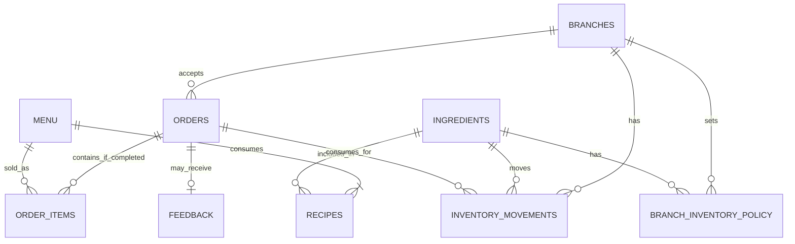

# 03 — Data contracts, relational schema, grain, ERD, dictionary

**Hal paling berisiko dalam proyek ini:** biaya, stok, revenue, jumlah transaksi, dan kategori menu berasal dari grain yang berbeda. **Seluruh coding agent wajib memahami dokumen ini sebelum menulis generator, KPI, atau grafik.**

## 3.1 Dataset scope dan rencana volume

| Entitas | Grain | Perkiraan volume | Tujuan |
|---|---|---:|---|
| `branches` | 1 baris/cabang | 3 | dimensi geografis dan kapasitas |
| `menu` | 1 baris/SKU menu | 20–24 | menu, kategori, harga list, station |
| `ingredients` | 1 baris/bahan | 27 | unit dan unit cost |
| `recipes` | 1 baris/pasangan menu-bahan | 100–160 | bill of materials (BOM) |
| `branch_inventory_policy` | 1 baris/pasangan cabang-bahan | 81 | reorder point, opening stock, lot, lead |
| `orders` | 1 baris/order (termasuk canceled) | **3.600** | fakta order dan SLA |
| `order_items` | 1 baris/order-item | ~6.000–9.000 | fakta omzet dan food cost |
| `inventory_movements` | 1 baris/event/bahan-cabang/order | puluhan ribu | stok as-of dan waste |
| `feedback` | maksimal 1 baris/order completed | ~500–1.100 | analisis kualitatif |

**Jumlah tabel inti = 9**. Metadata, derived tables/marts, rules config, dan QA logs merupakan artefak tambahan, bukan mengganti sembilan tabel tersebut. Jumlah pasti mengikuti generator dan dicatat dalam `manifest.json` di implementasi; jangan memalsukan angka hasil sebelum dieksekusi.

**Rentang:** `2026-10-01T00:00+07:00` hingga `2026-10-30T23:59:59+07:00`, order hanya pada jam simulasi 10:00–22:00. Gunakan satu pendekatan date boundary: `start_inclusive, end_exclusive`; contoh filter 10–12 Oktober berarti `[2026-10-10 00:00, 2026-10-13 00:00)`.

## 3.2 ERD wajib



Foreign keys: `orders.branch_id`, `order_items.order_id/menu_id`, `recipes.menu_id/ingredient_id`, `branch_inventory_policy.branch_id/ingredient_id`, `inventory_movements.branch_id/ingredient_id`, `inventory_movements.order_id nullable`, `feedback.order_id`.

### 3.2.1 Primary key / unique / index

- Semua PK harus string ID stabil unik atau pasangan unik (untuk resep/policy).
- `orders.order_id` unik global, misalnya `ORD-000001`.
- `order_items.order_item_id` unik; `order_id` *many-to-one*.
- `inventory_movements.movement_id` unik; banyak event dapat merujuk satu order.
- `feedback.order_id` **unique** supaya ulasan tidak menduplikasi denominator.
- `recipes(menu_id, ingredient_id)` dan `branch_inventory_policy(branch_id, ingredient_id)` **unique composites**.
- Join one-to-many hanya boleh di agregasi yang memperhatikan grain, bukan `orders` di-join item lalu `SUM(orders.net_amount)`.

## 3.3 Kontrak field — `branches`

| Field | Tipe logis | Null? | Aturan |
|---|---|---|---|
| `branch_id` | string PK | no | `BR-01`–`BR-03` |
| `branch_name` | string | no | ChickFlow Padang/Bukittinggi/Payakumbuh |
| `city` | string | no | kota representatif |
| `latitude`, `longitude` | float | no | `-90..90`, `-180..180`; kota konsisten; geolokasi simulasi |
| `opening_time`, `closing_time` | HH:MM | no | 10:00–22:00 WIB |
| `demand_multiplier` | float | no | parameter generator, `>0` |
| `prep_capacity_multiplier` | float | no | parameter simulasi, `>0` |
| `region` | string | no | Sumatera Barat |

Koordinat rancangan hanya representatif (cek ulang kewajaran dengan sumber geografi saat menulis data): Padang sekitar `(-0.95, 100.36)`, Bukittinggi sekitar `(-0.30, 100.37)`, Payakumbuh sekitar `(-0.23, 100.63)`. Jangan mengklaim titik sebagai bangunan restoran sebenarnya.

## 3.4 Kontrak field — `menu`

| Field | Tipe | Null? | Aturan |
|---|---|---|---|
| `menu_id` | string PK | no | `M01` dsb |
| `menu_name` | string | no | menu buatan, unik |
| `category` | enum string | no | `Fried Chicken`, `Burger`, `Rice Meal`, `Wings`, `Sides`, `Beverage`, `Combo` |
| `station` | enum | no | FRYER / GRILL / ASSEMBLY / DRINK |
| `base_prep_min` | float | no | 1–25, >0 |
| `list_price_idr` | integer | no | >0, tanpa digit sen |
| `is_active` | boolean | no | semua aktif pada simulasi awal |
| `popularity_weight` | float | no | >0 parameter generator |

**Harga menu bukan sumber pendapatan historis.** Untuk audit, transaksi memakai `order_items.unit_price_idr` yang merupakan snapshot pada saat order. Jika harga katalog berubah, histori tidak dihitung ulang.

## 3.5 Kontrak field — `ingredients`

| Field | Tipe | Null? | Aturan |
|---|---|---|---|
| `ingredient_id` | string PK | no | `I01` dsb |
| `ingredient_name` | string | no | unik, jenis bahan |
| `unit` | enum | no | `g`, `ml`, `pcs`; tidak boleh campur satuan untuk satu bahan |
| `unit_cost_idr` | float (decimal calculation) | no | biaya Rp per 1 g/ml/pcs; >0 |
| `shelf_life_days` | integer | yes | simulasi eksplorasi waste; bukan data keamanan pangan |
| `ingredient_group` | string | no | protein/oil/bread/produce/etc |

**Precision:** Qty gunakan Decimal atau integer dengan skala tetap (`quantity_milliunits` untuk konsistensi); jangan membulatkan qty tiap order sehingga stok drift. Rupiah transaksi integer. Food cost boleh dihitung Decimal dan dibulatkan **half-up** per line item, lalu hasil disimpan integer IDR. Catat kebijakan rounding global.

## 3.6 Kontrak field — `recipes`

| Field | Tipe | Aturan |
|---|---|---|
| `menu_id` | FK | harus ada di menu |
| `ingredient_id` | FK | harus ada di ingredients |
| `qty_per_unit` | positive decimal | penggunaan bahan per 1 SKU |

Menu combo memiliki **resep komposit yang *flattened*** (semua bahan penyusunnya dicantumkan dalam `recipes` untuk SKU combo), sehingga generator tidak menghitung bahan dua kali. Tidak ada tabel bundle parent-child yang digandakan lagi.

**Food cost katalog** per SKU = `SUM(recipes.qty_per_unit × ingredients.unit_cost_idr)`, bukan angka food cost random independen. Pastikan semua `menu_id` punya ≥1 resep. Tampilan harga dan recipe cost harus mendukung beberapa menu bermargin rendah untuk diskusi, tetapi **jangan memakai diskon sebagai komponen cost**.

## 3.7 Kontrak field — `branch_inventory_policy`

| Field | Tipe | Aturan |
|---|---|---|
| `branch_id`, `ingredient_id` | composite PK/FK | unik per cabang-bahan |
| `opening_qty` | decimal >0 | stok awal sebelum periode, satuan bahan |
| `reorder_point_qty` | decimal ≥0 | threshold kritis terspesifikasi cabang |
| `restock_lot_qty` | decimal >0 | lot pembelian simulasi |
| `lead_time_days` | int ≥0 | parameter jadwal receiving bila dimodelkan |
| `target_cover_days` | float >0 | digunakan hanya untuk insight tambahan |

Kontrak ini wajib karena reorder point bisa **berbeda per cabang**. Satu angka di `ingredients` tidak cukup untuk mendefinisikan ketersediaan lokal.

## 3.8 Kontrak field — `orders`

| Field | Tipe | Null? | Aturan |
|---|---|---|---|
| `order_id` | string PK | no | unik |
| `branch_id` | FK string | no | ada di branches |
| `ordered_at` | tz-aware timestamp | no | WIB, jam operasi |
| `ready_at` | tz-aware timestamp | yes | null untuk canceled |
| `completed_at` | tz-aware timestamp | yes | `>= ready_at` untuk completed |
| `channel` | enum string | no | `DINE_IN`, `TAKEAWAY`, `DELIVERY` |
| `order_status` | enum string | no | `COMPLETED`, `CANCELLED` |
| `payment_status` | enum string | no | `PAID` iff completed; `UNPAID` iff canceled (v1) |
| `gross_amount_idr` | integer | no | line_gross sum; ≥0 |
| `discount_amount_idr` | integer | no | 0 ≤ discount ≤ gross |
| `net_amount_idr` | integer | no | gross - discount |
| `sla_min` | positive float | no | 18/20/25 menit menurut channel, configurable |
| `prep_time_min` | nonnegative float | yes | null untuk canceled; `(ready_at-ordered_at)` |
| `delayed_flag` | nullable bool | yes | true iff prep_time > sla untuk completed |
| `simulation_date` | date | no | derived dari ordered_at WIB |

**Cancel:** terjadi sebelum pembayaran dan produksi. Order batal memiliki gross, diskon, dan net Rp0 serta tidak memiliki item atau event USAGE.

**ERD menampilkan hubungan opsional `ORDERS ||--o{ ORDER_ITEMS` karena canceled memiliki 0 item; validation asserts COMPLETED memiliki ≥1 item.**

## 3.9 Kontrak field — `order_items`

| Field | Tipe | Aturan |
|---|---|---|
| `order_item_id` | string PK | unik |
| `order_id` | FK | order completed saja |
| `menu_id` | FK | menu valid |
| `quantity` | integer | 1–5 |
| `unit_price_idr` | integer | snapshot unit price, >0 |
| `line_gross_idr` | integer | unit_price × quantity |
| `allocated_discount_idr` | integer | alokasi pro rata largest remainder; 0 ≤ alloc ≤ gross |
| `line_net_idr` | integer | gross - alloc |
| `unit_food_cost_idr` | integer | cost snapshot dari resep × ingredient cost, rounded consistent |
| `line_food_cost_idr` | integer | unit_food_cost × quantity |
| `line_food_gp_idr` | integer | line_net - line_food_cost |

**Diskon (kontrak deterministik):** hitung diskon order integer dengan % dan maksimum; alokasikan berdasarkan `line_gross` memakai floor yang jumlahnya ≤ order discount; distribusikan sisa rupiah ke line dengan pecahan terbesar; tie-break `order_item_id` ascending. Jadi setiap order **sum(line allocations) == discount**.

**Syarat invariants per COMPLETED/PAID order:**

```text
Σ line_gross_idr                == orders.gross_amount_idr
Σ allocated_discount_idr       == orders.discount_amount_idr
Σ line_net_idr                  == orders.net_amount_idr
Σ line_food_cost_idr           == derived order COGS
Σ line_food_gp_idr             == orders.net_amount_idr - derived order COGS
```

## 3.10 Kontrak field — `inventory_movements`

| Field | Tipe | Aturan |
|---|---|---|
| `movement_id` | string PK | unik |
| `branch_id` | FK | valid |
| `ingredient_id` | FK | valid |
| `order_id` | FK nullable | untuk `USAGE` dari completed order; null untuk receipt/waste/opening |
| `occurred_at` | WIB timestamp | valid |
| `movement_type` | enum | `OPENING`, `RECEIPT`, `USAGE`, `WASTE`, `ADJUSTMENT` |
| `signed_qty` | Decimal | + untuk OPENING/RECEIPT, - untuk USAGE/WASTE, ± untuk ADJUSTMENT |
| `reason` | string | `initial`, `reorder`, `emergency_restock`, `order_consumption`, `spoilage`, dll |
| `unit_cost_idr` | Decimal | positive cost snapshot per unit |
| `movement_cost_idr` | integer | abs(qty × unit cost), hanya digunakan sesuai konteks sign |

**Stock as-of = Σ signed_qty** sepanjang ledger **dari awal sampai cutoff**. Cutoff tanggal = **akhir tanggal filter**; jika filter 20–25 Okt, saldo pada akhir 25 Okt memakai semua movement sejak OPENING termasuk 1–19 Okt, bukan hanya di rentang filter. Untuk perbandingan stok, cutoff 1 vs 30 Okt jelas definisinya.

Usage harus berasal langsung dari **COMPLETED items × resep**. Event USAGE dihubungkan dengan order_id sehingga dapat direkonsiliasi ke item. Tidak boleh memakai angka usage acak yang tak cocok order. WASTE movement berbeda dari order usage; dianggap biaya waste **terpisah** dari food COGS transaksi untuk menghindari dua kali biaya.

Kuantitas stok harus **≥0 setelah setiap event yang disortir timestamp+sequence**; jika restock otomatis dibutuhkan, buat RECEIPT lebih dulu, **jangan clamp** saldo negatif atau menyisipkan stok misterius.

## 3.11 Kontrak field — `feedback`

| Field | Tipe | Aturan |
|---|---|---|
| `feedback_id` | string PK | unik |
| `order_id` | FK unique | completed order saja; 0 atau 1 feedback per order |
| `rating` | integer | 1..5 |
| `review_text` | string | teks Indonesia hasil generator, dapat kosong pada beberapa raw records (untuk cleaning) |
| `theme` | enum | `kecepatan`, `rasa`, `porsi`, `harga`, `kemasan`, `pelayanan` |
| `feedback_at` | WIB timestamp | >= completed_at |

Jangan simpan nama/nomor telepon pelanggan. Tema review disimulasikan dengan aturan dokumentasi (mis. lebih banyak kata “lama” pada delayed order), tetapi hal itu **bukan** bukti kausalitas di dunia nyata.

## 3.12 Data marts (DERIVED, jangan dianggap tabel sumber)

- `fact_orders_eligible`: completed+paid, **grain order**, fields derived: date, weekday, hour, branch, channel, prep, delayed.
- `fact_sales_lines`: completed+paid items, **grain order_item**, with menu/category/branch/date, net revenue, food COGS, GP.
- `mart_daily_sales`: **grain date × branch** dari line item.
- `mart_menu_performance`: **grain menu × branch × date** jika perlu drill-down.
- `mart_kitchen_hourly`: **grain date × branch × hour × channel**.
- `mart_inventory_asof`: **grain cutoff_date × branch × ingredient** dari events cumulatively.
- `mart_feedback`: **grain feedback**, optional features `is_delayed` (joined from orders once).

**Kaidah:** semua aggregasi financial bersumber dari `fact_sales_lines` lalu item->menu, sedangkan prep time/delay/order volume bersumber dari `fact_orders_eligible`. Order per kategori membutuhkan `distinct order_id` setelah set `order_id`s dari item kategori.

## 3.13 Unit, tanggal, tipe dan missing values

- Rupiah integer IDR. Jangan satu grafik dalam ribuan dan lainnya dalam rupiah tanpa label.
- Qty gram/ml/pcs ditampilkan dengan satuan aslinya, bukan menjumlah `g + ml + pcs` menjadi “total stok”.
- Durasi menit float untuk histogram, label 1 desimal.
- Waktu disimpan ISO 8601 timezone-aware dan diparse sebagai timezone Asia/Jakarta; konversi ke UTC boleh untuk internal, UI selalu WIB.
- Status canceled: `prep_time_min`, `ready_at`, `completed_at`, `delayed_flag` null, tidak dianggap keterlambatan.
- NaN prep untuk canceled **tidak diimputasi 0**.
- Missing `review_text` boleh diisi string kosong untuk text pipeline tetapi tetap dicatat missing count.
- Outlier prep time masuk audit; jangan langsung dihapus hanya karena di atas p99.

## 3.14 Quality assertions (wajib lulus setelah cleaning)

```text
A01 pk_uniqueness(all 9 tables)
A02 foreign_key_integrity(all FKs)
A03 completed_order_has_item; canceled_order_zero_items
A04 completed_payment_status_paid; canceled_payment_status_unpaid
A05 date_ranges_and_valid_channel
A06 readiness_chronology(ordered_at <= ready_at <= completed_at)
A07 prep_time_matches_timestamp_difference(tolerance <=1 sec)
A08 delayed_flag_matches_sla_exactly
A09 gross_discount_net_recon_per_order(Rp0 difference)
A10 recipe_coverage(all menu)
A11 food_cost_matches_recipe_snapshot(after prescribed rounding)
A12 inventory_usage_matches_orders_recipes_exactly(in unit precision)
A13 stock_on_hand_nonnegative_each_event
A14 movements_inventory_policy_coverage
A15 feedback_unique_and_valid_rating
A16 3 branches, >=500 eligible orders, >=7 unique order dates
A17 2 generate runs with same seed => deterministic SHA256 of normalized CSVs
A18 output data lineage / manifest / injected dirty issues report
```

## 3.15 Example manual recon case (unit-test FIXTURE, **bukan hasil dataset**)

Diberikan 1 completed order `O-T1` berisi 2 line: Fried Chicken Rp25.000 qty1, Iced Tea Rp10.000 qty1. Gross = Rp35.000, diskon order Rp3.500 (10%), food cost Rp11.000 dan Rp2.000.

| Line | Gross | Allocated discount | Net | Food COGS | Food GP |
|---|---:|---:|---:|---:|---:|
| Chicken | 25.000 | 2.500 | 22.500 | 11.000 | 11.500 |
| Tea | 10.000 | 1.000 | 9.000 | 2.000 | 7.000 |
| **Total** | **35.000** | **3.500** | **31.500** | **13.000** | **18.500** |

Konsekuensi KPI: `Revenue=31.500`, `Orders=1`, `AOV=31.500`, `Food Gross Profit=18.500`, `Food Gross Margin=18.500/31.500 = 58,730158...%`. **Jika filter kategori hanya Fried Chicken**, revenue scoped Rp22.500, unique orders 1, scoped COGS Rp11.000; jangan mengambil order-level net total Rp31.500.

## 3.16 Data type mapping untuk Bab IV (nanti)

- **Nominal**: ID, branch, channel, category, station, status, ingredient name, movement_type.
- **Ordinal**: rating 1–5, alert severity.
- **Interval**: waktu kalender/urutan timestamp bila diperlakukan sebagai posisi garis waktu (mengikuti definisi kontekstual).
- **Rasio**: rupiah, quantity, number of orders, duration minutes, stock units, food cost.
- Derived: percentage delayed, margin rate, basket size, AOV, revenue growth. Rumus dan denominator wajib dicantumkan.
