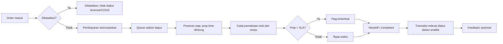

# 07 — Visualization design: types, choices, interaction, artifacts

## 7.1 Pemilihan grafik bukan dekorasi

Semua chart harus terkait pertanyaan PB dan memiliki: judul yang menyatakan tugas analisis, data+kolom, grain, library, jenis (kualitatif/kuantitatif/geografis), alasan pemilihan, alternatif yang ditolak, label, unit, tooltip, cara membaca, known limitations, serta rekomendasi tindakan. Jumlah chart yang bertambah **tidak otomatis** menambah nilai jika chart yang sama diulang tanpa pertanyaan.

## 7.2 Registry visualisasi formal

| V-ID | PB | Nama | Teknik/library | Jenis | Lokasi | Alasan tepat |
|---|---|---|---|---|---|---|
| V-Q01 | PB-01 | Pendapatan bersih harian | line Plotly + static Matplotlib | Kuantitatif | Overview/Sales | perubahan berurutan menurut waktu |
| V-Q02 | PB-02 | Top 10 SKU terjual | sorted horizontal bar Plotly + Matplotlib | Kuantitatif | Sales | peringkat banyak kategori |
| V-Q03 | PB-03 | Order per hari/jam | heatmap Plotly | Kuantitatif | Orders | pola gabungan weekday×hour |
| V-Q04 | PB-04 | Pendapatan per cabang | bar Plotly | Kuantitatif | Overview/Sales | banding kategori nominal |
| V-Q05 | PB-05 | Distribusi prep time | histogram+KDE static Seaborn / histogram Plotly | Kuantitatif | Kitchen | bentuk sebaran/skew/outlier |
| V-Q06 | PB-06 | Keterlambatan cabang×channel | grouped bar Plotly | Kuantitatif | Kitchen | banding proporsi berkelompok dengan denominator |
| V-Q07 | PB-07 | Popularitas vs margin | scatter Plotly | Kuantitatif | Profit | hubungan dua variabel, outlier |
| V-Q08 | PB-08 | Status stok kritis | bullet/grouped bar Plotly | Kuantitatif | Inventory | posisi stok vs threshold per bahan |
| V-Q09 | PB-09 | AOV channel | bar Plotly | Kuantitatif | Orders/Sales | banding nilai antar channel |
| V-Q10 | PB-11 | Prep time per cabang | boxplot Plotly + static Seaborn | Kuantitatif | Kitchen | median, IQR, outliers sekaligus |
| V-Q11 | PB-12 | Kontribusi Food GP kategori | ordered bar Plotly | Kuantitatif | Profit | kontribusi positif/negatif |
| V-Q12 | PB-13 | Waste cost per bahan | sorted bar Plotly | Kuantitatif | Inventory | prioritas bahan pemborosan |
| V-L01 | PB-14 | Suara pelanggan | word cloud (wordcloud + Matplotlib) | Kualitatif | Orders/Feedback expander | istilah sering muncul dalam teks review |
| V-L02 | PB-15 | Alur pesanan | Graphviz/Mermaid static diagram | Kualitatif | Orders / About process | hubungan langkah/status dan titik metrik |
| V-G01 | PB-10 | Lokasi & kinerja cabang | Plotly `px.scatter_map` | Geografis | Sales | melihat posisi representatif 3 kota |

**Coverage secara konservatif:** 12 visual kuantitatif yang direncanakan (minimal 5), 2 kualitatif, 1 geografis. Bukan 15 jenis grafik semuanya harus ada di satu layar. Setidaknya 5 kuantitatif wajib dari keluarga bar, line, histogram, scatter, boxplot; heatmap sebagai nilai tambah.

## 7.3 Detail setiap visual yang wajib benar

### V-Q01 Trend Revenue

- Source: `fact_sales_lines` (eligible). X `date`, Y sum `line_net_idr`. Tooltip `date/revenue/orders/AOV` (count distinct order id). Sorting chronological, date termasuk zero-sales days jika filter mencakup dan data ada; zero-sales displayed zero bar/line with note.
- Tidak salah mengagregasi order header yang diduplikasi item join.
- Color: primary amber accent; legend only if multiple branches.
- Invalid alternative: pie chart per hari (buruk untuk urutan waktu).

### V-Q02 Top Menu

- Source: `fact_sales_lines`; `groupby(menu_name).sum(quantity)`; top N, descending, horizontal bar; label `Unit terjual`.
- Jangan menyamakan jumlah order dengan unit terjual; satu order bisa punya 2–3 unit menu sama.
- Alternative scatter tidak seefektif sorted bar untuk rank.

### V-Q03 Peak Demand Heatmap

- Source: unique eligible orders; `weekday` ordered Senin–Minggu, `hour` 10–21; warna = jumlah order unik ÷ jumlah tanggal teramati untuk weekday tersebut. Tanggal teramati tanpa order bernilai 0, weekday di luar periode tampil kosong.
- Tooltip `Hari, jam, completed orders, n hari pengamatan`.
- Tidak boleh menggunakan `nunique` after item join without grouping.

### V-Q05 Prep Histogram & KDE

- Source: completed orders with non-null prep time; bins declared (contoh step 2 minutes), x prep minutes, y orders. Opsi KDE di static Seaborn with proper units, tidak memakai scale KDE sama dengan raw counts tanpa separate normalization.
- Display median, mean, p90 vertical lines if visible; outliers reviewed.
- Pastikan right tail tidak diamputasi sehingga proporsi delay tersembunyi.

### V-Q06 SLA Delays

- Source: completed orders, group by branch × channel; numerator sum delayed, denominator n eligible. Pct per group, tooltip `n/N`.
- Jangan mengurutkan persentase tanpa mengungkap sample n (n5, rate 60% bisa misleading).

### V-Q07 Scatter Profit

- Setiap titik = **menu** (atau menu-cabang jika toggle jelas), X units sold, Y food margin %, size optionally net revenue, color category. Tooltip full `units, net, COGS, GP, margin`.
- Threshold line at 25%, label `alert threshold`, jangan mengklaim semua menu di bawah rugi.
- Jangan plot item-level 8000 titik bila pertanyaan per menu.

### V-Q08 Stock vs Threshold

- Pilih ingredients dengan gap terburuk per branch; gunakan ratio `ending_qty / reorder_point` **atau** group bahan sama unit; jangan campur gram dan pcs pada satu sumbu nominal.
- Legend: `Aktual (x)` dan `Batas pesan ulang (x)`; label cutoff date.

### V-Q10 Box Plot Prep

- X branch, Y prep min, median/IQR/outliers; optional swarm sampled stable jika volume besar.
- Tidak perlu outlier suppression; jelaskan p90 vs median dan sample count.

### V-L01 Word Cloud

- Sampling: review_text cleaned for stopwords Indonesia; document stopword list/version, regex tokenization, strip punctuation; min token length, ignore common meaningless words (restoran, ChickFlow, sangat).
- Word size = count token; provide **top keywords table** for accessibility and interpretability. Read as relative frequent words, not positive/negative sentiment unless labels/analysis validate.
- If insufficient reviews: `Ulasan tidak cukup untuk word cloud` + frequency table/empty state.
- Library wordcloud + matplotlib; **no stock decorative word cloud asset**.

### V-L02 Order Process Flowchart

Flowchart adalah representasi kualitatif **proses**, bukan bukti bahwa semua order nyata melintasi setiap tahap. Di UI tampilkan diagram (bisa image static Graphviz/Mermaid render jika tersedia) plus keterangan titik di mana metrik dihitung.

### V-G01 Map

- 3 point markers dengan lat/lon simulasi; marker size by **net revenue**, **bukan** perbandingan lokasi sebagai real branch. Caption `Lokasi representatif cabang fiktif untuk demonstrasi analisis geografis`.
- Jika semua cabang revenue 0, size floor uniform dan tooltip tunjukkan 0, jangan `NaN` dan hilang.
- Catat koordinat di data dictionary, sumber/tipe sebagai **representative city coordinates (approximation)**.
- Plotly `px.scatter_map` adalah jalur modern berbasis MapLibre; dokumentasi: https://plotly.com/python/mapbox-to-maplibre/ . `scatter_mapbox` legacy harus dihindari.

## 7.4 Kolom wajib screenshot/visualization registry untuk laporan

| Kolom | Isi wajib |
|---|---|
| `chart_id`, `pb_id` | ID resmi |
| `title`, `question` | judul dan PB |
| `data_source` | nama tabel/kolom dan grain |
| `data_type` | nominal/ordinal/interval/ratio |
| `chart_type`, `library` | jenis spesifik dan library |
| `rationale`, `alternative` | alasan memilih dan menolak alternatif |
| `interaction` | hover, filter, drilldown jika ada |
| `expected_insight` | hipotesis sebelum generate |
| `actual_interpretation` | **baru diisi dari output aktual** |
| `screenshot_path` | path PNG bukti visual pada repo |
| `limitations` | data sintetik, 30 hari, sampling |

## 7.5 Graph quality checklist

- [ ] Sumbu, title, unit, legend, tooltip jelas.
- [ ] Batas sumbu tidak memotong batang/menipu. Baseline nol untuk bar nilai nonnegatif.
- [ ] Tidak ada pie chart >5 kategori; hindari pie jika peringkat lebih penting.
- [ ] Persentase memakai denominator n, bukan mean persentase.
- [ ] Palet categorical konsisten lintas halaman; warna tidak satu-satunya kode.
- [ ] Chart responsive; margin tidak menyebabkan label terpotong pada laptop 1366×768.
- [ ] Empty chart bukan `0 data` yang menyesatkan.
- [ ] Angka dari chart dapat di-reconcile dengan KPI.
- [ ] Plotly hover berisi metadata relevan, bukan semua kolom raw.
- [ ] Chart ID/kode PB disimpan di documentation registry.

## 7.6 Peran pustaka wajib & opsional

| Pustaka | Bukti penggunaan yang benar |
|---|---|
| pandas | loading, grouping, joining, cleaning, metrics |
| numpy | deterministic generator, statistical percentiles/sampling |
| matplotlib | EDA figure: static line dan bar (file PNG) |
| seaborn | EDA dist histogram+KDE dan box plot (file PNG) |
| plotly | seluruh grafik interaktif utama dan peta |
| streamlit (opsional pada template) | shell aplikasi, 6 pages, global state |
| wordcloud/Graphviz (opsional) | 2 kualitatif; install requirements jika dipakai |

## 7.7 Interaktivitas dan edge cases

- Filter tanggal+branch+category memicu recompute chart relevant; tooltip n; multiple selection channel bersifat lokal halaman jika diperlukan.
- Legend toggles ≠ data filter seluruh halaman; beri tahu pengguna jika legend hide hanya visual.
- Plotly click-selection sebagai bonus, jangan dependency inti agar dashboard tetap stabil ketika versi Streamlit tidak mendukung selection dengan baik.
- Offline map fallback diintegrasikan dan dites; jangan mengasumsikan internet selalu aktif saat presentasi.
- Chart image export PNG hanya bila deps yang sesuai tersedia (Kaleido/Chrome) dan benar-benar diuji; screenshot OS/manual adalah fallback.
