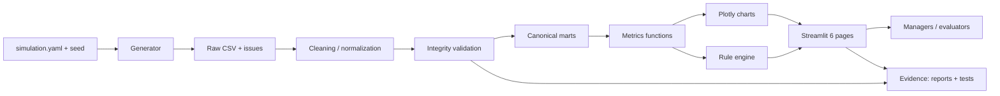

# 09 — Technical architecture, repository, modules, contracts, dependency strategy

## 9.1 Stack utama

- Python **3.12** sebagai baseline.
- `pandas`, `numpy` untuk data prep/metrics/generator; `matplotlib`, `seaborn` untuk EDA static; `plotly` untuk interactive visualization; `streamlit` untuk dashboard; `wordcloud` dan `graphviz`/Mermaid-render untuk qualitative; `pytest` untuk tests; `PyYAML`/Pydantic opsional untuk config validation.
- Gunakan **versi pinned lock setelah smoke test**, bukan menempelkan versi internet yang belum diverifikasi. `requirements.txt` menyimpan tested versions dan `requirements-dev.txt` menambah pytest + lint.
- Plotly versi modern **mendukung MapLibre `px.scatter_map`**; API Mapbox lama dihindari. Streamlit modern mendukung `st.navigation`, `st.Page`, dan `st.session_state`. Verifikasi API resmi berdasarkan versi di `requirements.txt` saat implementasi.

**Dokumentasi teknis resmi:**

- https://docs.streamlit.io/develop/api-reference/navigation/st.navigation
- https://docs.streamlit.io/develop/concepts/architecture/session-state
- https://docs.streamlit.io/develop/concepts/design/best-practices
- https://docs.streamlit.io/develop/api-reference/app-testing/st.testing.v1.apptest
- https://docs.streamlit.io/develop/api-reference/charts/st.plotly_chart
- https://plotly.com/python/mapbox-to-maplibre/
- https://plotly.com/python/maps/
- https://pandas.pydata.org/docs/user_guide/groupby.html

## 9.2 High-level dataflow



`data/clean` is source of truth for dashboards; `data/raw` for cleaning evidence. `data/marts` can be cached/derived; apps must not regenerate data every navigation. Business logic only in `src` modules; `app` is thin presentation layer.

## 9.3 Proposed repository tree

```text
chickflow/
├─ AGENTS.md
├─ README.md
├─ pyproject.toml                  # optional tooling config
├─ requirements.txt
├─ requirements-dev.txt
├─ .gitignore
├─ .streamlit/config.toml
├─ config/
│  ├─ simulation.yaml
│  ├─ alerts.yaml
│  └─ design_tokens.py
├─ data/
│  ├─ raw/                         # immutable injected-dirty simulation CSV
│  ├─ clean/                       # validated source-of-truth CSV
│  ├─ marts/                       # derived cached intermediates
│  ├─ fixtures/                    # test fixture sample, tiny
│  └─ manifest.json
├─ src/
│  └─ chickflow/
│     ├─ __init__.py
│     ├─ config.py                 # schema, validation
│     ├─ models.py                 # FilterContext, MetricValue, BusinessInsight, DataBundle
│     ├─ data/
│     │  ├─ master_data.py
│     │  ├─ generate.py
│     │  ├─ inject_quality_issues.py
│     │  ├─ clean.py
│     │  ├─ validate.py
│     │  ├─ load.py
│     │  ├─ build_marts.py
│     │  └─ schema.py
│     ├─ analytics/
│     │  ├─ filter_context.py
│     │  ├─ facts.py
│     │  ├─ metrics.py
│     │  ├─ kitchen.py
│     │  ├─ inventory.py
│     │  ├─ profitability.py
│     │  └─ insights.py
│     ├─ visualization/
│     │  ├─ chart_styles.py
│     │  ├─ sales.py
│     │  ├─ kitchen.py
│     │  ├─ inventory.py
│     │  ├─ profit.py
│     │  ├─ map.py
│     │  └─ qualitative.py
│     └─ reports/
│        └─ eda.py
├─ app/
│  ├─ main.py
│  ├─ pages/
│  │  ├─ overview.py
│  │  ├─ orders.py
│  │  ├─ kitchen.py
│  │  ├─ inventory.py
│  │  ├─ sales.py
│  │  └─ profit.py
│  ├─ components/
│  │  ├─ topbar.py
│  │  ├─ filters.py
│  │  ├─ kpi_card.py
│  │  ├─ insight_cards.py
│  │  ├─ section_header.py
│  │  ├─ data_status.py
│  │  └─ empty_state.py
│  └─ theme.py
├─ tests/
│  ├─ fixtures/
│  ├─ data/
│  ├─ metrics/
│  ├─ visualizations/
│  ├─ app/
│  └─ end_to_end/                # optional Playwright
├─ reports/
│  ├─ eda/
│  ├─ screenshots/
│  ├─ prototype_v1/
│  ├─ prototype_v2/
│  ├─ test_results/
│  ├─ evidence_matrix.md
│  ├─ change_log.md
│  └─ ai_use_log.md
├─ docs/
│  ├─ data_dictionary.md
│  ├─ metric_dictionary.md
│  ├─ visualization_registry.md
│  ├─ business_questions.md
│  ├─ erd.md
│  ├─ design_system.md
│  └─ running_deploying.md
└─ assets/
   ├─ brand/
   ├─ icons/
   └─ fonts/                     # do not ship unauthorized fonts
```

**Catatan namespace:** perintah CLI dengan struktur paket `src/chickflow` akan berbentuk **`python -m chickflow.data.generate`** sesudah `pip install -e .` atau `PYTHONPATH=src`; jangan campur dengan pseudocode `python -m src.data.generate` dari dokumen 04. **Keputusan final implementasi: gunakan `chickflow` package dan install editable (`pip install -e .`).** CLI publik harus konsisten dengan struktur repo di atas; update semua contoh penggunaan README hasil implementasi.

## 9.4 Architecture decision records (ADR)

| ADR | Keputusan | Alasan | Alternatif ditolak |
|---|---|---|---|
| ADR-01 | Streamlit multipage | cepat, native Python, mudah demo | Dash lebih fleksibel tetapi lebih banyak boilerplate |
| ADR-02 | Plotly charts | interaktif hover/filter, cocok CPMK | static Matplotlib saja tak memenuhi interaktivitas |
| ADR-03 | CSV cleaned + optional Parquet marts | transparan, portable, mudah divalidasi | database SQL production berlebihan |
| ADR-04 | Pure metrics in src | unit test, reuse across pages | hitung terpisah di tiap halaman rawan beda angka |
| ADR-05 | inventory event ledger | saldo as-of dapat diaudit | snapshot acak per hari tidak konsisten |
| ADR-06 | rule-based insights | explainable, testable sesuai syarat | LLM-generated “AI insights” tak berdasar |
| ADR-07 | deterministic simulation | validasi dan pengulangan demo | uncontrolled random generation |
| ADR-08 | no auth/edit write | menjaga scope tugas analitik | membangun ERP/POS lengkap bukan tujuan |

## 9.5 UI/data separation

- `src/chickflow` **tidak mengimpor Streamlit**. Semua KPI dan chart builders menerima DataFrames/Domain objects, mengembalikan dict/DataFrame/Plotly Figure.
- `app/main.py` menginisialisasi page registry, global filters, data bundle cached, CSS tokens, dan error boundary.
- Page functions mengambil `bundle` + `FilterContext`, mengatur layout, lalu memanggil `metrics`/`viz`; tidak membuat SQL/data joins panjang langsung di UI.
- Cross-page state hanya filter global; page-local filters disimpan key berbeda (contoh `kitchen_channel`, `sales_top_n`).
- `st.cache_data` dipakai untuk load/mart expensive, key by files version/manifest hash. Jangan cache object yang bisa bermutasi dengan efek side effect.

## 9.6 API function contracts (sketsa implementasi)

```python
# src/chickflow/models.py
@dataclass(frozen=True)
class FilterContext:
    start_date: date
    end_date: date
    branch_ids: tuple[str, ...] = ()
    categories: tuple[str, ...] = ()

@dataclass(frozen=True)
class MetricValue:
    value: int | float | None
    unit: str
    definition: str
    numerator: int | float | None = None
    denominator: int | float | None = None
    note: str = ""

@dataclass(frozen=True)
class BusinessInsight:
    rule_id: str
    severity: str
    title: str
    actual: float
    threshold: float
    denominator: int | None
    action: str
    destination_page: str

# pure data + analytics
load_clean_bundle(path: Path) -> DataBundle
validate_bundle(bundle: DataBundle) -> ValidationReport
get_sales_lines(bundle, filters: FilterContext) -> pd.DataFrame
get_scoped_orders(bundle, filters: FilterContext) -> pd.DataFrame
compute_overview_kpis(bundle, filters: FilterContext) -> dict[str, MetricValue]
compute_stock_asof(bundle, cutoff_date, branch_ids=()) -> pd.DataFrame
compute_alerts(bundle, filters: FilterContext) -> list[BusinessInsight]

# viz; Streamlit output wrappers live in app/pages
make_revenue_line(df: pd.DataFrame, palette: dict) -> plotly.graph_objs.Figure
make_prep_box(df: pd.DataFrame, palette: dict) -> plotly.graph_objs.Figure
make_branch_geo_map(df: pd.DataFrame, palette: dict) -> plotly.graph_objs.Figure
```

**Type-checking:** output contract documentation should be synchronized to implementation. Avoid cyclic imports (`metrics` may import facts, visualization may import metrics outputs; visualization must not import app).

## 9.7 Version and install strategy

1. Make new virtual environment, install Python 3.12 baseline.
2. `pip install -e .` + `pip install -r requirements-dev.txt` or unify with `pyproject.toml` extras; pick one and test.
3. Freeze tested versions in lock/requirements; record `python --version` and `pip freeze` to evidence.
4. Confirm latest Streamlit `st.navigation`, `st.Page`, `st.plotly_chart` signature; use `width='stretch'` if supported, else supported `use_container_width=True` for the chosen tested version, **not both blindly**.
5. Confirm Plotly `px.scatter_map` works with version; **avoid** deprecated Mapbox traces.
6. `pytest -q`, generator QA, `streamlit run app/main.py`, `ruff check .` if configured.
7. README includes both Windows PowerShell and Bash commands, config, seed, troubleshooting.

## 9.8 Security and engineering hygiene

- No secrets/credentials. `.env` optional for local dev only; never commit.
- No network requests required for core dataset calculations; map base tiles may need internet, provide fallback.
- Input CSV path sanitize using `pathlib.Path`; avoid unsafe deserialization of pickle from unknown sources.
- `numpy` RNG seed stable, chart builders pure, metrics don't mutate shared DataFrames in-place.
- Data pipeline safe to rerun: write temp and atomically replace generated files where possible; `--force` overwrite is explicit.
- Test that `python -m chickflow.data.validate` exits nonzero when financial inconsistencies found.
