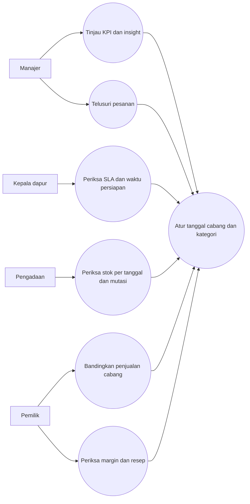
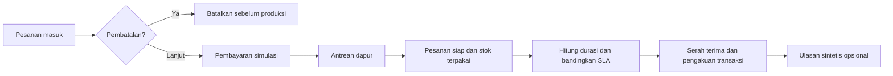

# Model ChickFlow

## Use case

## Alur pesanan

Katalog dan ERD sembilan tabel tercantum pada spesifikasi [kontrak data](../../ChickFlow_Codex_Handoff/docs/03_DATA_CONTRACTS.md). File desain interaktif [layouts.html](layouts.html) berisi 12 tampilan untuk enam modul.
